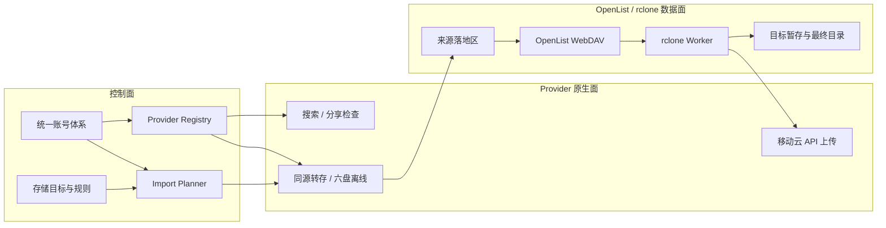
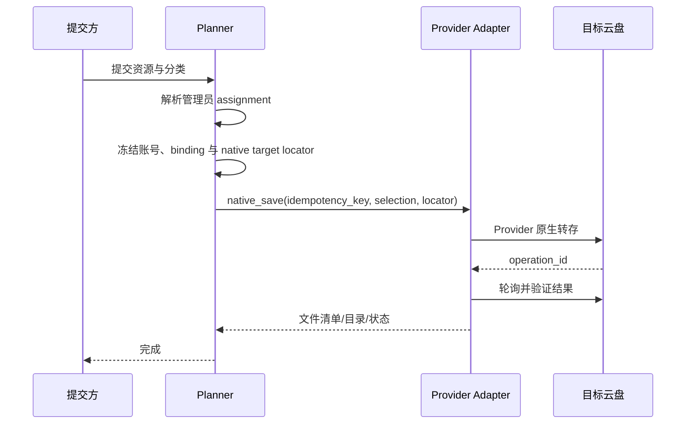
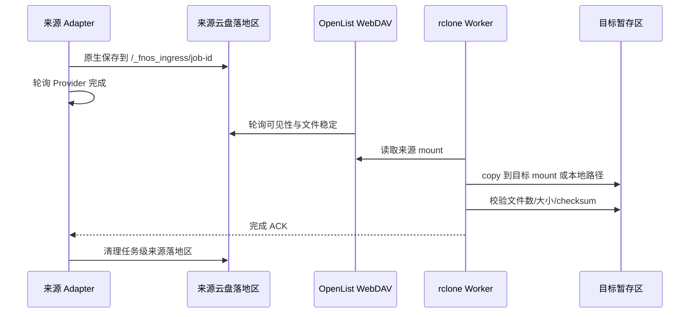
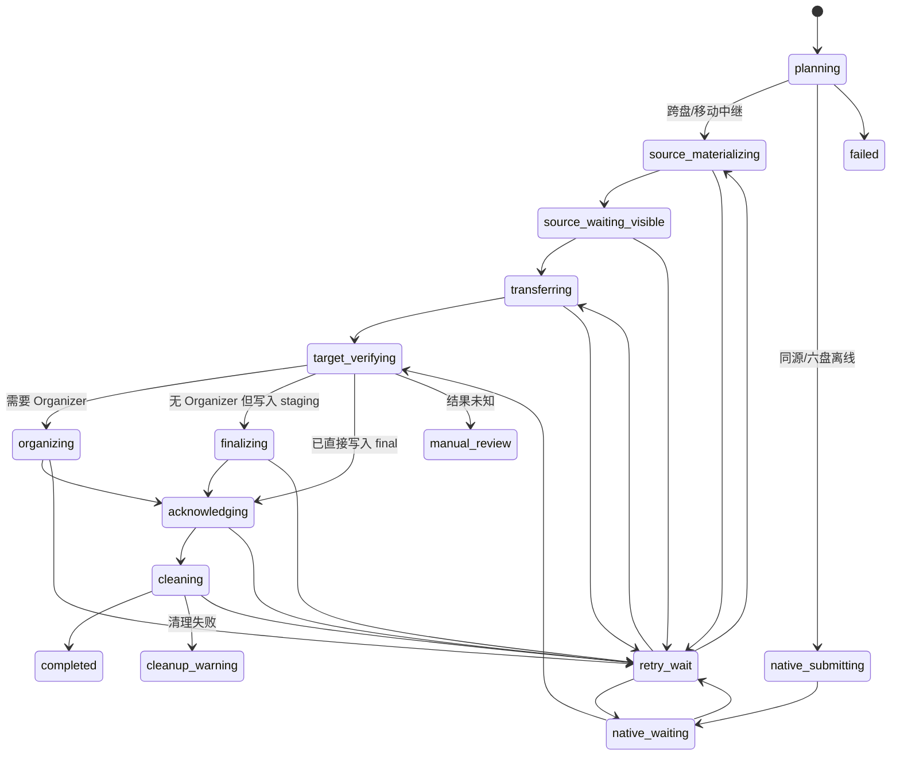

# V1.0 多链路设计文档

> 状态：设计定稿，作为开发基线  
> 版本：V1.0  
> 日期：2026-08-07  
> 项目：fnos-search 统一云盘账号与多链路入库  
> 范围：统一账号体系、Provider Adapter、存储目标、同源直转、跨盘 rclone、移动云中继、六盘磁链、后台管理、服务端入库路由、测试与上线切换。
> 实施原则：这是未投产功能的一次性重建，不兼容、迁移或保留任何旧版入库计划与执行链路。

## 1. 文档结论

系统采用“单应用部署 + 进程内 Provider Adapter + OpenList WebDAV/rclone 数据面”的架构，不为移动云、夸克、天翼云、六盘分别部署服务。

核心决策如下：

1. 每一种云盘归属一个 `provider_kind`，例如 `mobile`、`quark`、`tianyi`、`sixpan`、未来的 `115`。
2. 每种 Provider 可以维护多个账号，但 V1.0 每个账号作用域只能激活一个账号。搜索、预览、同源转存和跨盘落地都从同一账号选择记录解析账号。
3. 管理员配置的是逻辑保存位置 `destination_id`；保存位置只配置账号、OpenList 映射和一个保存根目录。电影、电视剧、动漫等分类目录名由系统统一生成，不再维护旧分类路径配置。访客不选择目标，也不提交账号、接口、remote 或路径。
4. 同源转存优先且强制使用 Provider 原生能力：移动到移动、夸克到夸克、天翼到天翼，以及未来 115 到 115。
5. 跨盘先由来源 Provider 把分享资源原生保存到来源账号的任务级落地区，再由 OpenList WebDAV 暴露给 rclone，最后复制到目标云盘或本地目录。
6. 目标为移动云且来源不是移动云时，使用唯一例外链路：rclone 下载到受控本地缓存，再调用移动云上传 API。原因是移动云大文件通过 OpenList 上传存在卡在 100% 的已知问题。
7. 磁链在 V1.0 只允许保存到六盘，由六盘执行离线任务。磁链到其他目标一律不展示、不接受，也不自动降级。
8. Planner 只生成新系统的 `plan_schema_version=1` 计划。旧 Planner、旧字段、旧执行器和旧任务数据直接移除，不实现读取、回放、预检、双写或兼容分支。
9. “保存到哪里”默认按 `search_source_id` 配置，必要时才对某个 `category_key` 覆盖目标。覆盖改变的是保存位置，不是分类路径。没有配置或当前不可执行时阻止提交。
10. 原生转存失败不得静默改走下载上传；路由或能力在提交前发生变化时，任务不创建并返回明确错误。


一句话模型：

```text
搜索/分享来源
  -> 服务端按搜索源与分类解析管理员配置的唯一目标
  -> Import Planner 按来源、目标、账号、OpenList 能力冻结执行计划
  -> 同源/磁链：native_save | native_offline
  -> 跨盘：Provider Adapter 原生物化到来源 landing
            -> rclone_copy | relay_upload
  -> 目标暂存/整理/最终目录
  -> 校验成功后完成任务并清理来源落地与本地缓存
```

## 2. 目标与非目标

### 2.1 V1.0 必须实现

- 一个后台维护移动云、夸克、天翼云、六盘四类 Provider 账号。
- 每类 Provider 可登录多个账号，可检测、禁用、重新登录、切换当前账号；后台不允许手工录入 API、Access Token 或 Refresh Token。
- 同一 Provider 在 `default` 作用域下最多只有一个激活账号。
- 账号切换只影响新任务；已创建任务继续使用冻结的账号 ID 与账号修订版本。
- 移动、夸克、天翼分享支持同源原生转存。
- 磁链支持六盘原生离线。
- 所有具备“来源 OpenList 可读 + 目标 OpenList 可写”条件的跨盘组合支持 rclone。
- 任意支持 rclone 来源的资源可以下载到受控本地目标。
- 非移动来源到移动目标使用本地中继 + 移动云 API 上传。
- 后台可维护 OpenList 连接、挂载映射、landing profile、逻辑存储目标和搜索源 assignment。
- 访客页面不展示目标选择器；服务端按当前资源解析唯一目标，不可执行时直接阻止提交。
- 任务计划、幂等、重试、取消、清理和日志都带来源账号、目标账号与 `destination_id` 身份。
- Provider 扩展不要求修改 Planner 的供应商分支；增加 115 时通过 Provider entry point 注册 manifest、登录处理器、搜索来源、Adapter 和契约测试。

### 2.2 V1.0 明确不做

- 不允许同一 Provider 同时激活多个账号做轮询、负载均衡或自动故障切换。
- 不允许访客选择或提交 `destination_id`、云盘账号、OpenList mount、rclone remote、绝对路径或原生目录 ID。
- 不把 Provider 拆成独立微服务或要求部署多个容器服务。
- 不使用天翼云、夸克等 Provider 的上传 API 处理跨盘上传；跨盘写入统一走 OpenList WebDAV/rclone。
- 不实现通用 BT 下载器。
- 不开放磁链到本地、移动、夸克、天翼或其他目标。
- 不在原生转存失败后自动降级为跨盘传输。
- 不支持一条任务同时写多个目标。需要多目标时创建多个单目标任务。
- 不在运行中加载不受信任代码。Provider 插件必须作为受信任的软件包安装，并在应用启动时通过 `fnos_media_import.providers` entry point 注册。
- 不为未投产的旧入库模型保留计划读取器、执行入口、数据转换器、配置导入器或历史任务展示。

## 3. 关键概念与边界

### 3.1 六个独立身份

| 概念 | 示例 | 含义 |
|---|---|---|
| `provider_kind` | `quark` | 云盘种类，决定使用哪个 Adapter |
| `account_id` | `acc_01J...` | 某个具体账号的稳定 ID |
| `account_scope` | `default` | 账号选择作用域，V1.0 只使用 default |
| `connection_id` | `ol_main` | 一个 OpenList WebDAV 服务连接 |
| `mount_id` | `mount_quark_main` | OpenList 中某个挂载与 Provider 账号的映射 |
| `destination_id` | `quark_library` | 管理员配置的逻辑入库目标 |

这些身份不能互相代替：

- `provider_kind` 不是账号；否则无法维护多个夸克账号。
- `account_id` 不是目标；同一激活账号可以有电影库、剧集库、归档库等多个目标。
- `mount_id` 不是账号；OpenList 挂载由 OpenList 管理，本系统只维护关联与能力验证。
- `destination_id` 不是 driver；目标 ID 必须稳定，底层实现和路径允许通过新修订更新。

### 3.2 三个平面



- 控制面决定“用哪个账号、存到哪个目标、走什么链路”。
- Provider 原生面只处理搜索、分享检查、同源保存、六盘离线和移动云特殊上传。
- OpenList/rclone 数据面处理跨盘复制、下载本地、文件校验和大多数目标写入。

### 3.3 来源、目标与传输策略分离

```python
@dataclass(frozen=True)
class SourceDescriptor:
    provider_kind: str
    source_form: str          # share | magnet | local | http
    source_record_id: str     # 服务端可信来源记录，不是分享 URL 或磁链正文
    source_revision: int
    canonical_source_id: str
    account_scope: str
    selected_item_refs: tuple[str, ...]
    selected_items_hash: str


@dataclass(frozen=True)
class DestinationDescriptor:
    destination_id: str
    provider_kind: str        # mobile/quark/tianyi/sixpan/local/generic
    account_scope: str | None
    target_revision: int
    category_key: str


TransferStrategy = Literal[
    "native_save",
    "native_offline",
    "rclone_copy",
    "relay_upload",
]
```

`source_record_id + source_revision` 必须能从不可变服务端记录中取回经过校验的分享信息或完整 magnet URI；`canonical_source_id` 只用于去重，绝不能被执行器当作 URL 使用。

`route=quark_to_mobile` 这类把来源和目标焊死的字符串从模型和代码中直接删除。Link Classifier 只产出 `provider_kind + source_form`，Planner 根据管理员 assignment 和能力选择策略。

### 3.4 可信来源快照

搜索结果缓存或直接链接检测成功后，服务端创建不可变来源快照：

```sql
CREATE TABLE import_source_records (
  source_record_id TEXT NOT NULL,
  revision INTEGER NOT NULL,
  search_source_id TEXT NOT NULL,
  provider_kind TEXT NOT NULL,
  source_form TEXT NOT NULL,
  canonical_source_id TEXT NOT NULL,
  access_payload_ciphertext BLOB NOT NULL,
  credential_key_id TEXT NOT NULL,
  expires_at TEXT,
  created_at TEXT NOT NULL,
  PRIMARY KEY (source_record_id, revision)
);
```

`access_payload_ciphertext` 保存 Adapter 执行所需的真实分享 URL、提取参数或完整 magnet URI。Planner 只引用 `source_record_id + revision`，并冻结经过 `inspect_source()` 验证的 `selected_item_refs + selected_items_hash`。

- `canonical_source_id` 只用于规范化和幂等，不能代替 access payload。
- 来源快照至少保留到所有引用任务进入终态并完成清理。
- 执行器只能通过注入的 `SourceRepository` 读取快照，不接受调用方临时拼接的 URL。
- 日志、公共 API 和普通任务详情不得输出 access payload 或 Provider item refs。

## 4. 总体架构

### 4.1 单部署模块边界

```text
fnos_media_import/
  providers/
    base.py                     # Adapter Protocol 与公共结果类型
    registry.py                 # Provider 注册表
    mobile/adapter.py
    quark/adapter.py
    tianyi/adapter.py
    sixpan/adapter.py
  accounts/
    service.py                  # 账号 CRUD、修订、激活与密钥解析
    repository.py
    crypto.py                   # 凭证信封加密
  openlist/
    connection_service.py
    mount_service.py
    probe_service.py
  storage/
    target_service.py
    locator.py
    policy_service.py
  planning/
    source_resolver.py
    route_resolver.py
    import_planner.py
    plan_validator.py
  transfer/
    orchestrator.py
    native_executor.py
    rclone_executor.py
    relay_executor.py
    verifier.py
    cleanup.py
```

这些是同一个应用中的模块，不是多个独立服务。rclone 可以继续由现有 Worker 进程执行，但它只接收数据库中冻结并校验过的执行计划，不能自行决定目标。

### 4.2 服务职责

| 服务 | 单一职责 |
|---|---|
| `ProviderRegistry` | 注册并按 `provider_kind` 获取 Adapter，拒绝未知 Provider |
| `ProviderAccountService` | 账号 CRUD、凭证修订、检测、启停与引用保护 |
| `ProviderSelectionService` | 以事务方式切换当前账号，保证一个作用域仅一个激活账号 |
| `OpenListConnectionService` | WebDAV 连接配置、认证与健康检测 |
| `OpenListMountService` | Provider 账号与 OpenList mount 的映射及读写能力检测 |
| `StorageTargetService` | 逻辑目标、账号 binding、分类路径、双定位器与版本管理 |
| `SourceRouteService` | 维护搜索源、分类到唯一目标的 assignment |
| `SourceResolver` | 从服务端可信资源记录解析来源，不信任客户端 provider 字段 |
| `RouteResolver` | 为当前来源和分类解析唯一 assignment，并计算路由修订与可执行性 |
| `ImportPlanner` | 解析账号、目标、能力和路径，冻结唯一执行策略 |
| `TransferOrchestrator` | 按计划状态机调用执行器，处理重试、取消和 ACK |
| `NativeTransferExecutor` | 同源保存与六盘离线，不执行跨盘复制 |
| `RcloneTransferExecutor` | 来源 OpenList 路径到目标 OpenList/本地路径的复制 |
| `RelayUploadExecutor` | rclone 下载本地缓存后调用目标 Adapter 提供的特殊上传器 |
| `TransferVerifier` | 校验目标存在、大小、文件数及可选 checksum |
| `TransferCleanupService` | 仅在目标确认和应用 ACK 后清理来源落地与本地缓存 |

应用组合根必须一次性构造并校验执行依赖：

```python
TransferDispatchService(
    runtime_repository=runtime_repository,
    source_repository=source_repository,
    adapter_registry=provider_registry,
    rclone_service=rclone_service,
    target_uploader_resolver=provider_registry,
    verifier=TransferVerifier(target_lister=target_lister),
    organizer_service=organizer_service,
    cleanup_service=TransferCleanupService(filesystem=controlled_filesystem),
    scheduler=transfer_scheduler,
)
```

执行器禁止在 `dispatch()` 内临时 `new` 账号客户端、上传器、Verifier、Organizer 或 CleanupService，否则会绕过计划冻结的修订和启动期依赖校验。

## 5. 统一账号体系

### 5.1 账号模型

统一账号体系只保存 Provider 原生能力需要的账号。OpenList 自己管理云盘挂载凭证，本系统不重复读取 OpenList 内部密码，但必须把 mount 映射到本系统账号。

```python
@dataclass(frozen=True)
class ProviderAccount:
    account_id: str
    provider_kind: str
    name: str
    enabled: bool
    current_revision: int
    identity_hint: str         # 脱敏手机号/昵称，用于防止映射错账号
    created_at: datetime
    updated_at: datetime


@dataclass(frozen=True)
class AccountSelection:
    provider_kind: str
    scope: str                 # V1.0 固定 default
    account_id: str
    account_revision: int
    selection_revision: int
```

每次修改凭证都创建不可变的 `provider_account_revisions`，而不是覆盖旧密文。任务引用具体 `account_id + revision`，因此：

- 后台切换当前账号只影响新任务。
- 在途任务不会突然改用另一个账号。
- 更新 Cookie/Token 后，新任务使用新修订；旧任务仍可读取旧修订并完成。
- 旧修订只有在没有非终态任务引用后才能清理。

### 5.2 数据表

```sql
CREATE TABLE provider_accounts (
  account_id TEXT PRIMARY KEY,
  provider_kind TEXT NOT NULL,
  name TEXT NOT NULL,
  enabled INTEGER NOT NULL DEFAULT 1,
  current_revision INTEGER NOT NULL,
  created_at TEXT NOT NULL,
  updated_at TEXT NOT NULL
);

CREATE TABLE provider_account_revisions (
  account_id TEXT NOT NULL,
  revision INTEGER NOT NULL,
  config_json TEXT NOT NULL,
  credentials_ciphertext BLOB NOT NULL,
  credential_key_id TEXT NOT NULL,
  identity_hint TEXT NOT NULL DEFAULT '',
  last_test_status TEXT NOT NULL DEFAULT 'untested',
  last_test_message TEXT NOT NULL DEFAULT '',
  last_tested_at TEXT,
  created_at TEXT NOT NULL,
  PRIMARY KEY (account_id, revision),
  FOREIGN KEY (account_id) REFERENCES provider_accounts(account_id)
);

CREATE TABLE provider_account_selections (
  provider_kind TEXT NOT NULL,
  scope TEXT NOT NULL DEFAULT 'default',
  current_selection_revision INTEGER NOT NULL,
  PRIMARY KEY (provider_kind, scope)
);

CREATE TABLE provider_account_selection_revisions (
  provider_kind TEXT NOT NULL,
  scope TEXT NOT NULL DEFAULT 'default',
  selection_revision INTEGER NOT NULL,
  account_id TEXT NOT NULL,
  account_revision INTEGER NOT NULL,
  selected_at TEXT NOT NULL,
  PRIMARY KEY (provider_kind, scope, selection_revision),
  FOREIGN KEY (provider_kind, scope)
    REFERENCES provider_account_selections(provider_kind, scope),
  FOREIGN KEY (account_id, account_revision)
    REFERENCES provider_account_revisions(account_id, revision)
);

CREATE TABLE provider_auth_sessions (
  session_id TEXT PRIMARY KEY,
  provider_kind TEXT NOT NULL,
  auth_method TEXT NOT NULL,
  status TEXT NOT NULL,
  state_ciphertext BLOB NOT NULL,
  credential_key_id TEXT NOT NULL,
  public_json TEXT NOT NULL,
  account_id TEXT,
  expires_at TEXT,
  created_at TEXT NOT NULL,
  updated_at TEXT NOT NULL
);
```

`PRIMARY KEY(provider_kind, scope)` 从数据库层保证同类 Provider 同一作用域只有一个当前账号。每次切换插入不可变 selection revision，再更新 current 指针；V1.0 不通过应用层布尔字段 `is_active` 模拟该约束。账号检测结果和 identity 属于具体凭证 revision，不能用旧检测结果覆盖新凭证状态。

### 5.3 账号操作规则

#### 新增账号

1. Provider manifest 声明 `qrcode`、`device_code`、`phone_sms` 或 `managed_account` 登录方式。
2. UI 创建 `provider_auth_session`，只展示授权地址、二维码、验证码和登录状态。
3. Cookie、Basic、Access Token、Refresh Token 和 device code 只存在于加密会话或账号 revision，不在 UI 回显。
4. 登录完成后执行真实账号检测；检测成功才创建账号、冻结凭证 revision 并允许激活。
5. Provider 自动刷新 Token 时创建新账号 revision，并把活动 selection 前移到新 revision；在途任务仍保留旧 revision。

夸克 V1 使用内置二维码登录：服务端调用 `uop.quark.cn/cas/ajax/getTokenForQrcodeLogin` 获取 Token，轮询 `getServiceTicketByQrcodeToken`，再访问 `pan.quark.cn/account/info?st=...&lw=scan` 接收 Cookie。Cookie 会在服务端加密会话中提取，并通过内置 `/account/info` 探测后才创建或替换账号；二维码登录失败不会产生健康账号。后台仍保留加密 Cookie 手动维护作为故障兜底。夸克转存调用内置网页 API 的 token/detail/save/task 链路，不依赖 Quark Auto Save 等第三方服务。

#### 切换账号

切换必须在一个数据库事务中完成：

1. 校验新账号已启用、最新修订检测成功且 Provider 类型一致。
2. 校验它需要的 OpenList 映射；缺少映射时可用于搜索/同源直转，但跨盘能力标记为不可用。
3. 预演新账号对应的 landing profile、目标 binding 和受影响 assignment；缺少 binding 的目标将对新任务不可用。
4. 管理员确认影响后，插入新的 `provider_account_selection_revisions`，再更新 current selection 指针。
5. 写审计日志，记录操作者、旧账号、新账号、受影响路由和时间。
6. 不修改任何已存在任务的 execution plan。

#### 禁用、删除和更新

- 当前账号不能直接禁用，必须先切换到另一个可用账号或关闭该 Provider。
- 被非终态任务引用的账号和修订不能删除。
- 被目标或 OpenList mount 引用的账号不能删除，只能解除引用后删除。
- 凭证更新创建新修订并重新检测，不修改旧修订。
- 如果被更新的是当前账号，只有新修订检测成功后，才在同一事务中创建指向新账号 revision 的 selection revision 并更新 current 指针；检测失败时当前选择保持不变。
- 账号名称可修改；`account_id`、`provider_kind` 不可修改。

### 5.4 凭证安全

- Cookie、Token、手机号和密码使用根密钥按用途派生的子密钥进行 AES-256-GCM 信封加密后入库。
- 根密钥只通过 `FNOS_ROOT_KEY` 或 Docker Secret 提供，不写入数据库、配置导出或日志；Flask 会话及各类持久化凭证子密钥通过 HKDF-SHA256 按用途派生，不单独配置或持久化。
- API 永远返回 `configured: true`、脱敏 identity 和检测状态，不回显密文或明文。
- Adapter 只有在执行单次操作时通过 `CredentialResolver` 获取短生命周期解密对象。
- 日志过滤器必须按 Adapter Schema 中 `secret: true` 的字段动态脱敏。
- 缺少主密钥时应用拒绝启动账号相关功能，不允许退化为明文保存。

## 6. Provider Adapter 可扩展设计

### 6.1 Adapter 协议

```python
@dataclass(frozen=True)
class ProviderManifest:
    contract_version: int
    provider_kind: str
    display_name: str
    icon_text: str
    auth_methods: tuple[AuthMethodManifest, ...]
    search_sources: tuple[SearchSourceManifest, ...]
    account_schema: AccountFormSchema  # 仅供无交互或迁移工具，正式 UI 不渲染凭证
    native_locator_schema: LocatorFormSchema | None
    secret_fields: frozenset[str]
    components: frozenset[str]  # search/inspect/native_save/materialize/offline/relay


class ProviderAdapter(Protocol):
    manifest: ProviderManifest

    def validate_account_config(self, config: dict) -> list[FieldError]: ...
    def test_account(self, account: AccountContext) -> AccountTestResult: ...
    def capabilities(self, account: AccountContext) -> ProviderCapabilities: ...

    def search(
        self, request: SearchRequest, account: AccountContext
    ) -> SearchResultPage: ...

    def inspect_source(
        self, source: SourceDescriptor, account: AccountContext
    ) -> SourceInspection: ...

    def can_native_transfer(
        self,
        source: SourceInspection,
        destination: NativeLocator,
        account: AccountContext,
    ) -> CapabilityDecision: ...

    def materialize_source(
        self, request: SourceMaterializeRequest
    ) -> OperationReceipt: ...

    def native_save(self, request: NativeSaveRequest) -> OperationReceipt: ...
    def native_offline(self, request: NativeOfflineRequest) -> OperationReceipt: ...
    def poll_operation(self, receipt: OperationReceipt) -> OperationStatus: ...
    def verify_native_result(self, request: VerifyRequest) -> VerifyResult: ...

    def relay_uploader(self) -> RelayUploader | None: ...
```

约束：

- Adapter 只理解自己的 Provider、账号、分享信息和原生 locator。
- Adapter 不读取目标 assignment，不决定是否跨盘，不拼 rclone 命令。
- 搜索和传输属于同一个 Provider 包，通过同一 `provider_kind` 与 `ProviderAccountService` 解析账号；不再各自维护凭证配置。没有搜索能力的 Provider 在 manifest 中不声明 `search`。
- 后台登录按钮、状态和 native locator 表单完全由 manifest 渲染。新增 Provider 不增加专用 HTML 表单，也不在 Planner 添加 Provider 字面量。
- `can_native_transfer()` 是针对本次来源、账号和目标的判断，不能只依赖一个笼统的 `supports_native_save=true`。
- `materialize_source()` 只把分享资源原生保存到 Planner 指定的任务级来源 landing；它不下载文件，也不决定最终目标。
- `relay_uploader()` V1.0 只有移动云返回实现，其他 Provider 返回 `None`。
- `native_offline()` V1.0 只有六盘磁链实现。
- 所有提交方法都接收业务幂等键，并返回 Provider 操作 ID 或可稳定轮询的 receipt。

### 6.2 Provider 能力

```python
@dataclass(frozen=True)
class ProviderCapabilities:
    supports_search: bool = False
    supports_share_inspection: bool = False
    supports_native_save: bool = False
    supports_native_offline: bool = False
    supports_operation_polling: bool = False
    supports_native_verify: bool = False
    supports_source_materialization: bool = False
    supports_relay_upload: bool = False
    supports_direct_final: bool = False
    supports_quota: bool = False
```

OpenList 读写能力不放在 Provider 能力中，因为它取决于具体 connection、mount 和路径。Planner 必须同时读取 `ProviderCapabilities` 与 `OpenListMountCapabilities`。

### 6.3 注册表

```python
_ADAPTERS: dict[str, ProviderAdapter] = {}

def register_provider(adapter: ProviderAdapter) -> None:
    kind = adapter.manifest.provider_kind
    if kind in _ADAPTERS:
        raise DuplicateProviderError(kind)
    validate_manifest(adapter.manifest)
    _ADAPTERS[kind] = adapter

def get_provider(kind: str) -> ProviderAdapter:
    try:
        return _ADAPTERS[kind]
    except KeyError as exc:
        raise UnknownProviderError(kind) from exc
```

注册表没有默认 Adapter，也不允许未知 Provider 回落到移动云或通用 rclone。`contract_version` 不受支持、manifest 与实现组件不一致或 Schema 非法时应用启动失败。

### 6.4 首批 Adapter

| Adapter | 搜索/检查 | 同源原生 | 原生离线 | 特殊上传 | OpenList 角色 |
|---|---|---|---|---|---|
| `MobileAdapter` | 移动云搜索与分享检查 | 移动到移动 | 否 | 移动云 API 上传 | 原生落地后作为跨盘来源读取 |
| `QuarkAdapter` | 夸克搜索与分享检查 | 夸克到夸克 | 否 | 否 | 原生落地后作为跨盘来源读取；也可作为目标写入 |
| `TianyiAdapter` | 天翼搜索与分享检查 | 天翼到天翼 | 否 | 否 | 原生落地后作为跨盘来源；也可作为目标写入 |
| `SixpanAdapter` | 六盘/磁链检查 | 不作为普通分享直转 | 磁链到六盘 | 否 | 目标写入；来源导出 V1.0 禁用 |

`TianyiAdapter` 支持账号密码登录、图片验证码挑战、Access/Refresh Token 加密持久化和自动刷新，并保留 SSON 回退；认证完成后换取 PC `sessionKey`，按天翼网页 API 的签名规则检查分享、校验访问码、创建 `SHARE_SAVE` 批任务、处理同名冲突并校验目标目录。天翼同源直转和跨盘来源落地复用同一 Adapter 契约，Planner 不包含天翼专用降级分支。

### 6.5 后续新增 115 的固定步骤

1. 新建独立 Provider 包并声明 `fnos_media_import.providers` entry point。
2. 在插件 `register(registry, context)` 中注册 `kind="115"` 的 manifest 与 Adapter。
3. manifest 声明扫码登录方式、`search_source_id`、`source_types` 和链接形态；来源解析自动识别，无需修改核心映射表。
4. 实现 `can_native_transfer()`、`native_save()`、轮询和结果校验。
5. 在后台建立 115 账号与 OpenList mount 的映射。
6. 创建一个或多个 `provider_kind=115` 保存位置，只配置保存根目录；分类目录由系统生成。
7. 运行通用 Adapter 契约测试、同源原生测试和跨盘 rclone 测试。

Planner 不新增 `if source == "115"` 分支。同源能力由 Adapter 回答，跨盘能力由 OpenList mount 回答。

## 7. OpenList 连接与挂载映射

### 7.1 为什么需要独立建模

跨盘链路不是“rclone 能看到一个路径就算完成”。系统必须知道：

- 这个路径属于哪个 OpenList 连接。
- 对应哪个 Provider 和哪个账号。
- 是否可读、可写、可列目录、可创建和删除临时文件。
- Provider 原生保存后的目录是否与 OpenList 所见目录是同一个逻辑位置。
- rclone 路径与 Organizer 路径是否处于同一命名空间。

因此账号、OpenList 连接和 mount 必须独立建模，再通过稳定 ID 关联。

### 7.2 数据模型

```sql
CREATE TABLE openlist_connections (
  connection_id TEXT PRIMARY KEY,
  name TEXT NOT NULL,
  enabled INTEGER NOT NULL DEFAULT 1,
  current_revision INTEGER NOT NULL,
  created_at TEXT NOT NULL,
  updated_at TEXT NOT NULL
);

CREATE TABLE openlist_connection_revisions (
  connection_id TEXT NOT NULL,
  revision INTEGER NOT NULL,
  base_url TEXT NOT NULL,
  username TEXT NOT NULL,
  password_ciphertext BLOB NOT NULL,
  credential_key_id TEXT NOT NULL,
  last_test_status TEXT NOT NULL DEFAULT 'untested',
  last_test_message TEXT NOT NULL DEFAULT '',
  last_tested_at TEXT,
  created_at TEXT NOT NULL,
  PRIMARY KEY (connection_id, revision),
  FOREIGN KEY (connection_id) REFERENCES openlist_connections(connection_id)
);

CREATE TABLE openlist_mounts (
  mount_id TEXT PRIMARY KEY,
  name TEXT NOT NULL,
  provider_kind TEXT,
  account_id TEXT,
  enabled INTEGER NOT NULL DEFAULT 1,
  current_revision INTEGER NOT NULL,
  created_at TEXT NOT NULL,
  updated_at TEXT NOT NULL,
  FOREIGN KEY (account_id) REFERENCES provider_accounts(account_id)
);

CREATE TABLE openlist_mount_revisions (
  mount_id TEXT NOT NULL,
  revision INTEGER NOT NULL,
  connection_id TEXT NOT NULL,
  connection_revision INTEGER NOT NULL,
  webdav_root TEXT NOT NULL,
  namespace_id TEXT NOT NULL,
  readable INTEGER NOT NULL DEFAULT 0,
  writable INTEGER NOT NULL DEFAULT 0,
  identity_status TEXT NOT NULL DEFAULT 'unverified',
  last_test_message TEXT NOT NULL DEFAULT '',
  last_tested_at TEXT,
  created_at TEXT NOT NULL,
  PRIMARY KEY (mount_id, revision),
  FOREIGN KEY (mount_id) REFERENCES openlist_mounts(mount_id),
  FOREIGN KEY (connection_id, connection_revision)
    REFERENCES openlist_connection_revisions(connection_id, revision)
);

CREATE TABLE provider_landing_profiles (
  landing_profile_id TEXT PRIMARY KEY,
  provider_kind TEXT NOT NULL,
  account_id TEXT NOT NULL,
  enabled INTEGER NOT NULL DEFAULT 1,
  current_revision INTEGER NOT NULL,
  UNIQUE (provider_kind, account_id),
  FOREIGN KEY (account_id) REFERENCES provider_accounts(account_id)
);

CREATE TABLE provider_landing_profile_revisions (
  landing_profile_id TEXT NOT NULL,
  revision INTEGER NOT NULL,
  mount_id TEXT NOT NULL,
  mount_revision INTEGER NOT NULL,
  native_root_json TEXT NOT NULL,
  openlist_relative_root TEXT NOT NULL,
  namespace_id TEXT NOT NULL,
  identity_status TEXT NOT NULL DEFAULT 'unverified',
  last_test_message TEXT NOT NULL DEFAULT '',
  last_tested_at TEXT,
  created_at TEXT NOT NULL,
  PRIMARY KEY (landing_profile_id, revision),
  FOREIGN KEY (landing_profile_id)
    REFERENCES provider_landing_profiles(landing_profile_id),
  FOREIGN KEY (mount_id, mount_revision)
    REFERENCES openlist_mount_revisions(mount_id, revision)
);
```

`namespace_id` 示例为 `openlist:ol_main:mount_quark_main`。路径比较必须使用 `(namespace_id, normalized_path)`，不同 namespace 的相同字符串路径不构成重叠。

`provider_landing_profiles` 是 Provider 原生目录与 OpenList 路径之间的桥。Planner 从同一个 profile 同时解析：

- Adapter 可理解的 `native_root_json`。
- rclone 可读取的 `mount_id + openlist_relative_root`。
- 两边共同的 `namespace_id`。

每个任务只能在该根下使用 `job_id` 派生的独占目录。只配置 mount 而没有 landing profile，账号仍可用于搜索和同源直转，但不能作为跨盘来源。

连接、mount 和 landing 的配置每次修改都插入新 revision；健康状态属于被检测的具体 revision。非终态任务引用的 revision 受外键/Repository 保护，不能删除或覆盖。

### 7.3 mount 检测

一次完整检测包含：

1. WebDAV 认证与服务版本探测。
2. mount 根目录列举。
3. 在配置的探测目录创建任务级临时目录和小文件。
4. 读取文件大小与内容摘要。
5. rename 或 move 能力探测。
6. 删除文件和临时目录。
7. 更新 `readable/writable` 和检测详情。

探测目录必须由管理员配置为专用目录，例如 `/_fnos_probe`。不得默认在 mount 根目录留下探测文件。清理失败时记录残留完整路径，并在后台显示“需要清理”。

Provider 账号与 mount 的真实身份有三种状态：

- `verified`：Adapter 与 OpenList 能提供可比对的脱敏账号标识，且一致。
- `declared`：管理员确认映射，但接口无法自动比对。
- `mismatch`：可比对且不一致，禁止用于同一个执行计划。

### 7.4 rclone remote 生成

一个 OpenList connection 对应一个受控 rclone WebDAV remote。任务只能提交：

```text
connection_id + mount_id + normalized_relative_path
```

`RcloneLocatorResolver` 在服务端转换为 `remote:path`。客户端、任务 payload 和 Adapter 都不能传 rclone 配置文件路径或任意 remote 名称。

## 8. 存储目标与路径模型

### 8.1 逻辑目标

存储目标表示用户眼中的“保存到哪里”，例如：

- 移动云主库
- 夸克影视库
- 天翼归档盘
- 六盘离线区
- 飞牛本地影视库

目标不是账号选择器。它引用 Provider 的账号作用域，Planner 创建任务时解析当前账号，再选择该账号对应的目标 binding。目录 ID 和 mount 都属于具体账号，绝不能把账号 B 与账号 A 的 locator 混用。

```python
@dataclass(frozen=True)
class StorageTarget:
    destination_id: str
    name: str
    provider_kind: str
    account_scope: str | None
    enabled: bool
    revision: int
    category_keys: tuple[str, ...]


@dataclass(frozen=True)
class TargetAccountBinding:
    binding_id: str
    destination_id: str
    target_revision: int
    account_id: str | None     # 本地/通用 OpenList 目标可为空
    binding_revision: int
    categories: dict[str, TargetCategoryBinding]
```

### 8.2 staging、final 与 Organizer 定位器

每个账号 binding 的分类分别配置原生面、rclone 数据面和 Organizer 可见路径；staging 与 final 不能压缩成一个字段：

```python
@dataclass(frozen=True)
class NativeLocator:
    provider_kind: str
    locator_type: str
    locator_data: dict[str, object]


@dataclass(frozen=True)
class TargetCategoryBinding:
    native_staging_locator: NativeLocator | None
    native_final_locator: NativeLocator | None
    rclone_staging_locator: RcloneLocator | LocalLocator | None
    rclone_final_locator: RcloneLocator | LocalLocator | None
    organizer_staging_locator: OpenListLocator | None
    publish_mode: Literal["direct_final", "staging_finalize"]
    admin_label: str
```

- `native_*_locator`：同源原生保存或特殊上传时由目标 Adapter 解释，通常包含目录 ID 或 Provider 相对路径。
- `rclone_*_locator`：跨盘写入与 finalize 时由 rclone 解释，引用 OpenList mount 或受控本地目录。
- `organizer_staging_locator`：Organizer 可见的任务 staging 路径。
- `direct_final` 仅允许 Organizer 关闭且 Adapter 明确声明直接落 final 可安全确认；其他情况使用 `staging_finalize`。

这些 locator 允许字符串相同，也允许格式完全不同。系统通过 namespace 与受控映射证明它们的实际关系，而不是简单比较字符串。

同一目标可以为该 Provider 的多个账号分别建立 binding，但新任务只使用当前账号对应且检测通过的 binding。账号切换只影响新任务；在途任务继续使用冻结的 `account_id + binding_id + binding_revision`。新账号没有 binding 时，该目标和引用它的 assignment 对新任务标记为不可用。

### 8.3 本地目标

本地目标只允许在部署时挂载的根目录下创建：

```text
/storage-targets/<target-id>/<category>/...
```

服务端对根目录和最终路径执行真实路径解析，拒绝 `..`、符号链接越界、控制字符、NUL 和不受控绝对路径。访客永远看不到或提交宿主机路径。

### 8.4 目标数据表

```sql
CREATE TABLE storage_targets (
  destination_id TEXT PRIMARY KEY,
  name TEXT NOT NULL,
  provider_kind TEXT NOT NULL,
  account_scope TEXT,
  enabled INTEGER NOT NULL DEFAULT 1,
  current_revision INTEGER NOT NULL,
  created_at TEXT NOT NULL,
  updated_at TEXT NOT NULL
);

CREATE TABLE storage_target_revisions (
  destination_id TEXT NOT NULL,
  revision INTEGER NOT NULL,
  category_keys_json TEXT NOT NULL,
  display_json TEXT NOT NULL,
  created_at TEXT NOT NULL,
  PRIMARY KEY (destination_id, revision),
  FOREIGN KEY (destination_id) REFERENCES storage_targets(destination_id)
);

CREATE TABLE storage_target_account_bindings (
  binding_id TEXT PRIMARY KEY,
  destination_id TEXT NOT NULL,
  target_revision INTEGER NOT NULL,
  account_id TEXT,
  enabled INTEGER NOT NULL DEFAULT 1,
  current_revision INTEGER NOT NULL,
  created_at TEXT NOT NULL,
  updated_at TEXT NOT NULL,
  FOREIGN KEY (destination_id, target_revision)
    REFERENCES storage_target_revisions(destination_id, revision),
  FOREIGN KEY (account_id) REFERENCES provider_accounts(account_id)
);

CREATE TABLE storage_target_account_binding_revisions (
  binding_id TEXT NOT NULL,
  revision INTEGER NOT NULL,
  categories_json TEXT NOT NULL,
  last_test_status TEXT NOT NULL DEFAULT 'untested',
  last_test_message TEXT NOT NULL DEFAULT '',
  last_tested_at TEXT,
  created_at TEXT NOT NULL,
  PRIMARY KEY (binding_id, revision),
  FOREIGN KEY (binding_id)
    REFERENCES storage_target_account_bindings(binding_id)
);
```

目标与 binding 修订不保存 Provider 凭证。目标修订保存分类和策略元数据；binding 修订保存该账号的 native/rclone/Organizer locator 与检测状态。任务冻结 `destination_id + target_revision + binding_id + binding_revision`。

Repository 必须保证同一 `destination_id + target_revision + account_id` 最多一个启用 binding；`account_id IS NULL` 的本地/通用目标同样最多一个。删除账号或 binding 前必须检查非终态任务引用。

编辑目标时先创建新的 target revision 及其 binding revisions，全部通过结构校验后再原子切换 `current_revision`；不能出现目标已更新但 binding 仍属于上一版的部分保存。

### 8.5 路径红线

- 来源 landing、目标 staging 和目标 final 在相同 namespace 下不得相等或互相包含。
- 每个跨盘任务必须使用任务级 landing 和 staging，例如 `/_fnos_ingress/job-123`、`/_fnos_staging/job-123`。
- 只有目标校验成功且应用完成 ACK 后才能删除 landing。
- Organizer 未启用时不强制配置 `organizer_staging_locator`，但 `staging_finalize` 必须有可执行的 staging 和 final locator。
- Organizer 启用时，native/rclone staging 与 organizer staging 必须通过 mount 映射证明是同一实际目录。
- 同一目标分类的最终路径不能为空、不能是 mount 根，除非管理员显式开启“允许写根目录”并通过高风险确认；V1.0 UI 默认不提供该开关。

## 9. 搜索源到目标 assignment

### 9.1 为什么按搜索源和分类绑定唯一目标

磁链只能去六盘；移动分享到移动适合原生转存；夸克分享到夸克也适合原生转存。一个全局默认目标会产生隐式跨盘和错误落库，因此路由必须由管理员按搜索源与分类明确配置。

```sql
CREATE TABLE source_route_assignments (
  assignment_id TEXT PRIMARY KEY,
  search_source_id TEXT NOT NULL,
  source_form TEXT NOT NULL,
  category_key TEXT NOT NULL,
  enabled INTEGER NOT NULL DEFAULT 1,
  current_revision INTEGER NOT NULL,
  updated_at TEXT NOT NULL,
  UNIQUE (search_source_id, source_form, category_key)
);

CREATE TABLE source_route_assignment_revisions (
  assignment_id TEXT NOT NULL,
  revision INTEGER NOT NULL,
  destination_id TEXT NOT NULL,
  created_at TEXT NOT NULL,
  PRIMARY KEY (assignment_id, revision),
  FOREIGN KEY (assignment_id) REFERENCES source_route_assignments(assignment_id),
  FOREIGN KEY (destination_id) REFERENCES storage_targets(destination_id)
);
```

`search_source_id` 是服务端注册的稳定来源实例 ID，例如 `mobile_search`、`quark_search`、`tianyi_search`、`sixpan_magnet`。直接分享链接由 Link Classifier 映射到对应的系统来源 ID，客户端不能声明该字段。

允许 `category_key='*'` 作为该搜索源的兜底 assignment，精确分类优先于 `*`。每个匹配单元只能有一个目标，不存在“候选目标”“优先级”“访客默认目标”或全局 fallback。精确 assignment 存在但被禁用时直接视为未配置，不继续回落到 `*`，避免管理员停用一个目标后资源静默改存其他盘。

修改目标时插入不可变 assignment revision，再更新 current 指针。任务冻结具体 revision，配置变化只影响新任务。

### 9.2 assignment 可保存不代表任务可执行

```text
管理员唯一 assignment
  ∩ 目标已启用
  ∩ 来源与目标账号可用
  ∩ Adapter 与 OpenList 当前能力满足
  = 本次请求唯一可执行路由
```

后台保存 assignment 时做静态能力校验；每次提交时 Planner 仍做动态校验。例如：

- 夸克目标缺少可写 OpenList mount 时，移动来源到该目标不可执行。
- 移动目标缺少有效移动云账号或上传能力时，天翼来源到该目标不可执行。
- 磁链即使被直接写入非六盘目标，服务端也拒绝保存 assignment；Planner 再做第二道防线。

assignment 失效时任务不创建，不自动换盘。管理员必须修复配置或明确改绑目标。

## 10. 入库链路

### 10.1 统一前置流程

所有来源先经过同一控制流程：

1. 服务端从搜索缓存或经过重新检测的 URL 识别 `provider_kind + source_form`。
2. 解析该 Provider 当前激活账号和不可变账号修订。
3. Adapter 检查分享、文件选择、提取码、资源状态和预计文件清单。
4. 按 `search_source_id + source_form + category_key` 解析管理员 assignment。
5. 计算 `routing_revision` 并校验唯一目标当前可执行。
6. 提交时重新计算路由修订，防止账号、目标或 mount 在页面停留期间发生变化。
7. Planner 冻结来源记录、账号修订、assignment、目标、mount、路径和唯一传输策略。
8. Orchestrator 持久化执行计划并推进状态机；执行器不得自行改变策略。

### 10.2 同源原生转存

适用：

- 移动云分享 -> 移动云目标
- 夸克分享 -> 夸克目标
- 天翼云分享 -> 天翼云目标（Adapter 实现并启用后）
- 未来 115 分享 -> 115 目标



规则：

- 同源判断不只比较 `provider_kind`，还必须由 Adapter 确认当前账号与目标 locator 可执行原生保存。
- 原生保存直接写目标任务级 staging 或 final，不先下载本地。
- Provider 返回“已存在”时必须校验对象身份、大小和选择清单后才能视为幂等成功。
- 原生失败返回 Provider 明确错误并进入可重试或人工处理状态，不允许自动改为 rclone。

### 10.3 跨盘 rclone

适用：移动、夸克、天翼来源到任意非移动且可通过 OpenList 写入的云盘或本地目标。



这里“下载到本地”不需要每个 Provider 再实现下载 API：

```text
来源 Provider 原生保存到来源账号
  -> OpenList 暴露来源目录
  -> rclone 从 WebDAV 读取
  -> 目标是云盘时写另一个 OpenList 路径
  -> 目标是本地时写 /storage-targets 下的受控路径
```

跨盘成立的必要条件：

- 来源 Adapter 支持把分享原生物化到来源账号 landing。
- 来源账号有匹配且可读的 OpenList mount。
- Provider 完成后，OpenList 能在超时内看到稳定文件。
- 目标为云盘时有可写 OpenList mount；目标为本地时路径位于受控根。
- 来源和目标路径不重叠。

### 10.4 其他来源到移动云

适用：夸克或天翼来源到移动云目标；未来其他来源同样复用。

```text
来源 Adapter 原生保存到来源 landing
  -> 等待 OpenList 可读
  -> rclone 下载到 /data/relay/job-<id>
  -> MobileAdapter.relay_uploader 调用移动云 API 上传
  -> 移动云 API/目录结果校验
  -> 应用 ACK
  -> 清理来源 landing 和本地缓存
```

这条链路使用通用策略 `relay_upload`，V1.0 唯一提供 relay uploader 的目标是移动云。它不能与普通 `rclone_copy` 混成一个执行器：

- rclone 只负责下载到本地缓存。
- `RelayUploadExecutor` 复用与跨盘相同的 `RcloneTransferService.submit_copy/poll/cancel` 契约，只是 destination locator 为受控本地目录；不另造 `download/check` 接口。
- 移动云 Adapter 负责秒传、完整上传、认证错误和结果确认。
- 上传返回 100% 但未确认目标存在时不得删除缓存或来源。
- 认证失效停止同账号后续上传任务并在后台生成账号告警，不进行盲重试。

### 10.5 移动云到其他目标

移动云分享到夸克、天翼、六盘可写 mount 或本地时：

1. `MobileAdapter` 原生保存到移动云来源 landing。
2. 等待移动云 OpenList mount 可读和文件稳定。
3. rclone 复制到目标 staging。
4. 校验、整理、ACK 后清理移动云 landing。

移动云只在“作为目标接收跨盘数据”时使用 API 上传例外；作为跨盘来源时仍通过 OpenList/rclone 读取。

### 10.6 六盘磁链边界

V1.0 的磁链不是通用可下载来源。唯一合法链路是：

```text
magnet/torrent
  -> SixpanAdapter.native_offline
  -> 六盘目标 native final locator
  -> 轮询离线任务
  -> 校验六盘结果
```

强制规则：

- 磁链目标必须是 `provider_kind=sixpan`，并且目标具有 `native_offline` locator。
- 磁链 assignment 只能绑定六盘目标；没有可用六盘账号或目标时直接阻止提交。
- 磁链不能路由到本地、移动、夸克、天翼或通用 OpenList 目标。
- 不以“先离线到六盘再 rclone”作为 V1.0 隐藏链路。
- 六盘离线成功只代表资源进入六盘，不代表已经具备可导出能力。
- `native_offline` 使用稳定幂等键和 Provider operation ID 轮询，明确处理超时、配额不足、结果未知和 Provider 不支持局部文件选择等状态；未知结果不得重复创建离线任务。
- V1.0 默认直接离线到六盘 final locator。只有六盘 binding 已单独验证 Organizer 能读取并移动 staging 时才允许启用 Organizer；这不等于开放六盘作为跨盘来源。

未来开放“磁链 -> 六盘 landing -> 其他目标”前必须同时满足：

1. 六盘账号与 OpenList mount 身份可确认。
2. mount 可稳定读取离线产物，而不是只能列目录。
3. 离线完成状态与 OpenList 文件稳定状态可以关联。
4. 大文件 rclone 读取、取消和重试通过实测。
5. 来源 landing 可按任务安全清理。
6. 后台显式启用 `sixpan_export_bridge` 能力。

未满足全部条件前，Planner 对磁链跨盘必须返回 `MAGNET_TARGET_RESTRICTED`。

其他云盘来源写入六盘不属于磁链限制：如果六盘 OpenList mount 经检测可写，可以作为普通 `rclone_copy` 目标；否则对应 assignment 不可启用。

## 11. 首批能力矩阵

| 来源 | 移动目标 | 夸克目标 | 天翼目标 | 六盘目标 | 本地/通用 OpenList |
|---|---|---|---|---|---|
| 移动分享 | `native_save` | `rclone_copy` | `rclone_copy` | mount 可写时 `rclone_copy` | `rclone_copy` |
| 夸克分享 | `relay_upload` | `native_save` | `rclone_copy` | mount 可写时 `rclone_copy` | `rclone_copy` |
| 天翼分享 | 落地能力完成后 `relay_upload` | 落地能力完成后 `rclone_copy` | Adapter 完成后 `native_save` | 落地与 mount 能力完成后 `rclone_copy` | 落地能力完成后 `rclone_copy` |
| 磁链/BT | 禁止 | 禁止 | 禁止 | `native_offline` | 禁止 |

表格表示候选策略，不表示无条件可用。每个单元格仍需账号、Adapter、landing profile、mount、目标 locator、分类路径和健康状态共同通过。未来新增 115 时，同源由 115 Adapter 原生转存，跨盘继续复用同一 rclone/移动中继规则。

## 12. Import Planner 与 Execution Plan

### 12.1 版本决策

业务版本为 V1.0，新的执行计划格式从 `plan_schema_version=1` 开始：

```python
PLAN_SCHEMA_VERSION = 1
```

它只是新系统自身未来演进的格式号，不承担任何旧实现兼容职责。开发时直接删除旧计划字段、旧表、旧分发器和旧测试数据，代码库中只有这一套计划定义、校验器和执行入口。

### 12.2 规划算法

```text
1. 服务端识别并规范化来源。
2. 冻结可信 source_record_id + source_revision + 文件选择摘要。
3. 解析来源 Provider 当前账号，冻结 account_id + revision + selection_revision。
4. 按 search_source_id + source_form + category 解析唯一 assignment。
5. 读取目标修订并解析目标 Provider 当前账号，再选择该账号对应且检测通过的 binding（如需要）。
6. 从冻结 binding 解析目标 native/rclone staging/final、Organizer；从来源 landing profile 解析来源路径和本地缓存路径。
7. source_form == magnet：
     只允许 SixpanAdapter.native_offline -> native_offline。
8. 来源与目标 Provider 相同：
     Adapter.can_native_transfer() 必须通过 -> native_save。
     不通过即报错，不尝试跨盘替代。
9. 目标 Adapter 暴露 relay uploader：
     来源 landing 可通过 OpenList 读取
     且目标 uploader 能解析冻结账号与 native locator -> relay_upload。
10. 其他目标：
     来源 landing 可读
     且目标 rclone locator 可写 -> rclone_copy。
11. 无策略时失败关闭，不生成任务。
12. 计算 routing_revision 和幂等身份，在同一事务中持久化不可变计划与初始状态快照。
```

同源强制原生的原因：管理员配置同盘目标时期待服务端转存；自动降级会引入下载流量、缓存空间、时间和完全不同的失败语义。若未来需要允许降级，必须成为管理员显式策略，不能静默加入。

### 12.3 计划结构

```json
{
  "plan_schema_version": 1,
  "job_id": "job-123",
  "created_at": "2026-08-07T12:00:00Z",
  "routing": {
    "assignment_id": "route_quark_movie",
    "assignment_revision": 3,
    "routing_revision": "sha256:...",
    "category_key": "movie"
  },
  "source": {
    "provider_kind": "quark",
    "source_form": "share",
    "source_ref": {
      "record_id": "source-456",
      "revision": 2
    },
    "canonical_source_id": "quark:share:abc",
    "selection": {
      "item_refs": ["provider-item-1"],
      "hash": "sha256:..."
    },
    "account": {
      "account_id": "acc_quark_a",
      "account_revision": 7,
      "selection_revision": 3
    }
  },
  "destination": {
    "destination_id": "tianyi_library",
    "provider_kind": "tianyi",
    "target_revision": 5,
    "binding_id": "binding_tianyi_a",
    "binding_revision": 3,
    "account": {
      "account_id": "acc_tianyi_a",
      "account_revision": 4,
      "selection_revision": 2
    },
    "native_staging_locator": null,
    "native_final_locator": null
  },
  "source_materialization": {
    "required": true,
    "executor": "provider_adapter",
    "landing_profile_id": "landing_quark_a",
    "landing_profile_revision": 4,
    "native_landing_locator": {
      "provider_kind": "quark",
      "path": "/_fnos_ingress/job-123"
    },
    "openlist_locator": {
      "connection_id": "ol_main",
      "connection_revision": 2,
      "mount_id": "mount_quark_main",
      "mount_revision": 8,
      "namespace_id": "openlist:ol_main:mount_quark_main",
      "relative_path": "/_fnos_ingress/job-123"
    }
  },
  "transfer": {
    "strategy": "rclone_copy",
    "executor": "rclone",
    "idempotency_key": "import:...",
    "source": {
      "kind": "openlist",
      "mount_id": "mount_quark_main",
      "mount_revision": 8,
      "namespace_id": "openlist:ol_main:mount_quark_main",
      "relative_path": "/_fnos_ingress/job-123"
    },
    "destination_staging": {
      "kind": "openlist",
      "connection_id": "ol_main",
      "connection_revision": 2,
      "mount_id": "mount_tianyi_main",
      "mount_revision": 6,
      "namespace_id": "openlist:ol_main:mount_tianyi_main",
      "relative_path": "/影视/_fnos_staging/job-123"
    },
    "destination_final": {
      "kind": "openlist",
      "mount_id": "mount_tianyi_main",
      "mount_revision": 6,
      "namespace_id": "openlist:ol_main:mount_tianyi_main",
      "relative_path": "/影视/电影"
    },
    "local_temp": null,
    "delete_source_after_ack": true
  },
  "verification": {
    "minimum": ["file_count", "total_size"],
    "checksum": "when_supported"
  },
  "postprocess": {
    "organizer_enabled": true,
    "organizer_staging_locator": {
      "mount_id": "mount_tianyi_main",
      "mount_revision": 6,
      "namespace_id": "openlist:ol_main:mount_tianyi_main",
      "relative_path": "/影视/_fnos_staging/job-123"
    },
    "media_refresh_enabled": true
  }
}
```

计划不保存分享 URL、完整 magnet URI、账号明文凭证、OpenList 密码或任意 rclone 配置路径。执行时从 `source_ref` 和冻结 revision 读取不可变加密记录。执行器生成的 Provider operation ID、rclone `run_id`、上传 session ID 与每次 attempt 写入独立 receipt 表，不覆盖计划。

### 12.4 计划校验器

生成器和校验器必须执行相同的安全约束，校验器不能比生成器宽松：

- `job_id`、`destination_id`、plan schema version 与数据库列一致。
- `source_ref` 可读取不可变来源记录，Provider、来源形态与 canonical identity 一致。
- Provider、账号和修订真实存在且互相匹配。
- 账号 revision 与 selection revision 是计划创建时的合法组合；执行时不要求它仍是当前选中账号。
- 目标 revision 与 locator 存在。
- Provider 目标的 binding 属于冻结账号、目标与分类，binding revision 中的 native/rclone/Organizer locator 完整可解析。
- `native_save` 必须再次通过 Adapter 的原生绑定校验，Provider、目标账号和 native locator 必须匹配。
- `native_offline` 只允许 magnet/torrent + sixpan。
- `relay_upload` 的目标 Adapter 必须与计划中的目标 Provider 一致，并为冻结账号修订提供 relay uploader；V1.0 实际实现只有移动云。
- `rclone_copy` 必须有来源 landing profile、可读 locator 和目标可写 locator。
- 所有 namespace 和路径身份一致，无来源目标重叠或本地越界。
- 任务级 landing/staging 目录叶子必须与 `job_id` 一致。
- Organizer 启用时必须存在可验证映射。
- `direct_final` 只能在 Organizer 关闭且目标 Adapter/执行器明确支持时使用；否则必须冻结 staging 与 final 并经过 finalize gate。

任何字段缺失、修订被非法删除或身份不一致都失败关闭，不根据当前后台配置“补全”。账号切换只影响新计划，不能让已冻结计划失效。

“当前启用、当前选择、最近健康”只在创建新计划时作为路由门槛；恢复在途任务时读取冻结修订并根据本次真实调用结果决定重试/熔断，不要求其仍等于后台 current 指针。管理员若要强制停止冻结账号上的任务，必须走显式撤销流程并记录审计，不能靠切换账号隐式改写任务。

## 13. 状态机、幂等与清理

### 13.1 状态机



状态机是数据库持久状态机，不是一次函数调用：

- 每次状态迁移、attempt、下次轮询时间和 receipt 都在同一事务中保存。
- 应用启动时扫描所有非终态任务恢复调度；公共提交、管理员提交、追更、热榜和手动重试创建任务后都调用同一个调度入口。
- rclone 状态只能按当前任务 receipt 中的 `run_id` 查询，不能读取全局最近一次状态。
- Dispatcher 在应用组合根中注入 `SourceRepository`、Adapter Registry、rclone service、移动上传器解析器、具备目标 lister 的 Verifier、Organizer 和带受控 filesystem 的 CleanupService；缺少任一计划要求的依赖时启动失败，不在运行时静默跳过。
- Organizer 开启时必须经过 `organizing`；关闭时只要使用过 staging，就必须经过 `finalizing`，两种情况都不能直接标记完成。

最小持久化结构：

```sql
CREATE TABLE transfer_job_runtime (
  job_id TEXT PRIMARY KEY,
  plan_schema_version INTEGER NOT NULL,
  execution_plan_json TEXT NOT NULL,
  idempotency_hash TEXT NOT NULL,
  state TEXT NOT NULL,
  state_version INTEGER NOT NULL,
  attempt INTEGER NOT NULL DEFAULT 0,
  next_run_at TEXT,
  lease_owner TEXT,
  lease_until TEXT,
  last_error_code TEXT,
  updated_at TEXT NOT NULL
);

CREATE UNIQUE INDEX uq_transfer_active_idempotency
ON transfer_job_runtime(idempotency_hash)
WHERE state NOT IN ('completed', 'failed', 'cancelled', 'cleanup_warning');

CREATE TABLE transfer_operation_receipts (
  job_id TEXT NOT NULL,
  phase TEXT NOT NULL,
  attempt INTEGER NOT NULL,
  executor_kind TEXT NOT NULL,
  operation_id TEXT,
  run_id TEXT,
  receipt_json TEXT NOT NULL,
  status TEXT NOT NULL,
  updated_at TEXT NOT NULL,
  PRIMARY KEY (job_id, phase, attempt),
  FOREIGN KEY (job_id) REFERENCES transfer_job_runtime(job_id)
);
```

调度器用 `state_version` 做乐观锁，用有期限的 lease 防止两个进程同时推进同一任务。超时 lease 可被其他实例接管；接管后必须先读取 receipt 并轮询既有操作，不能重新提交。

取消状态需要区分：

- 尚未向 Provider/rclone 提交：可直接取消。
- 已提交且 Provider 支持取消：请求取消并轮询确认。
- 已提交但结果未知：进入 `cancel_pending`，不能假装失败后重试。
- 目标已确认但 ACK 未完成：保留来源，恢复 ACK/清理阶段，不重复传输。

重试始终复用原 execution plan、账号/binding revision 和既有 receipt，从失败阶段恢复；不得重新经过 RouteResolver 后换账号或换目标。“按当前配置重新提交”是显式创建新任务，必须生成新的计划和幂等身份。

### 13.2 幂等身份

任务级唯一身份至少包含：

```text
canonical_source_id
+ source_record_id/revision
+ selected_items_hash
+ category_key
+ destination_id
+ source_account_id/revision
+ destination_account_id/revision（如适用）
+ destination_target_revision
+ destination_binding_id/revision
+ assignment_id/revision
```

数据库对非终态任务建立等价唯一约束。结果：

- 同一资源存移动和存本地是两个合法任务。
- 同一资源、同一文件选择、同一目标的重复点击复用原任务。
- 同一分享的不同文件选择不会错误去重。
- 账号、目标或 assignment 修订变化后可创建新任务，但 UI 要提示已有同资源任务。

数据库直接对上述字段的规范化哈希建立非终态唯一约束，Repository 不得再用较弱的 `(source_url, category, destination_id)` 做二次复用。Provider 操作和 Worker 回调使用派生的稳定幂等键，不能仅依赖 URL。

### 13.3 删除与保留规则

- 未完成目标校验：不删除来源 landing，不删除本地缓存。
- 目标校验成功但应用未 ACK：不删除来源。
- Provider 返回未知结果：不创建第二次原生转存。
- rclone 退出成功但目标文件未稳定：进入验证重试，不清理。
- 完成 ACK 后，由独立清理步骤删除任务级 landing 和 local temp；清理失败不回滚已完成入库，但记录告警并可重试。
- 永远不对 mount 根、分类 final 根或非 `job-<id>` 目录执行递归删除。

## 14. “保存到哪里”与访客行为

### 14.1 决策边界

“保存到哪里”是管理员配置，不是访客选择。访客只选择资源、文件和业务分类，不看到也不提交 `destination_id`、目标盘名称、账号、路径或传输方式。

这样处理有三个目的：

- 防止访客把资源送到内部归档盘或高成本跨盘链路。
- 保证同一个搜索源和分类始终进入管理员约定的媒体库。
- 后续切换账号、mount 或底层路径时，不改变公共接口和访客操作。

### 14.2 管理员配置流程

管理员在“入库规则”页完成以下操作：

1. 选择搜索源和来源形态。
2. 选择分类，或使用 `*` 作为该搜索源兜底。
3. 从 Planner 静态支持的目标中选择唯一 `destination_id`。
4. 查看系统预演的策略、来源 landing、目标类型、账号和依赖状态。
5. 运行安全检测；所有必需能力通过后才允许启用 assignment。

目标下拉框可以显示不可用目标及原因，但不能保存不可执行组合。磁链单元只显示六盘目标。

```text
┌──────────────────────────────────────────────────────────────┐
│ 搜索源：夸克搜索      分类：电影                            │
│                                                              │
│ 保存目标  [ 天翼影视库                                  v ] │
│ 预计链路  夸克原生落地 -> OpenList -> rclone -> 天翼        │
│ 来源账号  家庭账号（当前）        目标状态  可写             │
│                                                              │
│ [检测链路]                                      [保存规则]   │
└──────────────────────────────────────────────────────────────┘
```

### 14.3 访客提交流程

```text
选择/解析资源
  -> 服务端确认来源和文件选择
  -> 访客选择分类
  -> GET routing-preview
  -> 可用：返回不含目标详情的 routing_revision
  -> 不可用：禁用确认并显示通用原因
  -> POST 提交时服务端重新解析并校验路由
```

公共页面不渲染目标 select，也不把目标 ID 放入 DOM、URL、本地缓存或请求体。预览只回答“当前是否可以入库”，可返回预计耗时级别等非敏感提示，不返回真实盘名和路径。

### 14.4 路由变化与错误处理

`routing_revision` 至少由以下内容计算：

```text
source record/revision
+ selected items hash
+ category
+ assignment id/revision
+ target revision
+ target binding revision
+ source/destination account selection revisions
+ landing profile and mount capability revisions
```

提交时服务端重新计算：

- 修订一致且路由仍可执行：创建任务。
- assignment、账号、目标或 mount 已变化：返回 `ROUTING_CHANGED`，要求重新确认。
- 没有 assignment：返回 `SOURCE_DESTINATION_NOT_CONFIGURED`。
- assignment 存在但不可执行：返回 `SOURCE_DESTINATION_UNAVAILABLE`。
- 请求体携带 `destination_id`、账号、remote 或路径：严格 schema 直接拒绝，不能借此改变路由。

任何失败都不回落到全局默认目标，也不选取目标列表第一项。

### 14.5 首装建议

首装向导只给管理员建议，不自动创建或启用 assignment：

| 来源 | 建议目标 |
|---|---|
| 移动分享 | 移动云目标 |
| 夸克分享 | 夸克目标 |
| 天翼分享 | 天翼目标（Adapter 可用后） |
| 磁链 | 六盘目标 |

管理员可以明确配置跨盘目标，但保存前必须看到实际策略和缺失依赖。

## 15. 公共 API 契约

### 15.1 路由预览

```http
POST /api/public/resources/{public_id}/routing-preview
Content-Type: application/json
```

```json
{
  "category": "movie",
  "selected_items": ["file-id-1"]
}
```

可用响应：

```json
{
  "success": true,
  "available": true,
  "source": {
    "kind": "quark",
    "label": "夸克云盘"
  },
  "category": "movie",
  "routing_revision": "sha256:..."
}
```

不可用时 `available=false`，并返回公共错误码与不泄露账号、目标和路径的提示。接口不返回 `destination_id`、目标名称、账号、策略、mount 或路径；详细诊断只在管理 API 暴露。

### 15.2 提交入库

```http
POST /api/public/requests
Content-Type: application/json
```

```json
{
  "public_id": "res_123",
  "category": "movie",
  "routing_revision": "sha256:...",
  "selected_items": ["file-id-1"]
}
```

禁止接受或必须在进入业务层前丢弃：

- `provider_kind`
- `search_source_id`
- `destination_id`
- `account_id`
- `driver` / `backend`
- `remote` / `mount_id`
- `root` / `target_path` / `absolute_path`
- Cookie、Token、密码等凭证字段

公共请求使用严格 allowlist schema；出现上述字段或其他未知字段直接返回 400，而不是静默丢弃。服务端基于 `public_id` 的可信缓存或重新检测结果解析来源和 assignment，不采用客户端声明的来源或目标。

成功返回 `202`、`job_id`、初始状态和公共查询 token。访客取消使用 `POST /api/public/requests/{job_id}/cancel`，必须校验该 token 或登录身份；取消只驱动 §13 状态机，不直接删除目录或重置任务行。

### 15.3 错误码

| 错误码 | HTTP | 用户提示 | 行为 |
|---|---:|---|---|
| `SOURCE_DESTINATION_NOT_CONFIGURED` | 409 | 当前资源尚未配置入库位置 | 阻止提交，通知管理员 |
| `SOURCE_DESTINATION_UNAVAILABLE` | 503 | 当前资源暂时无法入库 | 阻止提交，不回退 |
| `ROUTING_CHANGED` | 409 | 入库配置已变化，请重新确认 | 刷新路由预览 |
| `INFRASTRUCTURE_FIELD_FORBIDDEN` | 400 | 请求包含不允许的字段 | 拒绝并记录安全日志 |
| `SOURCE_ACCOUNT_UNAVAILABLE` | 503 | 当前来源账号不可用 | 阻止提交 |
| `DESTINATION_ACCOUNT_UNAVAILABLE` | 503 | 保存位置暂不可用 | 阻止提交 |
| `NATIVE_TRANSFER_UNAVAILABLE` | 409 | 同盘转存能力不可用 | 不降级 |
| `SOURCE_LANDING_UNAVAILABLE` | 503 | 来源暂时无法用于跨盘搬运 | 阻止提交 |
| `OPENLIST_UNAVAILABLE` | 503 | 跨盘通道暂不可用 | 阻止提交 |
| `MAGNET_TARGET_RESTRICTED` | 409 | 磁链目前只能入库到六盘 | 阻止提交 |

错误响应统一包含 `code`、`message`、`request_id`。公共接口可以把内部能力错误映射为 `SOURCE_DESTINATION_UNAVAILABLE`；完整内部错误只写日志和管理诊断。

## 16. 管理 API 契约

### 16.1 Provider Catalog 与账号

```text
GET    /api/admin/providers/catalog
GET    /api/admin/provider-accounts?provider_kind=quark
POST   /api/admin/provider-accounts
GET    /api/admin/provider-accounts/{account_id}
PATCH  /api/admin/provider-accounts/{account_id}
POST   /api/admin/provider-accounts/{account_id}/test
POST   /api/admin/provider-accounts/{account_id}/activate
POST   /api/admin/provider-accounts/{account_id}/disable
DELETE /api/admin/provider-accounts/{account_id}
```

Catalog 返回 Adapter 的显示名、功能和表单 Schema。账号详情只返回非敏感配置、掩码占位和检测信息。

激活接口需要乐观并发字段：

```json
{
  "scope": "default",
  "expected_selection_revision": 3
}
```

修订不一致返回 `SELECTION_CHANGED`，避免两个后台页面互相覆盖。

### 16.2 OpenList

```text
GET    /api/admin/openlist/connections
POST   /api/admin/openlist/connections
PATCH  /api/admin/openlist/connections/{connection_id}
POST   /api/admin/openlist/connections/{connection_id}/test
GET    /api/admin/openlist/mounts
POST   /api/admin/openlist/mounts
PATCH  /api/admin/openlist/mounts/{mount_id}
POST   /api/admin/openlist/mounts/{mount_id}/test
DELETE /api/admin/openlist/mounts/{mount_id}
GET    /api/admin/openlist/connections/{connection_id}/directories

GET    /api/admin/provider-landing-profiles
POST   /api/admin/provider-landing-profiles
PATCH  /api/admin/provider-landing-profiles/{landing_profile_id}
POST   /api/admin/provider-landing-profiles/{landing_profile_id}/test
```

连接检测、mount 读写检测与 landing 原生/OpenList 同一性检测必须分开返回。WebDAV 登录成功不代表具体 mount 可用，mount 可读也不代表 Provider 原生落地后一定出现在同一路径。

### 16.3 存储目标与入库规则

```text
GET    /api/admin/storage-targets
POST   /api/admin/storage-targets
GET    /api/admin/storage-targets/{destination_id}
PATCH  /api/admin/storage-targets/{destination_id}
POST   /api/admin/storage-targets/{destination_id}/test
POST   /api/admin/storage-targets/{destination_id}/disable
DELETE /api/admin/storage-targets/{destination_id}
GET    /api/admin/storage-targets/{destination_id}/bindings
POST   /api/admin/storage-targets/{destination_id}/bindings
PATCH  /api/admin/storage-target-bindings/{binding_id}
POST   /api/admin/storage-target-bindings/{binding_id}/test

GET    /api/admin/source-route-assignments
PUT    /api/admin/source-route-assignments
GET    /api/admin/transfer-matrix
POST   /api/admin/transfer-matrix/probe

POST   /api/admin/import-jobs/{job_id}/cancel
POST   /api/admin/import-jobs/{job_id}/retry
```

目标检测按分类返回：

- 原生 locator 是否可解析。
- rclone locator 是否可读/写。
- Organizer 映射是否一致。
- 当前激活账号是否可用。
- 对每种来源会选择什么策略以及不可用原因。

删除已被任务、订阅或规则引用的目标返回 `TARGET_IN_USE`。管理员应禁用目标，不应物理删除其历史修订。

### 16.4 审计与权限

所有管理 API 要求管理员认证，并写入审计事件：

```text
provider_account.created
provider_account.credential_revised
provider_account.activated
provider_account.disabled
openlist_connection.updated
openlist_mount.mapped
storage_target.created
storage_target.revised
storage_target_binding.revised
source_route_assignment.updated
```

审计记录保存操作者、对象 ID、旧/新修订、时间、请求 ID 和结果，不保存 secret 值。

## 17. 后台页面 UI

### 17.1 信息架构

后台新增一级工作区“云盘与入库”，包含五个页签：

```text
云盘与入库
  账号
  OpenList
  存储目标
  入库规则
  链路诊断
```

现有“高级设置”里的移动云凭证、单一 WebDAV 和只读存储目标卡片直接删除，由该工作区成为唯一配置入口，避免同时存在两套运行时真源。

### 17.2 账号页

按 Provider 分组显示紧凑表格，不为每个账号创建大卡片：

| Provider | 账号名称 | 当前 | 账号状态 | OpenList 映射 | 最近检测 | 操作 |
|---|---|---|---|---|---|---|
| 移动云 | 主账号 | 当前 | 正常 | 已验证 | 2 分钟前 | 检测、编辑 |
| 移动云 | 备用账号 | - | 正常 | 未映射 | 1 天前 | 设为当前、编辑 |
| 夸克 | 家庭账号 | 当前 | 凭证将过期 | 已声明 | 1 小时前 | 检测、编辑 |

页面行为：

- Provider 标题旁显示“新增账号”。
- 当前账号使用单选状态和“当前使用”文字，不用仅靠颜色表达。
- “设为当前”先预演 landing、目标 binding 和 assignment，确认框明确列出将变为不可用的路由，并说明“只影响新任务，进行中的任务继续使用原账号”。
- 凭证过期、映射错账号和无当前账号是不同状态，不合并成笼统的“失败”。
- 加载、无账号、接口错误、保存中、检测中、成功和失败状态完整。

新增/编辑账号使用 Adapter Schema 驱动的表单抽屉：

1. 基本信息：账号名称。
2. Provider 凭证字段：由 Adapter 声明输入类型、帮助文本、是否 secret。
3. 检测结果：账号身份、能力、过期状态。
4. 保存选项：“仅保存”“保存并检测”“保存、检测并设为当前”。

UI 不允许直接编辑 `account_id`、Provider 类型或 revision。

### 17.3 OpenList 页

分为连接和挂载映射两块：

- 连接表：名称、URL、启用状态、认证状态、延迟、最近检测。
- mount 表：挂载名称、Provider、绑定账号、WebDAV 根、读、写、身份状态、残留探测告警。
- landing 表：Provider 账号、原生落地根、对应 mount/OpenList 根、同一性状态、最近检测。

新增 mount 流程：

1. 选择 OpenList 连接。
2. 从服务端列出的目录中选择 mount 根，不让用户手输任意 `remote:path`。
3. 可选绑定 Provider 与账号。
4. 执行读写检测。
5. 自动生成 namespace，保存后不可编辑。

完成 mount 后，跨盘来源账号还必须建立 landing profile。原生根使用 Adapter 对应的目录选择器，OpenList 根使用服务端目录浏览器；保存前以专用小目录验证两侧映射，不允许管理员只凭字符串相同宣告成功。

### 17.4 存储目标页

目标列表显示：名称、目标 ID、Provider、账号绑定方式、分类覆盖、健康状态和 assignment 引用数。

“新增目标”使用分步表单：

1. **目标类型**：移动、夸克、天翼、六盘、本地、通用 OpenList。
2. **基本信息**：名称、不可变 `destination_id`。
3. **账号 binding**：选择要支持的同 Provider 账号；至少为当前账号建立 binding，也可提前为备用账号建立。
4. **路径配置**：在每个账号 binding 下按分类填写 native locator、OpenList mount/相对目录、本地目录和 Organizer 映射。
5. **连接检测**：逐分类展示可用策略和失败原因。
6. **确认保存**：生成新目标或新修订。

界面使用目录选择器和已注册 mount 选择器，不要求普通管理员拼写 WebDAV/rclone 路径。高级 locator ID 放在折叠区，并执行服务端校验。

### 17.5 入库规则页

使用来源到目标矩阵：

| 来源 | 电影目标 | 剧集目标 | 兜底目标 | 当前链路状态 |
|---|---|---|---|---|
| 移动分享 | 移动云主库 | 移动云主库 | 未配置 | 可用 |
| 夸克分享 | 夸克影视库 | 夸克影视库 | 未配置 | 可用 |
| 天翼分享 | 未启用 | 未启用 | 未配置 | Adapter 待实现 |
| 磁链 | 六盘离线区 | 六盘离线区 | 六盘离线区 | 可用 |

管理员选择一个来源后，右侧编辑区只允许为每个分类绑定一个目标。不可用目标显示禁用状态和具体原因。保存 assignment 时再次校验，不允许把磁链目标配置为非六盘。

### 17.6 链路诊断页

诊断页用于回答“为什么这个来源不能保存到那个盘”，包括：

- Provider 当前账号及能力状态。
- 来源账号与 OpenList mount 映射。
- 目标账号、locator 和写能力。
- Planner 选出的策略。
- 最近一次真实探测结果。
- 失败阶段、错误码、request ID 和建议操作。

诊断按钮只运行安全探测，不发起真实分享转存或大文件复制。真实端到端测试必须由管理员使用专用小文件测试任务显式触发。

### 17.7 任务详情页

任务详情展示用户可理解的链路：

```text
夸克云盘（来源账号：家庭账号）
  -> 来源落地完成
  -> OpenList 可见
  -> rclone 跨盘搬运 68%
  -> 天翼影视库
```

账号名称只在管理员页面显示。任务详情同时展示冻结的账号/目标修订、当前阶段、重试次数、校验结果和清理状态，便于切换账号后排查既有任务。

### 17.8 访客提交页

访客页保持现有资源与分类确认流程，但不出现“保存到”、云盘名称、目标选择器或目标 ID。路由预览不可用时禁用提交按钮并展示通用错误；`ROUTING_CHANGED` 时自动刷新预览并要求再次确认，不自行重试提交。

## 18. 错误处理、重试与熔断

### 18.1 统一错误分类

Adapter 和执行器内部异常必须映射为：

| 分类 | 例子 | 默认行为 |
|---|---|---|
| `AUTH_CONFIG` | 缺字段、账号不匹配 | 不重试，告警管理员 |
| `AUTH_EXPIRED` | Cookie/Token 过期 | 暂停该账号新操作，告警 |
| `SHARE_INVALID` | 分享失效、提取码错 | 任务失败，不重试 |
| `QUOTA_EXCEEDED` | 容量不足 | 不重试，目标标记不可用 |
| `RATE_LIMITED` | Provider 限流 | 按 Retry-After 退避 |
| `NETWORK_TRANSIENT` | 超时、临时 5xx | 有界指数退避 |
| `OPERATION_PENDING` | 原生任务未完成 | 继续轮询，不重复提交 |
| `RESULT_UNKNOWN` | 返回成功但目标不可确认 | 人工复核，不删除来源 |
| `PATH_CONFLICT` | 重叠、越界、同名冲突 | 失败关闭 |
| `CANCELLED` | 用户取消 | 按取消阶段处理 |

### 18.2 账号级熔断

- 连续认证失败立即打开熔断，不等待三次。
- 网络瞬时失败达到阈值后短时熔断。
- 熔断只影响对应 `account_id + revision`，不自动切换备用账号。
- 后台显示熔断原因和解除方式；账号检测成功可人工解除。
- 已冻结到该账号的任务进入等待或人工处理，不改用当前新账号。

### 18.3 并发限制

分别配置 Provider 原生操作、OpenList/rclone 复制和移动云上传并发。限流键至少包含 Provider 和账号 ID，避免一个账号触发限流拖累全部 Provider。

## 19. 可观测性与安全

### 19.1 日志字段

每条结构化日志包含适用字段：

```text
request_id, job_id, plan_schema_version, provider_kind,
source_record_id, assignment_id, routing_revision,
source_account_id, destination_id, destination_account_id,
strategy, phase, operation_id, attempt, error_code
```

日志不得包含分享完整敏感参数、Cookie、Token、WebDAV 密码、手机号全文或本地凭证文件内容。

### 19.2 指标

- 按 Provider/策略统计任务量、成功率和耗时。
- 来源物化耗时、OpenList 可见等待耗时、rclone 传输耗时、目标校验耗时。
- Provider 认证失败、限流、容量不足和未知结果数量。
- relay 本地缓存占用、残留 landing 数量、清理失败数量。
- 路由未配置、路由不可用和路由变更的次数及原因分布。

### 19.3 安全边界

- 公共请求只提交资源、分类、文件选择和 `routing_revision`，不提交目标或基础设施字段。
- 所有 URL、目录和 remote 都来自管理员配置并在服务端解析。
- OpenList URL 只允许 `http/https`，禁止 URL 内嵌凭证，限制重定向和请求超时。
- 因 OpenList 常位于局域网，私网地址由管理员显式允许；公共接口不能触发任意 URL 探测。
- rclone 命令使用参数数组，不拼接 shell 字符串。
- 本地目录和清理操作执行 realpath containment 校验。
- 管理配置更新使用 revision 乐观锁，凭证和目标更新不允许部分保存。

## 20. 数据库与配置归属

### 20.1 数据库存储

以下内容由数据库管理并通过后台 UI 修改：

- Provider 账号、不可变账号修订和当前账号选择。
- 不可变、加密的来源快照及引用保护。
- OpenList 连接与 mount 映射。
- 存储目标及目标修订。
- 搜索源到目标 assignment。
- execution plan、操作 receipt、阶段状态、校验和清理记录。

### 20.2 部署级配置

部署配置只保留机器级参数：

```text
FNOS_ROOT_KEY                  # 唯一根密钥，按用途派生 Flask 会话和数据加密子密钥
FNOS_RCLONE_CONFIG_PATH        # 应用管理的 rclone 配置位置
FNOS_RELAY_ROOT=/data/relay    # 移动云中继缓存根
FNOS_LOCAL_TARGET_ROOT=/storage-targets
FNOS_PROVIDER_PLUGIN_MODE=builtin
```

Provider 账号不再以 `cloud139.*`、`quark.*`、`tianyi.*` 等散落高级配置作为运行时真源。OpenList 密码也不再由单一全局 WebDAV 表单代表全部连接。

### 20.3 高级配置文档契约

非身份类运行参数仍可由后台高级配置维护，但所有保存和导入请求必须使用唯一的版本化 envelope：

```json
{
  "format": "fnos-media-import/advanced-config",
  "version": 1,
  "stored": {
    "pansou": {"timeout": 20},
    "openlist": {"timeout": 30, "verify_tls": true}
  }
}
```

- 页面增量保存使用 `mode=merge`，完整导入使用 `mode=replace`，导入范围必须显式为 `stored` 或 `effective`。
- 裸 section patch、未知版本、未知字段以及旧 Provider/OpenList 凭证、旧分类路径字段全部拒绝，不做推断、迁移或静默过滤。
- OpenList 高级配置只允许超时、TLS、代理和刷新等通用行为；连接地址和密码属于数据库连接资源。
- 数据库内部 `advanced_config` 只保存清洗后的 `stored` section map，禁止把导出 envelope 整体写入该设置项。

## 21. 全量重建与发布策略

### 21.1 开发基线

本模块尚未投产，直接按本文模型重建：

- 删除未投产的旧 Planner、执行器、route 字段、存储后端配置、相关表和测试数据。
- 不编写旧计划 Reader、旧配置导入器、旧任务预检、历史展示、双写或回退分支。
- 新 execution plan 从 `plan_schema_version=1` 开始，数据库只建立本文定义的新表、约束和索引。
- 账号、OpenList、landing profile、目标和 assignment 通过新后台重新配置并检测，不从旧高级设置自动搬运。
- 搜索索引、媒体库、用户、通知等与未投产入库模型无关的数据保持原样。

删除范围必须通过明确的表名和字段清单执行，不能重建整个业务数据库。

### 21.2 发布步骤

1. 备份数据库、部署配置和 rclone 配置。
2. 暂停新提交、自动追更与 Worker。
3. 部署新应用并创建新模型表；确认代码中只有一个 Planner 和一个调度入口。
4. 在“云盘与入库”后台重新录入账号、OpenList、mount、landing profile、目标和 assignment。
5. 逐项执行账号检测、mount 检测、landing 同一性检测和目标检测。
6. 用专用小资源完成真实链路冒烟，确认持久状态机可恢复后再开放公共提交与自动追更。

### 21.3 回滚

1. 进入维护模式，停止新提交与 Worker。
2. 导出本次发布后任务清单，保留人工核对依据。
3. 恢复发布前数据库和配置备份。
4. 部署发布前镜像并执行原有冒烟测试。

应用与数据库必须作为一组回滚，不能只回滚镜像并继续使用新 schema。

## 22. 当前项目改造清单

| 当前模块 | V1.0 改造 |
|---|---|
| `planning/import_planner.py` | 按 assignment 与能力生成唯一新计划；不含 Provider 名称分支或目标 ID 字面量 |
| `planning/plan_validator.py` | 与生成器执行同强度校验；账号切换后仍接受计划冻结的账号修订 |
| `providers/` | Provider Adapter、注册表、来源物化、原生转存、六盘离线与移动特殊上传 |
| `storage/`、`openlist/` | 目标、landing profile、locator、namespace、目录浏览与能力探测 |
| `config_persistence.py` | 删除 Provider 账号和目标动态配置，只保留机器级部署参数 |
| `services/settings_service.py` | 提供账号、OpenList、landing、目标、assignment 完整 CRUD |
| `blueprints/settings.py` | 增加管理 API 资源路由与 revision 校验 |
| `public_submission_preparation_service.py` | 只接收资源、分类、文件选择和 `routing_revision`，服务端解析唯一目标 |
| `/api/public/storage-targets` | 删除；新增资源上下文 `routing-preview` API |
| `static/public-submit.js` | 删除目标选择 UI；按来源、分类和文件选择刷新 routing preview |
| `templates/admin.html` | 移除高级设置中的重复账号入口，新增“云盘与入库”工作区 |
| `transfer/dispatch.py`、`app.py` | 组合并校验全部执行依赖，恢复非终态任务，并让所有任务创建入口进入同一调度器 |
| `transfer/orchestrator.py` | 持久化 snapshot、receipt、轮询、重试、取消、finalize、Organizer、ACK 和清理 |
| `scripts/fnos_rclone_worker.sh` | 只执行冻结 locator 的 `rclone_copy` 或受控 relay download，以 task `run_id` 隔离状态 |
| schema/repositories | 新建账号、修订、选择、OpenList、landing、目标、assignment、计划、receipt 与完整幂等索引 |

`route`、`storage_backend`、`provider_target_path` 等旧字段直接从解析、Planner、任务、Worker 和测试中删除，不保留 shim。

## 23. 分阶段开发计划

最终只保留一套实现，但开发仍按可验证阶段推进；每一阶段只合并通过测试的代码，不在生产启用半成品。

### 阶段 1：领域骨架与数据库

- 新增 Provider 协议、注册表、统一错误、账号/修订/选择表。
- 实现凭证加密、账号 CRUD、激活事务、审计和引用保护。
- 建立 OpenList connection/mount、landing profile、storage target/revision、source route assignment 数据模型。
- Gate：数据库迁移、并发激活、密钥安全和 revision 测试通过。

### 阶段 2：四类 Provider Adapter

- 将现有移动云、夸克、六盘能力收敛到 Adapter。
- 实现移动、夸克的同源保存与任务级来源落地；实现六盘磁链离线。
- 注册 TianyiAdapter 与账号 Schema，实现分享检查、同源保存、任务轮询、结果校验和跨盘 landing 物化。
- 跨盘读取全部通过“Provider 原生落地 -> OpenList -> rclone”，不开发 Provider 文件下载 API。
- 实现通用 Adapter 契约测试。
- Gate：移动、夸克、天翼、六盘真实账号检测与对应原生操作通过；凭证过期和分享失效能正确分类。

### 阶段 3：OpenList 与目标体系

- 实现连接、mount、landing profile、写入/Organizer 检测、身份状态和 locator resolver。
- 实现逻辑目标 CRUD、每账号 binding 的分类映射、本地越界防护和 source route assignment。
- Gate：所有配置均可通过 API 创建、读取、更新、禁用和检测，API 不泄露 secret。

### 阶段 4：Planner 与执行器

- 实现 SourceResolver、RoutingPreviewService、SourceRouteService 和新 Planner。
- 实现 native、native_offline、rclone_copy、relay_upload 四种策略。
- 实现持久任务状态机、完整幂等、receipt、验证、Organizer/finalize、取消和清理。
- 删除所有旧计划字段、执行入口、route 分发和弱二次去重。
- Gate：能力矩阵、伪造计划、路径重叠、失败注入和恢复测试通过。

### 阶段 5：后台与访客 UI

- 完成账号、OpenList、目标、搜索源路由、诊断五个后台页签。
- 完成 Provider Schema 动态账号表单和目标创建向导。
- 完成访客无目标选择的 routing preview、文件规模、routing stale 和错误反馈。
- Gate：桌面与移动端关键路径、空态、加载态、错误态和可访问性检查通过。

### 阶段 6：切换与验收

- 备份并部署全新 schema，通过后台重新完成配置。
- 用专用小资源完成四条核心链路冒烟。
- 验证 Organizer 开启时四类策略全部经过整理，Organizer 关闭时才允许 direct_final。
- 观察指标和残留目录，再开放访客与自动追更。
- 确认代码和 UI 中不存在第二套配置入口或执行链路。

## 24. 测试方案

### 24.1 单元与契约测试

- Provider 注册重复、未知 Provider、Schema 校验和统一错误映射。
- 每个 Adapter 的账号检测、来源物化、原生能力判断、幂等 receipt、轮询和结果校验。
- 同 Provider 多账号只能有一个当前账号。
- 账号切换后在途计划仍读取冻结账号修订，新计划读取新选择。
- 切换到没有目标 binding 的账号时，对应 assignment 对新任务不可用；在途任务继续使用旧 binding。
- 凭证更新产生新修订且旧修订不被覆盖。
- 账号、connection、mount、landing、目标 binding 的健康结果均绑定具体 revision，更新配置不会复用旧检测结论。
- `source_record_id + revision` 可回读真实分享信息或 magnet URI，canonical ID 不会被当作来源 URL。
- Planner 冻结目标 category 与 native locator，校验器与生成器执行相同原生账号绑定检查。
- locator 规范化、namespace 重叠和本地 realpath 越界。
- assignment 精确分类优先于 `*`，每个单元唯一且不允许全局 fallback。
- Planner 对能力矩阵的每个单元格选择唯一正确策略。
- 公共请求严格拒绝 `destination_id`、账号、remote、路径和未知字段。

### 24.2 集成测试

- Provider 原生保存到 landing 后，OpenList 可见性、文件稳定性和来源清单校验。
- 目标 OpenList 只读时拒绝 rclone_copy。
- OpenList 来源到云目标、OpenList 来源到本地的文件数和总大小校验。
- 夸克到移动的 rclone 本地缓存、冻结目标账号的移动云上传、ACK 和清理。
- 原生提交超时但 Provider 实际成功时不重复创建。
- 目标确认失败时保留本地缓存。
- Organizer 开启时 native/rclone/relay/native_offline 任一策略未完成整理都不能进入 completed。
- Organizer 关闭时 staging 必须 finalize 到 final，不能把任务停在 staging。
- 取消发生在每个阶段的状态与清理行为。
- 账号熔断只影响对应账号修订。
- 重启后从持久 snapshot 与 receipt 恢复；公共、管理员、追更、热榜和手动重试任务均进入同一调度器。
- 在途任务引用的 connection/mount/landing/binding revision 更新后仍可读取且路径不变。
- 两个并发 rclone 任务按各自 `run_id` 轮询，不能互相读取状态。
- Verifier 缺少目标 lister、Organizer 启用但服务缺失、Cleanup 缺少 filesystem 时组合根直接失败。

### 24.3 公共路由预览测试

- 没有 assignment 时按钮禁用并返回 `SOURCE_DESTINATION_NOT_CONFIGURED`。
- assignment 目标不可用时返回 `SOURCE_DESTINATION_UNAVAILABLE`，绝不换盘。
- 路由预览不返回或显示管理员配置目标，不渲染 select 或目标 ID 输入。
- 分类/文件选择变化后重新获取 routing preview。
- 磁链始终只允许管理员配置的六盘目标。
- 管理员在确认期间修改 assignment/账号/目标时返回 `ROUTING_CHANGED`。
- 伪造 destination、account、remote、path 和 provider 字段被严格拒绝。
- 严格 schema 拒绝未知基础设施字段。

### 24.4 UI 与端到端测试

- 新增两个同类账号、检测并切换当前账号。
- 配置 OpenList connection、mount 与 landing profile，并查看三层检测结果。
- 创建移动、夸克、天翼、六盘和本地目标。
- 为同一 Provider 的两个账号分别配置目标 binding，并验证切换影响预览。
- 配置搜索源到唯一目标的 assignment，并验证跨盘链路。
- 从访客搜索到确认入库完整走通。
- 访客页面源码、DOM、请求体和本地缓存均不出现目标 ID 或目标选择器。
- 任务详情能准确显示当前阶段、策略、目标和错误。
- 360px 移动端与常用桌面宽度无文字遮挡、按钮溢出或选择器不可操作。

### 24.5 真实链路发布门槛

至少用非生产专用目录完成：

1. 移动分享 -> 移动目标原生转存。
2. 夸克分享 -> 夸克目标原生转存。
3. 移动或夸克分享 -> 非移动 OpenList 目标：原生落地 + OpenList/rclone。
4. 夸克分享 -> 移动目标：原生落地 + rclone relay + 移动云 API。
5. 磁链 -> 六盘 native_offline。
6. 移动或夸克分享 -> 本地目标：原生落地 + OpenList/rclone。

每条链路都要验证成功、认证失败、目标不可写、取消和重复提交。

天翼 `native_save()` 与 `materialize_source()` 接入后，必须额外完成“天翼 -> 天翼”“天翼 -> 非移动目标”“天翼 -> 移动目标”三条真实冒烟，才允许启用相应天翼 assignment。

## 25. 验收标准

V1.0 满足以下条件才算完成：

- 管理员能在同一后台为移动、夸克、天翼、六盘分别维护多个账号，并且每类只有一个当前账号。
- 切换账号不影响在途任务，在途与新任务引用的账号修订可在任务详情证明。
- 后台能完成 OpenList 连接、mount、landing profile、读写/同一性检测和账号映射状态管理。
- 管理员无需编辑 YAML 即可创建和维护逻辑存储目标、分类路径和搜索源 assignment。
- 每个 Provider 目标可以维护多个账号 binding，Planner 只使用当前账号对应 binding，账号与 locator 不会串用。
- 访客不看到或提交保存目标；服务端始终按当前搜索源和分类解析唯一 assignment。
- 管理员 assignment 不可用时任务不创建、不回退到其他目标。
- 移动到移动、夸克到夸克、天翼到天翼走原生转存，原生失败不自动降级为跨盘传输。
- 非移动目标的跨盘链路使用来源原生落地 + OpenList/rclone，不实现 Provider 文件下载 API。
- 非移动来源到移动走来源原生落地 + OpenList/rclone 下载本地 + 移动云 API 中继，普通 rclone 不直接上传移动云。
- 磁链只能进入六盘，任何接口伪造都不能绕过。
- 来源和目标在校验与 ACK 前不被误删，失败任务可安全重试或人工处理。
- 所有任务创建入口进入同一个持久调度器，重启、重试和取消可从 snapshot/receipt 恢复。
- 新增 115 时不修改 Planner 核心分支，只增加 Adapter、搜索、配置和契约测试。
- 代码、数据库和 UI 中不存在第二套入库计划、执行器、route shim 或配置真源。
- 全量自动化测试、真实链路冒烟、移动/桌面 UI 验证和安全检查全部通过。

## 26. 已锁定决策与后续边界

以下内容已经锁定，开发中不再反复摇摆：

- 一个应用、一套账号系统、进程内 Adapter，不拆 Provider 微服务。
- 每类账号可维护多个，V1.0 每类只激活一个。
- 目标与账号分离，管理员按 `search_source_id + category_key` 配置唯一 `destination_id`，访客不选择也不看到目标。
- 同源原生；跨盘先原生落到来源账号，再由 OpenList/rclone 读取；跨盘到移动最终使用移动 API 中继。
- 不开发夸克、天翼等 Provider 文件下载 API；OpenList 是统一下载数据面。
- 天翼 Adapter 已实现分享检查、目录读取、同源转存、任务轮询、冲突处理、结果校验和跨盘来源落地，可开放已完成账号与 OpenList 检测的天翼 assignment。
- 磁链在 V1.0 只进入六盘，六盘导出桥接延后。
- 新执行计划从 `plan_schema_version=1` 起步，不保留任何未投产旧实现的读取、转换或执行代码。
- 路由预览必须按资源上下文计算，但不向访客暴露目标；无 assignment 或目标不可用都要明确反馈。

后续可独立演进但不阻塞 V1.0 的能力：

- 六盘导出桥接验证通过后开放磁链跨盘。
- Provider 多作用域或多账号调度。
- 同一任务多目标复制。
- 115 等新 Provider。
- 更强的校验能力，例如跨 Provider checksum、抽样读取和媒体探测。
