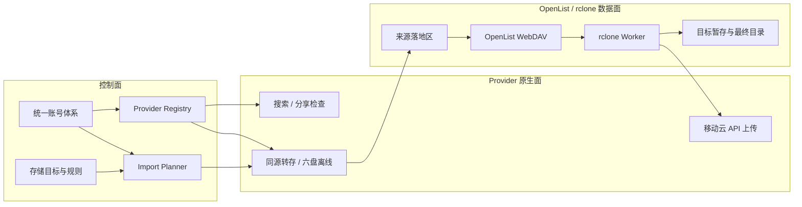
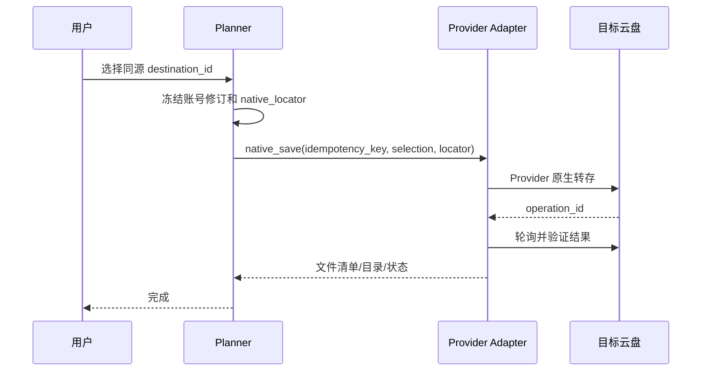
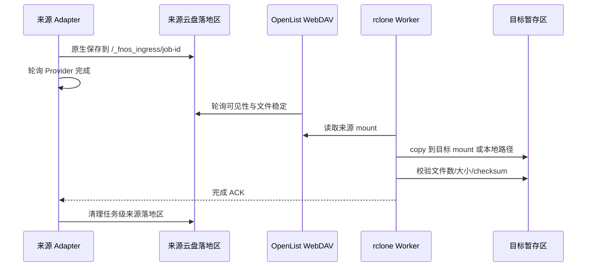
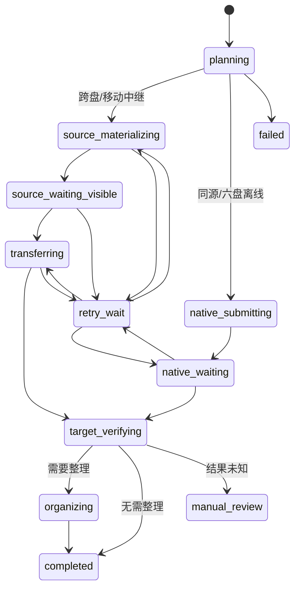

# V1.0 多链路设计文档

> 状态：设计定稿，作为开发基线  
> 版本：V1.0  
> 日期：2026-08-07  
> 项目：fnos-search 统一云盘账号与多链路入库  
> 范围：统一账号体系、Provider Adapter、存储目标、同源直转、跨盘 rclone、移动云中继、六盘磁链、后台管理、访客目标选择、测试与上线切换。

## 0. 修订记录（2026-08-07 开发前确认）

以下修改经项目方确认后生效，正文中的相关表述以本节为准：

1. **跨盘下载一律走 OpenList，不做 Provider 下载 API**。来源分享由 Provider 原生保存到来源账号任务级落地区，OpenList 暴露后由 rclone 读取；「账号 API 下载到本地缓存」不作为 V1.0 通用能力。§23 阶段 2 中相应条目不再要求。
2. **天翼云同源转存先留接口，实现后补**。`TianyiAdapter.native_save()` 先实现协议接口并返回「未实现」的明确错误；V1.0 发布门槛中「天翼到天翼原生转存」改为「接口与契约测试就绪，实现待项目方提供转存源码后补入」，天翼目标在原生实现落地前不标记可用。
3. **在现有 v3 未发布骨架上一次性切换为 v4**。v3 的路径安全、namespace 身份、本地目标、worker rclone_copy、幂等地基继承；v4 替换「目标内联凭证 + 全局默认目标 + 按 driver 选策略」，按 §21 一次性切换，不保留 v2/v3 执行器。
4. **访客不选择保存位置**。访客提交时不体现、不选择最终保存路径；由管理员为每个搜索源（夸克/天翼/移动/六盘/后续 + 本地 + OpenList 通用）通过 `source_destination_rules` 分配保存目标。§14 访客目标选择、§15.1 destination-options 接口、§24.3 公共选择测试相应简化为「服务端按来源+分类解析目标；无可用目标则阻止提交并提示」。管理员为「OpenList 通用」类型目标配置保存路径时，后台提供 OpenList 目录选择器。


## 1. 文档结论

系统采用“单应用部署 + 进程内 Provider Adapter + OpenList WebDAV/rclone 数据面”的架构，不为移动云、夸克、天翼云、六盘分别部署服务。

核心决策如下：

1. 每一种云盘归属一个 `provider_kind`，例如 `mobile`、`quark`、`tianyi`、`sixpan`、未来的 `115`。
2. 每种 Provider 可以维护多个账号，但 V1.0 每个账号作用域只能激活一个账号。搜索、预览、同源转存和跨盘落地都从同一账号选择记录解析账号。
3. 用户选择的是逻辑存储目标 `destination_id`，不是账号、接口、remote 或路径。账号由系统解析，路径由目标配置解析。
4. 同源转存优先且强制使用 Provider 原生能力：移动到移动、夸克到夸克、天翼到天翼，以及未来 115 到 115。
5. 跨盘先由来源 Provider 把分享资源原生保存到来源账号的任务级落地区，再由 OpenList WebDAV 暴露给 rclone，最后复制到目标云盘或本地目录。
6. 目标为移动云且来源不是移动云时，使用唯一例外链路：rclone 下载到受控本地缓存，再调用移动云上传 API。原因是移动云大文件通过 OpenList 上传存在卡在 100% 的已知问题。
7. 磁链在 V1.0 只允许保存到六盘，由六盘执行离线任务。磁链到其他目标一律不展示、不接受，也不自动降级。
8. Planner 只生成并执行 v4 计划。当前 v2/v3 尚未正式使用，因此不保留兼容执行器、旧 route 分发或双写逻辑。
9. 访客的“保存到哪里”必须在来源识别和分类确定后计算。没有可用目标时阻止提交；只有一个目标时自动选中但仍明确展示；多个目标时由用户选择并在提交时重新校验。
10. 任何显式选择失败都不得回退到默认盘，任何原生转存失败都不得静默改走下载上传。


一句话模型：

```text
搜索/分享来源
  -> Provider Adapter 用当前激活账号把资源物化到来源落地区
  -> Import Planner 按来源、目标、账号、OpenList 能力冻结执行计划
  -> native_save | native_offline | rclone_copy | relay_upload_mobile
  -> 目标暂存/整理/最终目录
  -> 校验成功后完成任务并清理来源落地与本地缓存
```

## 2. 目标与非目标

### 2.1 V1.0 必须实现

- 一个后台维护移动云、夸克、天翼云、六盘四类 Provider 账号。
- 每类 Provider 可新增多个账号，可检测、禁用、更新、切换当前账号。
- 同一 Provider 在 `default` 作用域下最多只有一个激活账号。
- 账号切换只影响新任务；已创建任务继续使用冻结的账号 ID 与账号修订版本。
- 移动、夸克、天翼分享支持同源原生转存。
- 磁链支持六盘原生离线。
- 所有具备“来源 OpenList 可读 + 目标 OpenList 可写”条件的跨盘组合支持 rclone。
- 任意支持 rclone 来源的资源可以下载到受控本地目标。
- 非移动来源到移动目标使用本地中继 + 移动云 API 上传。
- 后台可维护 OpenList 连接、挂载映射、逻辑存储目标和来源到目标规则。
- 访客页面按当前资源返回真正可执行的存储目标，不展示理论上配置了但当前不可执行的目标。
- 任务计划、幂等、重试、取消、清理和日志都带来源账号、目标账号与 `destination_id` 身份。
- Provider 扩展不要求修改 Planner 的供应商分支；增加 115 时主要新增 Adapter、账号表单 Schema、搜索实现和契约测试。

### 2.2 V1.0 明确不做

- 不允许同一 Provider 同时激活多个账号做轮询、负载均衡或自动故障切换。
- 不允许访客选择具体云盘账号、OpenList mount、rclone remote、绝对路径或原生目录 ID。
- 不把 Provider 拆成独立微服务或要求部署多个容器服务。
- 不使用天翼云、夸克等 Provider 的上传 API 处理跨盘上传；跨盘写入统一走 OpenList WebDAV/rclone。
- 不实现通用 BT 下载器。
- 不开放磁链到本地、移动、夸克、天翼或其他目标。
- 不在原生转存失败后自动降级为跨盘传输。
- 不支持一条任务同时写多个目标。需要多目标时创建多个单目标任务。
- 不支持运行时安装不受信任的第三方 Python 插件。V1.0 的可扩展是项目内 Adapter 注册机制。
- 不兼容执行 v2/v3 计划。旧完成记录可作为历史展示，但不得恢复或重试。

## 3. 关键概念与边界

### 3.1 六个独立身份

| 概念 | 示例 | 含义 |
|---|---|---|
| `provider_kind` | `quark` | 云盘种类，决定使用哪个 Adapter |
| `account_id` | `acc_01J...` | 某个具体账号的稳定 ID |
| `account_scope` | `default` | 账号选择作用域，V1.0 只使用 default |
| `connection_id` | `ol_main` | 一个 OpenList WebDAV 服务连接 |
| `mount_id` | `mount_quark_main` | OpenList 中某个挂载与 Provider 账号的映射 |
| `destination_id` | `quark_library` | 用户可理解、可选择的逻辑入库目标 |

这些身份不能互相代替：

- `provider_kind` 不是账号；否则无法维护多个夸克账号。
- `account_id` 不是目标；同一激活账号可以有电影库、剧集库、归档库等多个目标。
- `mount_id` 不是账号；OpenList 挂载由 OpenList 管理，本系统只维护关联与能力验证。
- `destination_id` 不是 driver；目标 ID 必须稳定，底层实现和路径允许通过新修订更新。

### 3.2 三个平面



- 控制面决定“用哪个账号、存到哪个目标、走什么链路”。
- Provider 原生面只处理搜索、分享检查、同源保存、六盘离线和移动云特殊上传。
- OpenList/rclone 数据面处理跨盘复制、下载本地、文件校验和大多数目标写入。

### 3.3 来源、目标与传输策略分离

```python
@dataclass(frozen=True)
class SourceDescriptor:
    provider_kind: str
    source_form: str          # share | magnet | local | http
    canonical_source_id: str
    account_scope: str
    selected_items_hash: str


@dataclass(frozen=True)
class DestinationDescriptor:
    destination_id: str
    provider_kind: str        # mobile/quark/tianyi/sixpan/local/generic
    account_scope: str | None
    target_revision: int


TransferStrategy = Literal[
    "native_save",
    "native_offline",
    "rclone_copy",
    "relay_upload_mobile",
]
```

`route=quark_to_mobile` 这类把来源和目标焊死的字符串不再参与执行。Link Classifier 只产出 `provider_kind + source_form`，Planner 根据动态目标和能力选择策略。

## 4. 总体架构

### 4.1 单部署模块边界

```text
fnos_media_import/
  providers/
    base.py                     # Adapter Protocol 与公共结果类型
    registry.py                 # Provider 注册表
    mobile/adapter.py
    quark/adapter.py
    tianyi/adapter.py
    sixpan/adapter.py
  accounts/
    service.py                  # 账号 CRUD、修订、激活与密钥解析
    repository.py
    crypto.py                   # 凭证信封加密
  openlist/
    connection_service.py
    mount_service.py
    probe_service.py
  storage/
    target_service.py
    locator.py
    policy_service.py
  planning/
    source_resolver.py
    destination_options.py
    import_planner.py
    plan_validator.py
  transfer/
    orchestrator.py
    native_executor.py
    rclone_executor.py
    mobile_relay_executor.py
    verifier.py
    cleanup.py
```

这些是同一个应用中的模块，不是多个独立服务。rclone 可以继续由现有 Worker 进程执行，但它只接收数据库中冻结并校验过的执行计划，不能自行决定目标。

### 4.2 服务职责

| 服务 | 单一职责 |
|---|---|
| `ProviderRegistry` | 注册并按 `provider_kind` 获取 Adapter，拒绝未知 Provider |
| `ProviderAccountService` | 账号 CRUD、凭证修订、检测、启停与引用保护 |
| `ProviderSelectionService` | 以事务方式切换当前账号，保证一个作用域仅一个激活账号 |
| `OpenListConnectionService` | WebDAV 连接配置、认证与健康检测 |
| `OpenListMountService` | Provider 账号与 OpenList mount 的映射及读写能力检测 |
| `StorageTargetService` | 逻辑目标、分类路径、双定位器、展示信息与版本管理 |
| `DestinationPolicyService` | 来源、分类、受众到允许目标和默认目标的规则 |
| `SourceResolver` | 从服务端可信资源记录解析来源，不信任客户端 provider 字段 |
| `DestinationOptionsService` | 为当前来源和分类计算用户真正可选的目标 |
| `ImportPlanner` | 解析账号、目标、能力和路径，冻结唯一执行策略 |
| `TransferOrchestrator` | 按计划状态机调用执行器，处理重试、取消和 ACK |
| `NativeTransferExecutor` | 同源保存与六盘离线，不执行跨盘复制 |
| `RcloneTransferExecutor` | 来源 OpenList 路径到目标 OpenList/本地路径的复制 |
| `MobileRelayExecutor` | rclone 下载本地缓存后调用移动云上传 API |
| `TransferVerifier` | 校验目标存在、大小、文件数及可选 checksum |
| `TransferCleanupService` | 仅在目标确认和应用 ACK 后清理来源落地与本地缓存 |

## 5. 统一账号体系

### 5.1 账号模型

统一账号体系只保存 Provider 原生能力需要的账号。OpenList 自己管理云盘挂载凭证，本系统不重复读取 OpenList 内部密码，但必须把 mount 映射到本系统账号。

```python
@dataclass(frozen=True)
class ProviderAccount:
    account_id: str
    provider_kind: str
    name: str
    enabled: bool
    current_revision: int
    identity_hint: str         # 脱敏手机号/昵称，用于防止映射错账号
    created_at: datetime
    updated_at: datetime


@dataclass(frozen=True)
class AccountSelection:
    provider_kind: str
    scope: str                 # V1.0 固定 default
    account_id: str
    account_revision: int
    selection_revision: int
```

每次修改凭证都创建不可变的 `provider_account_revisions`，而不是覆盖旧密文。任务引用具体 `account_id + revision`，因此：

- 后台切换当前账号只影响新任务。
- 在途任务不会突然改用另一个账号。
- 更新 Cookie/Token 后，新任务使用新修订；旧任务仍可读取旧修订并完成。
- 旧修订只有在没有非终态任务引用后才能清理。

### 5.2 数据表

```sql
CREATE TABLE provider_accounts (
  account_id TEXT PRIMARY KEY,
  provider_kind TEXT NOT NULL,
  name TEXT NOT NULL,
  enabled INTEGER NOT NULL DEFAULT 1,
  current_revision INTEGER NOT NULL,
  identity_hint TEXT NOT NULL DEFAULT '',
  last_test_status TEXT NOT NULL DEFAULT 'untested',
  last_test_message TEXT NOT NULL DEFAULT '',
  last_tested_at TEXT,
  created_at TEXT NOT NULL,
  updated_at TEXT NOT NULL
);

CREATE TABLE provider_account_revisions (
  account_id TEXT NOT NULL,
  revision INTEGER NOT NULL,
  config_json TEXT NOT NULL,
  credentials_ciphertext BLOB NOT NULL,
  credential_key_id TEXT NOT NULL,
  created_at TEXT NOT NULL,
  PRIMARY KEY (account_id, revision),
  FOREIGN KEY (account_id) REFERENCES provider_accounts(account_id)
);

CREATE TABLE provider_account_selections (
  provider_kind TEXT NOT NULL,
  scope TEXT NOT NULL DEFAULT 'default',
  account_id TEXT NOT NULL,
  account_revision INTEGER NOT NULL,
  selection_revision INTEGER NOT NULL,
  selected_at TEXT NOT NULL,
  PRIMARY KEY (provider_kind, scope),
  FOREIGN KEY (account_id) REFERENCES provider_accounts(account_id)
);
```

`PRIMARY KEY(provider_kind, scope)` 从数据库层保证同类 Provider 同一作用域只有一个当前账号。V1.0 不通过应用层布尔字段 `is_active` 模拟该约束。

### 5.3 账号操作规则

#### 新增账号

1. 从 Provider Catalog 选择云盘类型。
2. UI 根据 Adapter 提供的表单 Schema 渲染凭证字段。
3. 保存前执行本地格式校验，保存后执行真实账号检测。
4. 检测成功后允许设为当前账号；检测失败的账号可以保存为草稿，但不能激活。
5. 第一个检测成功的账号可以由管理员明确选择“保存并设为当前”，不能暗中替换当前账号。

#### 切换账号

切换必须在一个数据库事务中完成：

1. 校验新账号已启用、最新修订检测成功且 Provider 类型一致。
2. 校验它需要的 OpenList 映射；缺少映射时可用于搜索/同源直转，但跨盘能力标记为不可用。
3. 更新 `provider_account_selections` 并递增 `selection_revision`。
4. 写审计日志，记录操作者、旧账号、新账号和时间。
5. 不修改任何已存在任务的 execution plan。

#### 禁用、删除和更新

- 当前账号不能直接禁用，必须先切换到另一个可用账号或关闭该 Provider。
- 被非终态任务引用的账号和修订不能删除。
- 被目标或 OpenList mount 引用的账号不能删除，只能解除引用后删除。
- 凭证更新创建新修订并重新检测，不修改旧修订。
- 如果被更新的是当前账号，只有新修订检测成功后，才在同一事务中把 `provider_account_selections.account_revision` 指向新修订并递增 `selection_revision`；检测失败时当前选择保持不变。
- 账号名称可修改；`account_id`、`provider_kind` 不可修改。

### 5.4 凭证安全

- Cookie、Token、手机号和密码使用主密钥进行 AES-256-GCM 信封加密后入库。
- 主密钥只通过部署环境变量或 Docker Secret 提供，不写入数据库、配置导出或日志。
- API 永远返回 `configured: true`、脱敏 identity 和检测状态，不回显密文或明文。
- Adapter 只有在执行单次操作时通过 `CredentialResolver` 获取短生命周期解密对象。
- 日志过滤器必须按 Adapter Schema 中 `secret: true` 的字段动态脱敏。
- 缺少主密钥时应用拒绝启动账号相关功能，不允许退化为明文保存。

## 6. Provider Adapter 可扩展设计

### 6.1 Adapter 协议

```python
class ProviderAdapter(Protocol):
    kind: str
    display_name: str

    def account_schema(self) -> AccountFormSchema: ...
    def validate_account_config(self, config: dict) -> list[FieldError]: ...
    def test_account(self, account: AccountContext) -> AccountTestResult: ...
    def capabilities(self, account: AccountContext) -> ProviderCapabilities: ...

    def inspect_source(
        self, source: SourceDescriptor, account: AccountContext
    ) -> SourceInspection: ...

    def can_native_transfer(
        self,
        source: SourceInspection,
        destination: NativeLocator,
        account: AccountContext,
    ) -> CapabilityDecision: ...

    def native_save(self, request: NativeSaveRequest) -> OperationReceipt: ...
    def native_offline(self, request: NativeOfflineRequest) -> OperationReceipt: ...
    def poll_operation(self, receipt: OperationReceipt) -> OperationStatus: ...
    def verify_native_result(self, request: VerifyRequest) -> VerifyResult: ...

    def relay_uploader(self) -> RelayUploader | None: ...
```

约束：

- Adapter 只理解自己的 Provider、账号、分享信息和原生 locator。
- Adapter 不读取目标选择规则，不决定是否跨盘，不拼 rclone 命令。
- `can_native_transfer()` 是针对本次来源、账号和目标的判断，不能只依赖一个笼统的 `supports_native_save=true`。
- `relay_uploader()` V1.0 只有移动云返回实现，其他 Provider 返回 `None`。
- `native_offline()` V1.0 只有六盘磁链实现。
- 所有提交方法都接收业务幂等键，并返回 Provider 操作 ID 或可稳定轮询的 receipt。

### 6.2 Provider 能力

```python
@dataclass(frozen=True)
class ProviderCapabilities:
    supports_search: bool = False
    supports_share_inspection: bool = False
    supports_native_save: bool = False
    supports_native_offline: bool = False
    supports_operation_polling: bool = False
    supports_native_verify: bool = False
    supports_relay_upload: bool = False
```

OpenList 读写能力不放在 Provider 能力中，因为它取决于具体 connection、mount 和路径。Planner 必须同时读取 `ProviderCapabilities` 与 `OpenListMountCapabilities`。

### 6.3 注册表

```python
_ADAPTERS: dict[str, ProviderAdapter] = {}

def register_provider(adapter: ProviderAdapter) -> None:
    if adapter.kind in _ADAPTERS:
        raise DuplicateProviderError(adapter.kind)
    _ADAPTERS[adapter.kind] = adapter

def get_provider(kind: str) -> ProviderAdapter:
    try:
        return _ADAPTERS[kind]
    except KeyError as exc:
        raise UnknownProviderError(kind) from exc
```

注册表没有默认 Adapter，也不允许未知 Provider 回落到移动云或通用 rclone。

### 6.4 首批 Adapter

| Adapter | 搜索/检查 | 同源原生 | 原生离线 | 特殊上传 | OpenList 角色 |
|---|---|---|---|---|---|
| `MobileAdapter` | 移动云搜索与分享检查 | 移动到移动 | 否 | 移动云 API 上传 | 跨盘来源读取 |
| `QuarkAdapter` | 夸克搜索与分享检查 | 夸克到夸克 | 否 | 否 | 跨盘来源读取和目标写入 |
| `TianyiAdapter` | 天翼搜索与分享检查 | 天翼到天翼 | 否 | 否 | 跨盘来源读取和目标写入 |
| `SixpanAdapter` | 六盘/磁链检查 | 不作为普通分享直转 | 磁链到六盘 | 否 | 目标写入；来源导出 V1.0 禁用 |

V1.0 发布门槛包含天翼到天翼原生转存。没有通过真实账号契约测试前，天翼目标不得在生产标记为可用。

### 6.5 后续新增 115 的固定步骤

1. 新增 `providers/p115/adapter.py` 并实现统一协议。
2. 注册 `kind="115"`，提供账号表单 Schema 和脱敏规则。
3. 接入 115 搜索/分享解析，产出统一 `SourceDescriptor`。
4. 实现 `can_native_transfer()`、`native_save()`、轮询和结果校验。
5. 在后台建立 115 账号与 OpenList mount 的映射。
6. 创建一个或多个 `provider_kind=115` 存储目标及分类路径。
7. 运行通用 Adapter 契约测试、同源原生测试和跨盘 rclone 测试。

Planner 不新增 `if source == "115"` 分支。同源能力由 Adapter 回答，跨盘能力由 OpenList mount 回答。

## 7. OpenList 连接与挂载映射

### 7.1 为什么需要独立建模

跨盘链路不是“rclone 能看到一个路径就算完成”。系统必须知道：

- 这个路径属于哪个 OpenList 连接。
- 对应哪个 Provider 和哪个账号。
- 是否可读、可写、可列目录、可创建和删除临时文件。
- Provider 原生保存后的目录是否与 OpenList 所见目录是同一个逻辑位置。
- rclone 路径与 Organizer 路径是否处于同一命名空间。

因此账号、OpenList 连接和 mount 必须独立建模，再通过稳定 ID 关联。

### 7.2 数据模型

```sql
CREATE TABLE openlist_connections (
  connection_id TEXT PRIMARY KEY,
  name TEXT NOT NULL,
  base_url TEXT NOT NULL,
  username TEXT NOT NULL,
  password_ciphertext BLOB NOT NULL,
  credential_key_id TEXT NOT NULL,
  enabled INTEGER NOT NULL DEFAULT 1,
  revision INTEGER NOT NULL,
  last_test_status TEXT NOT NULL DEFAULT 'untested',
  last_tested_at TEXT,
  created_at TEXT NOT NULL,
  updated_at TEXT NOT NULL
);

CREATE TABLE openlist_mounts (
  mount_id TEXT PRIMARY KEY,
  connection_id TEXT NOT NULL,
  name TEXT NOT NULL,
  provider_kind TEXT,
  account_id TEXT,
  webdav_root TEXT NOT NULL,
  namespace_id TEXT NOT NULL,
  readable INTEGER NOT NULL DEFAULT 0,
  writable INTEGER NOT NULL DEFAULT 0,
  enabled INTEGER NOT NULL DEFAULT 1,
  revision INTEGER NOT NULL,
  identity_status TEXT NOT NULL DEFAULT 'unverified',
  last_tested_at TEXT,
  FOREIGN KEY (connection_id) REFERENCES openlist_connections(connection_id),
  FOREIGN KEY (account_id) REFERENCES provider_accounts(account_id)
);
```

`namespace_id` 示例为 `openlist:ol_main:mount_quark_main`。路径比较必须使用 `(namespace_id, normalized_path)`，不同 namespace 的相同字符串路径不构成重叠。

### 7.3 mount 检测

一次完整检测包含：

1. WebDAV 认证与服务版本探测。
2. mount 根目录列举。
3. 在配置的探测目录创建任务级临时目录和小文件。
4. 读取文件大小与内容摘要。
5. rename 或 move 能力探测。
6. 删除文件和临时目录。
7. 更新 `readable/writable` 和检测详情。

探测目录必须由管理员配置为专用目录，例如 `/_fnos_probe`。不得默认在 mount 根目录留下探测文件。清理失败时记录残留完整路径，并在后台显示“需要清理”。

Provider 账号与 mount 的真实身份有三种状态：

- `verified`：Adapter 与 OpenList 能提供可比对的脱敏账号标识，且一致。
- `declared`：管理员确认映射，但接口无法自动比对。
- `mismatch`：可比对且不一致，禁止用于同一个执行计划。

### 7.4 rclone remote 生成

一个 OpenList connection 对应一个受控 rclone WebDAV remote。任务只能提交：

```text
connection_id + mount_id + normalized_relative_path
```

`RcloneLocatorResolver` 在服务端转换为 `remote:path`。客户端、任务 payload 和 Adapter 都不能传 rclone 配置文件路径或任意 remote 名称。

## 8. 存储目标与路径模型

### 8.1 逻辑目标

存储目标表示用户眼中的“保存到哪里”，例如：

- 移动云主库
- 夸克影视库
- 天翼归档盘
- 六盘离线区
- 飞牛本地影视库

目标不是账号选择器。它引用 Provider 的账号作用域，Planner 创建任务时再把作用域解析成具体账号与修订。

```python
@dataclass(frozen=True)
class StorageTarget:
    destination_id: str
    name: str
    provider_kind: str
    account_scope: str | None
    enabled: bool
    audience: Literal["admin", "guest"]
    revision: int
    categories: dict[str, TargetCategory]
```

### 8.2 双定位器与 Organizer 定位器

每个分类可以配置三套定位器：

```python
@dataclass(frozen=True)
class TargetCategory:
    native_locator: NativeLocator | None
    rclone_locator: RcloneLocator | LocalLocator | None
    organizer_locator: OpenListLocator | None
    public_label: str
```

- `native_locator`：同源原生保存或移动云 API 上传时由 Provider Adapter 解释，通常包含目录 ID 或 Provider 相对路径。
- `rclone_locator`：跨盘写入时由 rclone 解释，引用 OpenList mount 或受控本地目录。
- `organizer_locator`：Organizer 可见的同一目标路径。

三者允许字符串相同，也允许格式完全不同。系统通过 namespace 与受控映射证明它们指向同一目标，而不是简单比较字符串。

### 8.3 本地目标

本地目标只允许在部署时挂载的根目录下创建：

```text
/storage-targets/<target-id>/<category>/...
```

服务端对根目录和最终路径执行真实路径解析，拒绝 `..`、符号链接越界、控制字符、NUL 和不受控绝对路径。访客永远看不到或提交宿主机路径。

### 8.4 目标数据表

```sql
CREATE TABLE storage_targets (
  destination_id TEXT PRIMARY KEY,
  name TEXT NOT NULL,
  provider_kind TEXT NOT NULL,
  account_scope TEXT,
  enabled INTEGER NOT NULL DEFAULT 1,
  audience TEXT NOT NULL DEFAULT 'admin',
  current_revision INTEGER NOT NULL,
  created_at TEXT NOT NULL,
  updated_at TEXT NOT NULL
);

CREATE TABLE storage_target_revisions (
  destination_id TEXT NOT NULL,
  revision INTEGER NOT NULL,
  categories_json TEXT NOT NULL,
  display_json TEXT NOT NULL,
  created_at TEXT NOT NULL,
  PRIMARY KEY (destination_id, revision),
  FOREIGN KEY (destination_id) REFERENCES storage_targets(destination_id)
);
```

目标修订不保存 Provider 凭证，只保存 locator、分类映射、展示信息和策略参数。任务冻结 `destination_id + target_revision`。

### 8.5 路径红线

- 来源 landing、目标 staging 和目标 final 在相同 namespace 下不得相等或互相包含。
- 每个跨盘任务必须使用任务级 landing 和 staging，例如 `/_fnos_ingress/job-123`、`/_fnos_staging/job-123`。
- 只有目标校验成功且应用完成 ACK 后才能删除 landing。
- Organizer 未启用时不强制配置 `organizer_locator`，但目标仍必须有可执行的 native 或 rclone locator。
- Organizer 启用时，staging 与 organizer locator 必须通过 mount 映射证明是同一实际目录。
- 同一目标分类的最终路径不能为空、不能是 mount 根，除非管理员显式开启“允许写根目录”并通过高风险确认；V1.0 UI 默认不提供该开关。

## 9. 来源到目标规则

### 9.1 为什么不能只有一个全局默认盘

磁链只能去六盘；移动分享到移动适合原生转存；夸克分享到夸克也适合原生转存。一个全局默认目标会产生错误选择和隐式降级，因此默认目标必须与来源和分类关联。

```sql
CREATE TABLE source_destination_rules (
  rule_id TEXT PRIMARY KEY,
  source_provider_kind TEXT NOT NULL,
  source_form TEXT NOT NULL,
  category_key TEXT NOT NULL,
  destination_id TEXT NOT NULL,
  guest_allowed INTEGER NOT NULL DEFAULT 0,
  admin_allowed INTEGER NOT NULL DEFAULT 1,
  is_default INTEGER NOT NULL DEFAULT 0,
  priority INTEGER NOT NULL DEFAULT 100,
  enabled INTEGER NOT NULL DEFAULT 1,
  FOREIGN KEY (destination_id) REFERENCES storage_targets(destination_id)
);
```

允许 `category_key='*'` 作为 Provider 级规则。精确分类规则优先于 `*`。同一来源、来源形态、分类和受众最多一个默认目标；通过事务校验和部分唯一索引保证。

### 9.2 可选目标是三者交集

```text
后台策略允许
  ∩ 目标已启用且受众允许
  ∩ Planner 当前能力检查可执行
  = 用户可选目标
```

配置了目标不代表当前资源一定能存进去。例如：

- 夸克目标缺少可写 OpenList mount 时，移动来源不能选择它。
- 移动目标缺少有效移动云账号或上传能力时，天翼来源不能选择它。
- 磁链即使策略误配了本地目标，Planner 仍必须移除该选项。

策略只能缩小能力集合，不能强行绕过能力校验。

## 10. 入库链路

### 10.1 统一前置流程

所有来源先经过同一控制流程：

1. 服务端从搜索缓存或经过重新检测的 URL 识别 `provider_kind + source_form`。
2. 解析该 Provider 当前激活账号和不可变账号修订。
3. Adapter 检查分享、文件选择、提取码、资源状态和预计文件清单。
4. 根据来源、分类、受众和实时能力计算目标选项。
5. 用户确认 `destination_id`。
6. 提交时重新计算并校验选择修订，防止账号或目标在确认期间发生变化。
7. Planner 冻结账号、目标、mount、路径和唯一传输策略。
8. Orchestrator 执行计划；执行器不得自行改变策略。

### 10.2 同源原生转存

适用：

- 移动云分享 -> 移动云目标
- 夸克分享 -> 夸克目标
- 天翼云分享 -> 天翼云目标
- 未来 115 分享 -> 115 目标



规则：

- 同源判断不只比较 `provider_kind`，还必须由 Adapter 确认当前账号与目标 locator 可执行原生保存。
- 原生保存直接写目标任务级 staging 或 final，不先下载本地。
- Provider 返回“已存在”时必须校验对象身份、大小和选择清单后才能视为幂等成功。
- 原生失败返回 Provider 明确错误并进入可重试或人工处理状态，不允许自动改为 rclone。

### 10.3 跨盘 rclone

适用：移动、夸克、天翼来源到任意非移动且可通过 OpenList 写入的云盘或本地目标。



这里“下载到本地”不需要每个 Provider 再实现下载 API：

```text
来源 Provider 原生保存到来源账号
  -> OpenList 暴露来源目录
  -> rclone 从 WebDAV 读取
  -> 目标是云盘时写另一个 OpenList 路径
  -> 目标是本地时写 /storage-targets 下的受控路径
```

跨盘成立的必要条件：

- 来源 Adapter 支持把分享原生物化到来源账号 landing。
- 来源账号有匹配且可读的 OpenList mount。
- Provider 完成后，OpenList 能在超时内看到稳定文件。
- 目标为云盘时有可写 OpenList mount；目标为本地时路径位于受控根。
- 来源和目标路径不重叠。

### 10.4 其他来源到移动云

适用：夸克或天翼来源到移动云目标；未来其他来源同样复用。

```text
来源 Adapter 原生保存到来源 landing
  -> 等待 OpenList 可读
  -> rclone 下载到 /data/relay/job-<id>
  -> MobileAdapter.relay_uploader 调用移动云 API 上传
  -> 移动云 API/目录结果校验
  -> 应用 ACK
  -> 清理来源 landing 和本地缓存
```

这条链路命名为 `relay_upload_mobile`，不能与普通 `rclone_copy` 混成一个执行器：

- rclone 只负责下载到本地缓存。
- 移动云 Adapter 负责秒传、完整上传、认证错误和结果确认。
- 上传返回 100% 但未确认目标存在时不得删除缓存或来源。
- 认证失效停止同账号后续上传任务并在后台生成账号告警，不进行盲重试。

### 10.5 移动云到其他目标

移动云分享到夸克、天翼、六盘可写 mount 或本地时：

1. `MobileAdapter` 原生保存到移动云来源 landing。
2. 等待移动云 OpenList mount 可读和文件稳定。
3. rclone 复制到目标 staging。
4. 校验、整理、ACK 后清理移动云 landing。

移动云只在“作为目标接收跨盘数据”时使用 API 上传例外；作为跨盘来源时仍通过 OpenList/rclone 读取。

### 10.6 六盘磁链边界

V1.0 的磁链不是通用可下载来源。唯一合法链路是：

```text
magnet/torrent
  -> SixpanAdapter.native_offline
  -> 六盘目标 native_locator
  -> 轮询离线任务
  -> 校验六盘结果
```

强制规则：

- 磁链目标必须是 `provider_kind=sixpan`，并且目标具有 `native_offline` locator。
- 访客页面只返回六盘目标；没有可用六盘账号或目标时直接阻止提交。
- 磁链不能选择本地、移动、夸克、天翼或通用 OpenList 目标。
- 不以“先离线到六盘再 rclone”作为 V1.0 隐藏链路。
- 六盘离线成功只代表资源进入六盘，不代表已经具备可导出能力。

未来开放“磁链 -> 六盘 landing -> 其他目标”前必须同时满足：

1. 六盘账号与 OpenList mount 身份可确认。
2. mount 可稳定读取离线产物，而不是只能列目录。
3. 离线完成状态与 OpenList 文件稳定状态可以关联。
4. 大文件 rclone 读取、取消和重试通过实测。
5. 来源 landing 可按任务安全清理。
6. 后台显式启用 `sixpan_export_bridge` 能力。

未满足全部条件前，Planner 对磁链跨盘必须返回 `MAGNET_TARGET_RESTRICTED`。

其他云盘来源写入六盘不属于磁链限制：如果六盘 OpenList mount 经检测可写，可以作为普通 `rclone_copy` 目标；否则不展示。

## 11. 首批能力矩阵

| 来源 | 移动目标 | 夸克目标 | 天翼目标 | 六盘目标 | 本地/通用 OpenList |
|---|---|---|---|---|---|
| 移动分享 | `native_save` | `rclone_copy` | `rclone_copy` | mount 可写时 `rclone_copy` | `rclone_copy` |
| 夸克分享 | `relay_upload_mobile` | `native_save` | `rclone_copy` | mount 可写时 `rclone_copy` | `rclone_copy` |
| 天翼分享 | `relay_upload_mobile` | `rclone_copy` | `native_save` | mount 可写时 `rclone_copy` | `rclone_copy` |
| 磁链/BT | 禁止 | 禁止 | 禁止 | `native_offline` | 禁止 |
| 未来 115 分享 | `relay_upload_mobile` | `rclone_copy` | `rclone_copy` | mount 可写时 `rclone_copy` | 同源为 `native_save`，其他为 `rclone_copy` |

表格表示候选策略，不表示无条件可用。每个单元格仍需账号、Adapter、mount、目标 locator、分类路径和健康状态共同通过。

## 12. Import Planner 与 Execution Plan v4

### 12.1 版本决策

业务版本为 V1.0，执行计划版本固定为 `4`，用于与当前仓库中尚未投产的 v3 实现明确区分。

```python
EXECUTION_PLAN_VERSION = 4
```

系统只允许创建、恢复、重试和执行 v4：

- 不保留 v2/v3 Plan Reader。
- 不按旧 `route`、`storage_backend` 或 `provider_target_path` 分发。
- 旧完成任务只作为只读历史展示。
- 发现任何非终态旧版本任务时，启动预检失败，要求取消并重新提交。
- Worker 收到非 v4 计划时返回 `UNSUPPORTED_PLAN_VERSION`，不得从当前配置重建计划。

### 12.2 规划算法

```text
1. 服务端识别并规范化来源。
2. 解析来源 Provider 当前账号，冻结 account_id + revision + selection_revision。
3. 读取目标及目标修订，解析目标 Provider 当前账号（如需要）。
4. 校验调用者是否允许选择该目标。
5. 解析来源 landing、目标 staging/final、Organizer 和本地缓存路径。
6. source_form == magnet：
     只允许 SixpanAdapter.native_offline -> native_offline。
7. 来源与目标 Provider 相同：
     Adapter.can_native_transfer() 必须通过 -> native_save。
     不通过即报错，不尝试跨盘替代。
8. 目标 Provider == mobile：
     来源 landing 可通过 OpenList 读取
     且 MobileAdapter 有 relay uploader -> relay_upload_mobile。
9. 其他目标：
     来源 landing 可读
     且目标 rclone locator 可写 -> rclone_copy。
10. 无策略时失败关闭，不生成任务。
11. 计算 options_revision 和幂等身份，持久化不可变 v4 计划。
```

同源强制原生的原因：用户选择同盘通常期待服务端转存；自动降级会引入下载流量、缓存空间、时间和完全不同的失败语义。若未来需要允许降级，必须作为目标级显式策略展示给管理员和用户，不能静默加入。

### 12.3 计划结构

```json
{
  "version": 4,
  "job_id": 123,
  "created_at": "2026-08-07T12:00:00Z",
  "source": {
    "provider_kind": "quark",
    "source_form": "share",
    "canonical_source_id": "quark:share:abc",
    "selection_hash": "sha256:...",
    "account_id": "acc_quark_a",
    "account_revision": 7,
    "account_selection_revision": 3
  },
  "destination": {
    "id": "tianyi_library",
    "provider_kind": "tianyi",
    "target_revision": 5,
    "account_id": "acc_tianyi_a",
    "account_revision": 4,
    "account_selection_revision": 2
  },
  "transfer": {
    "strategy": "rclone_copy",
    "executor": "rclone",
    "idempotency_key": "import:...",
    "delete_source_after_ack": true
  },
  "bindings": {
    "source_mount_id": "mount_quark_main",
    "source_mount_revision": 8,
    "destination_mount_id": "mount_tianyi_main",
    "destination_mount_revision": 6
  },
  "paths": {
    "source_landing": {
      "namespace_id": "openlist:ol_main:mount_quark_main",
      "path": "/_fnos_ingress/job-123"
    },
    "destination_staging": {
      "namespace_id": "openlist:ol_main:mount_tianyi_main",
      "path": "/影视/_fnos_staging/job-123"
    },
    "destination_final": {
      "namespace_id": "openlist:ol_main:mount_tianyi_main",
      "path": "/影视/电影"
    },
    "organizer": {
      "namespace_id": "openlist:ol_main:mount_tianyi_main",
      "path": "/影视/_fnos_staging/job-123"
    },
    "local_temp": null
  },
  "verification": {
    "minimum": ["file_count", "total_size"],
    "checksum": "when_supported"
  },
  "postprocess": {
    "organizer_enabled": true,
    "media_refresh_enabled": true
  }
}
```

计划不保存账号明文凭证、OpenList 密码或任意 rclone 配置路径。执行时按冻结的 revision 读取不可变密文和配置。

### 12.4 计划校验器

生成器和校验器必须执行相同的安全约束，校验器不能比生成器宽松：

- `job_id`、`destination_id`、plan version 与数据库列一致。
- Provider、账号和修订真实存在且互相匹配。
- 账号 revision 与 selection revision 是计划创建时的合法组合。
- 目标 revision 与 locator 存在。
- `native_save` 必须再次通过 Adapter 的原生绑定校验。
- `native_offline` 只允许 magnet/torrent + sixpan。
- `relay_upload_mobile` 的目标必须是 mobile，且 uploader 是移动云 Adapter。
- `rclone_copy` 必须有来源可读 locator 和目标可写 locator。
- 所有 namespace 和路径身份一致，无来源目标重叠或本地越界。
- 任务级 landing/staging 目录叶子必须与 `job_id` 一致。
- Organizer 启用时必须存在可验证映射。

任何字段缺失、修订被非法删除或身份不一致都失败关闭，不根据当前后台配置“补全”。

## 13. 状态机、幂等与清理

### 13.1 状态机



取消状态需要区分：

- 尚未向 Provider/rclone 提交：可直接取消。
- 已提交且 Provider 支持取消：请求取消并轮询确认。
- 已提交但结果未知：进入 `cancel_pending`，不能假装失败后重试。
- 目标已确认但 ACK 未完成：保留来源，恢复 ACK/清理阶段，不重复传输。

### 13.2 幂等身份

任务级唯一身份至少包含：

```text
canonical_source_id
+ selected_items_hash
+ category_key
+ destination_id
+ source_account_id/revision
+ destination_target_revision
```

数据库对非终态任务建立等价唯一约束。结果：

- 同一资源存移动和存本地是两个合法任务。
- 同一资源、同一文件选择、同一目标的重复点击复用原任务。
- 同一分享的不同文件选择不会错误去重。
- 账号或目标修订变化后，管理员可明确创建新任务，但 UI 要提示已有历史任务。

Provider 操作和 Worker 回调使用派生的稳定幂等键，不能仅依赖 URL。

### 13.3 删除与保留规则

- 未完成目标校验：不删除来源 landing，不删除本地缓存。
- 目标校验成功但应用未 ACK：不删除来源。
- Provider 返回未知结果：不创建第二次原生转存。
- rclone 退出成功但目标文件未稳定：进入验证重试，不清理。
- 完成 ACK 后，由独立清理步骤删除任务级 landing 和 local temp；清理失败不回滚已完成入库，但记录告警并可重试。
- 永远不对 mount 根、分类 final 根或非 `job-<id>` 目录执行递归删除。

## 14. 用户“保存到哪里”设计

### 14.1 设计原则

用户不应该理解账号、WebDAV、rclone 或 Provider API。用户只需要回答一个问题：这个资源最终进入哪个逻辑媒体库。

每个公开目标包含：

- 目标名称，例如“夸克影视库”。
- 公开分类路径标签，例如“电影库”，不是实际 mount 路径。
- 实际传输方式，例如“同盘直转”“跨盘搬运”“移动云中继”“六盘离线”。
- 可选的简短注意，例如“跨盘任务耗时较长”。

不公开：账号名称、手机号、remote、OpenList URL、目录 ID、绝对路径、namespace、容量明细和凭证状态详情。

### 14.2 计算时机

目标不能在页面初始加载时全局获取。正确时序是：

```text
选择/解析资源
  -> 服务端确认来源和文件选择
  -> 用户选择分类
  -> GET contextual destination options
  -> 展示保存目标
  -> 用户确认
  -> POST 提交时重新校验
```

分类变化、文件选择变化或重新解析来源后都必须重新请求选项。前端不能永久缓存全局目标列表。

### 14.3 0、1、多个目标

#### 0 个可用目标

- 禁用“确认入库”。
- 在保存目标区域显示具体但不泄密的原因，例如“该资源当前没有可用的保存位置”。
- 若为磁链且六盘不可用，显示“磁链目前只能保存到六盘，请联系管理员检查六盘账号或目标”。
- 不提交空 `destination_id`，服务端也不回落到默认目标。

#### 1 个可用目标

- 自动选中该目标。
- 仍显示只读的“保存到：目标名称”和传输方式，不隐藏选择结果。
- 请求必须显式携带该 `destination_id`。

#### 2 个及以上目标

- 使用下拉选择器；移动端使用原生 select 或底部选择面板。
- 预选来源和分类规则指定的默认目标。
- 没有规则默认值时保持“请选择保存位置”，不能取数组第一项。
- 用户切换后更新链路说明和确认摘要。

### 14.4 确认界面

```text
┌────────────────────────────────────┐
│ 确认入库                           │
│ 资源：示例电影 2026                │
│ 来源：夸克云盘                     │
│ 分类：电影                         │
│                                    │
│ 保存到                             │
│ [ 天翼影视库                  v ]  │
│ 跨盘搬运 · 完成后进入电影库        │
│                                    │
│              [取消] [确认入库]     │
└────────────────────────────────────┘
```

磁链确认界面只显示：

```text
保存到：六盘离线区
处理方式：六盘离线
```

### 14.5 防止选错和配置变化

目标选项接口返回 `options_revision`，由以下内容计算：

```text
source fingerprint
+ selected items hash
+ category
+ applicable policy revisions
+ target revisions
+ source/destination account selection revisions
+ mount capability revisions
```

提交时客户端发送 `destination_id + options_revision`。服务端重新计算：

- 修订一致且目标仍可用：创建任务。
- 目标仍可用但选项集合发生变化：返回 `TARGET_CHANGED` 和新选项，要求重新确认。
- 目标已不可用：返回具体错误和新选项，绝不改存其他目标。
- 客户端伪造未出现在选项中的 ID：返回 `TARGET_NOT_SELECTABLE`。

在管理员切换账号、禁用目标或 OpenList 检测转为失败的瞬间，已经打开确认框的访客不会被静默导向另一个盘。

### 14.6 推荐默认规则

首装向导建议但不强制创建：

| 来源 | 推荐默认目标 |
|---|---|
| 移动分享 | 移动云目标 |
| 夸克分享 | 夸克目标 |
| 天翼分享 | 天翼目标 |
| 磁链 | 六盘目标 |

管理员可以把跨盘目标设为默认，但保存前后台必须展示实际策略和依赖条件。

## 15. 公共 API 契约

### 15.1 获取上下文目标

```http
GET /api/public/resources/{public_id}/destination-options?category=movie
```

响应：

```json
{
  "success": true,
  "source": {
    "kind": "quark",
    "label": "夸克云盘"
  },
  "category": "movie",
  "options_revision": "sha256:...",
  "selection_required": true,
  "default_destination_id": "quark_library",
  "targets": [
    {
      "destination_id": "quark_library",
      "name": "夸克影视库",
      "category_label": "电影库",
      "transfer_mode": "native_save",
      "transfer_label": "同盘直转",
      "notice": ""
    },
    {
      "destination_id": "tianyi_library",
      "name": "天翼影视库",
      "category_label": "电影库",
      "transfer_mode": "rclone_copy",
      "transfer_label": "跨盘搬运",
      "notice": "跨盘任务通常需要更长时间"
    }
  ]
}
```

接口只返回当前资源真正可执行且访客可选的目标。账号或 mount 的内部错误只在管理 API 暴露。

### 15.2 提交入库

```http
POST /api/public/requests
Content-Type: application/json
```

```json
{
  "public_id": "res_123",
  "category": "movie",
  "destination_id": "tianyi_library",
  "options_revision": "sha256:...",
  "selected_items": ["file-id-1"]
}
```

禁止接受或必须在进入业务层前丢弃：

- `provider_kind`
- `account_id`
- `driver` / `backend`
- `remote` / `mount_id`
- `root` / `target_path` / `absolute_path`
- Cookie、Token、密码等凭证字段

服务端基于 `public_id` 的可信缓存或重新检测结果解析来源，不采用客户端声明的来源。

### 15.3 错误码

| 错误码 | HTTP | 用户提示 | 行为 |
|---|---:|---|---|
| `DESTINATION_REQUIRED` | 400 | 请选择保存位置 | 保留确认框 |
| `TARGET_NOT_FOUND` | 404 | 保存位置不存在 | 刷新选项 |
| `TARGET_DISABLED` | 409 | 该保存位置已停用 | 刷新选项，不回退 |
| `TARGET_NOT_SELECTABLE` | 403 | 无权选择该保存位置 | 记录安全日志 |
| `TARGET_INCOMPATIBLE` | 409 | 当前资源不能保存到该位置 | 展示新选项 |
| `SOURCE_ACCOUNT_UNAVAILABLE` | 503 | 当前来源账号不可用 | 阻止提交 |
| `DESTINATION_ACCOUNT_UNAVAILABLE` | 503 | 保存位置暂不可用 | 阻止提交 |
| `NATIVE_TRANSFER_UNAVAILABLE` | 409 | 同盘转存能力不可用 | 不降级 |
| `SOURCE_LANDING_UNAVAILABLE` | 503 | 来源暂时无法用于跨盘搬运 | 阻止提交 |
| `OPENLIST_UNAVAILABLE` | 503 | 跨盘通道暂不可用 | 阻止提交 |
| `MAGNET_TARGET_RESTRICTED` | 409 | 磁链目前只能保存到六盘 | 只展示六盘 |
| `TARGET_CHANGED` | 409 | 保存位置配置已变化，请重新确认 | 返回最新选项 |
| `UNSUPPORTED_PLAN_VERSION` | 409 | 任务版本不可执行，请重新提交 | 不恢复旧任务 |

错误响应统一包含 `code`、`message`、`request_id`，需要刷新时附带最新 `destination_options`。

## 16. 管理 API 契约

### 16.1 Provider Catalog 与账号

```text
GET    /api/admin/providers/catalog
GET    /api/admin/provider-accounts?provider_kind=quark
POST   /api/admin/provider-accounts
GET    /api/admin/provider-accounts/{account_id}
PATCH  /api/admin/provider-accounts/{account_id}
POST   /api/admin/provider-accounts/{account_id}/test
POST   /api/admin/provider-accounts/{account_id}/activate
POST   /api/admin/provider-accounts/{account_id}/disable
DELETE /api/admin/provider-accounts/{account_id}
```

Catalog 返回 Adapter 的显示名、功能和表单 Schema。账号详情只返回非敏感配置、掩码占位和检测信息。

激活接口需要乐观并发字段：

```json
{
  "scope": "default",
  "expected_selection_revision": 3
}
```

修订不一致返回 `SELECTION_CHANGED`，避免两个后台页面互相覆盖。

### 16.2 OpenList

```text
GET    /api/admin/openlist/connections
POST   /api/admin/openlist/connections
PATCH  /api/admin/openlist/connections/{connection_id}
POST   /api/admin/openlist/connections/{connection_id}/test
GET    /api/admin/openlist/mounts
POST   /api/admin/openlist/mounts
PATCH  /api/admin/openlist/mounts/{mount_id}
POST   /api/admin/openlist/mounts/{mount_id}/test
DELETE /api/admin/openlist/mounts/{mount_id}
```

连接检测与 mount 读写检测必须分开返回。WebDAV 登录成功不代表具体 mount 可用。

### 16.3 存储目标与入库规则

```text
GET    /api/admin/storage-targets
POST   /api/admin/storage-targets
GET    /api/admin/storage-targets/{destination_id}
PATCH  /api/admin/storage-targets/{destination_id}
POST   /api/admin/storage-targets/{destination_id}/test
POST   /api/admin/storage-targets/{destination_id}/disable
DELETE /api/admin/storage-targets/{destination_id}

GET    /api/admin/destination-rules
PUT    /api/admin/destination-rules
GET    /api/admin/transfer-matrix
POST   /api/admin/transfer-matrix/probe
```

目标检测按分类返回：

- 原生 locator 是否可解析。
- rclone locator 是否可读/写。
- Organizer 映射是否一致。
- 当前激活账号是否可用。
- 对每种来源会选择什么策略以及不可用原因。

删除已被任务、订阅或规则引用的目标返回 `TARGET_IN_USE`。管理员应禁用目标，不应物理删除其历史修订。

### 16.4 审计与权限

所有管理 API 要求管理员认证，并写入审计事件：

```text
provider_account.created
provider_account.credential_revised
provider_account.activated
provider_account.disabled
openlist_connection.updated
openlist_mount.mapped
storage_target.created
storage_target.revised
destination_rules.updated
```

审计记录保存操作者、对象 ID、旧/新修订、时间、请求 ID 和结果，不保存 secret 值。

## 17. 后台页面 UI

### 17.1 信息架构

后台新增一级工作区“云盘与入库”，包含五个页签：

```text
云盘与入库
  账号
  OpenList
  存储目标
  入库规则
  链路诊断
```

现有“高级设置”里的移动云凭证、单一 WebDAV 和只读存储目标卡片迁移到该工作区，避免一个页面同时出现两套配置入口。

### 17.2 账号页

按 Provider 分组显示紧凑表格，不为每个账号创建大卡片：

| Provider | 账号名称 | 当前 | 账号状态 | OpenList 映射 | 最近检测 | 操作 |
|---|---|---|---|---|---|---|
| 移动云 | 主账号 | 当前 | 正常 | 已验证 | 2 分钟前 | 检测、编辑 |
| 移动云 | 备用账号 | - | 正常 | 未映射 | 1 天前 | 设为当前、编辑 |
| 夸克 | 家庭账号 | 当前 | 凭证将过期 | 已声明 | 1 小时前 | 检测、编辑 |

页面行为：

- Provider 标题旁显示“新增账号”。
- 当前账号使用单选状态和“当前使用”文字，不用仅靠颜色表达。
- “设为当前”弹出确认框，明确“只影响新任务，进行中的任务继续使用原账号”。
- 凭证过期、映射错账号和无当前账号是不同状态，不合并成笼统的“失败”。
- 加载、无账号、接口错误、保存中、检测中、成功和失败状态完整。

新增/编辑账号使用 Adapter Schema 驱动的表单抽屉：

1. 基本信息：账号名称。
2. Provider 凭证字段：由 Adapter 声明输入类型、帮助文本、是否 secret。
3. 检测结果：账号身份、能力、过期状态。
4. 保存选项：“仅保存”“保存并检测”“保存、检测并设为当前”。

UI 不允许直接编辑 `account_id`、Provider 类型或 revision。

### 17.3 OpenList 页

分为连接和挂载映射两块：

- 连接表：名称、URL、启用状态、认证状态、延迟、最近检测。
- mount 表：挂载名称、Provider、绑定账号、WebDAV 根、读、写、身份状态、残留探测告警。

新增 mount 流程：

1. 选择 OpenList 连接。
2. 从服务端列出的目录中选择 mount 根，不让用户手输任意 `remote:path`。
3. 可选绑定 Provider 与账号。
4. 执行读写检测。
5. 自动生成 namespace，保存后不可编辑。

### 17.4 存储目标页

目标列表显示：名称、目标 ID、Provider、账号绑定方式、访客可见性、分类覆盖、健康状态和引用数。

“新增目标”使用分步表单：

1. **目标类型**：移动、夸克、天翼、六盘、本地、通用 OpenList。
2. **基本信息**：名称、不可变 `destination_id`、公开名称。
3. **账号绑定**：Provider 目标固定使用该 Provider 的 `default` 当前账号；显示当前解析结果但不让访客选择。
4. **路径配置**：按分类填写 native locator、OpenList mount/相对目录、本地目录和 Organizer 映射。
5. **访问范围**：仅管理员或允许访客，再由入库规则进一步限制。
6. **连接检测**：逐分类展示可用策略和失败原因。
7. **确认保存**：生成新目标或新修订。

界面使用目录选择器和已注册 mount 选择器，不要求普通管理员拼写 WebDAV/rclone 路径。高级 locator ID 放在折叠区，并执行服务端校验。

### 17.5 入库规则页

使用来源到目标矩阵：

| 来源 | 电影默认 | 剧集默认 | 允许的访客目标 | 当前链路状态 |
|---|---|---|---|---|
| 移动分享 | 移动云主库 | 移动云主库 | 移动、夸克、天翼 | 3/3 可用 |
| 夸克分享 | 夸克影视库 | 夸克影视库 | 夸克、天翼、移动 | 3/3 可用 |
| 天翼分享 | 天翼影视库 | 天翼影视库 | 天翼、夸克、移动 | 3/3 可用 |
| 磁链 | 六盘离线区 | 六盘离线区 | 六盘 | 1/1 可用 |

管理员选择一个来源后，右侧编辑区只展示 Planner 理论支持的目标；不可用目标显示禁用状态和具体原因。保存规则时再次校验，不允许把磁链目标配置为非六盘。

### 17.6 链路诊断页

诊断页用于回答“为什么这个来源不能保存到那个盘”，包括：

- Provider 当前账号及能力状态。
- 来源账号与 OpenList mount 映射。
- 目标账号、locator 和写能力。
- Planner 选出的策略。
- 最近一次真实探测结果。
- 失败阶段、错误码、request ID 和建议操作。

诊断按钮只运行安全探测，不发起真实分享转存或大文件复制。真实端到端测试必须由管理员使用专用小文件测试任务显式触发。

### 17.7 任务详情页

任务详情展示用户可理解的链路：

```text
夸克云盘（来源账号：家庭账号）
  -> 来源落地完成
  -> OpenList 可见
  -> rclone 跨盘搬运 68%
  -> 天翼影视库
```

账号名称只在管理员页面显示。任务详情同时展示冻结的账号/目标修订、当前阶段、重试次数、校验结果和清理状态，便于切换账号后排查旧任务。

## 18. 错误处理、重试与熔断

### 18.1 统一错误分类

Adapter 和执行器内部异常必须映射为：

| 分类 | 例子 | 默认行为 |
|---|---|---|
| `AUTH_CONFIG` | 缺字段、账号不匹配 | 不重试，告警管理员 |
| `AUTH_EXPIRED` | Cookie/Token 过期 | 暂停该账号新操作，告警 |
| `SHARE_INVALID` | 分享失效、提取码错 | 任务失败，不重试 |
| `QUOTA_EXCEEDED` | 容量不足 | 不重试，目标标记不可用 |
| `RATE_LIMITED` | Provider 限流 | 按 Retry-After 退避 |
| `NETWORK_TRANSIENT` | 超时、临时 5xx | 有界指数退避 |
| `OPERATION_PENDING` | 原生任务未完成 | 继续轮询，不重复提交 |
| `RESULT_UNKNOWN` | 返回成功但目标不可确认 | 人工复核，不删除来源 |
| `PATH_CONFLICT` | 重叠、越界、同名冲突 | 失败关闭 |
| `CANCELLED` | 用户取消 | 按取消阶段处理 |

### 18.2 账号级熔断

- 连续认证失败立即打开熔断，不等待三次。
- 网络瞬时失败达到阈值后短时熔断。
- 熔断只影响对应 `account_id + revision`，不自动切换备用账号。
- 后台显示熔断原因和解除方式；账号检测成功可人工解除。
- 已冻结到该账号的任务进入等待或人工处理，不改用当前新账号。

### 18.3 并发限制

分别配置 Provider 原生操作、OpenList/rclone 复制和移动云上传并发。限流键至少包含 Provider 和账号 ID，避免一个账号触发限流拖累全部 Provider。

## 19. 可观测性与安全

### 19.1 日志字段

每条结构化日志包含适用字段：

```text
request_id, job_id, plan_version, provider_kind,
source_account_id, destination_id, destination_account_id,
strategy, phase, operation_id, attempt, error_code
```

日志不得包含分享完整敏感参数、Cookie、Token、WebDAV 密码、手机号全文或本地凭证文件内容。

### 19.2 指标

- 按 Provider/策略统计任务量、成功率和耗时。
- 来源物化耗时、OpenList 可见等待耗时、rclone 传输耗时、目标校验耗时。
- Provider 认证失败、限流、容量不足和未知结果数量。
- relay 本地缓存占用、残留 landing 数量、清理失败数量。
- 目标选项为 0 的次数及原因分布。

### 19.3 安全边界

- 公共请求只提交 `destination_id` 和选项修订，不提交基础设施字段。
- 所有 URL、目录和 remote 都来自管理员配置并在服务端解析。
- OpenList URL 只允许 `http/https`，禁止 URL 内嵌凭证，限制重定向和请求超时。
- 因 OpenList 常位于局域网，私网地址由管理员显式允许；公共接口不能触发任意 URL 探测。
- rclone 命令使用参数数组，不拼接 shell 字符串。
- 本地目录和清理操作执行 realpath containment 校验。
- 管理配置更新使用 revision 乐观锁，凭证和目标更新不允许部分保存。

## 20. 数据库与配置归属

### 20.1 数据库存储

以下内容由数据库管理并通过后台 UI 修改：

- Provider 账号、不可变账号修订和当前账号选择。
- OpenList 连接与 mount 映射。
- 存储目标及目标修订。
- 来源到目标规则。
- execution plan、操作 receipt、阶段状态、校验和清理记录。

### 20.2 部署级配置

部署配置只保留机器级参数：

```text
FNOS_ACCOUNT_MASTER_KEY        # 账号与 WebDAV 凭证主密钥
FNOS_RCLONE_CONFIG_PATH        # 应用管理的 rclone 配置位置
FNOS_RELAY_ROOT=/data/relay    # 移动云中继缓存根
FNOS_LOCAL_TARGET_ROOT=/storage-targets
FNOS_PROVIDER_PLUGIN_MODE=builtin
```

Provider 账号不再以 `cloud139.*`、`quark.*`、`tianyi.*` 等散落高级配置作为运行时真源。OpenList 密码也不再由单一全局 WebDAV 表单代表全部连接。

## 21. 一次性切换策略

### 21.1 不兼容切换前提

由于 v2/v3 尚未开始正式使用，本次选择直接切换，不建立兼容层。部署前必须满足：

1. 非终态旧计划任务数量为 0。
2. Worker 队列和待确认 marker 数量为 0。
3. 已暂停自动追更和新访客提交。
4. 数据库、配置和 rclone 配置已备份。
5. 管理员已准备四类 Provider 账号凭证和 OpenList mount 信息。

预检 SQL/服务检查发现任何旧在途任务时，发布程序必须中止。处理方式是取消旧任务，发布后重新提交，而不是继续执行旧计划。

### 21.2 配置转换

可以提供一次性导入器读取现有移动云、夸克、六盘和单一 WebDAV 配置，生成账号草稿、OpenList connection 和目标草稿，但规则如下：

- 导入是一次性数据转换，不是运行时兼容读取。
- 导入后所有账号必须重新检测并由管理员明确激活。
- 无法证明账号与 mount 身份一致时标记为 `declared`，不自动开放跨盘。
- 原 `storage.targets` 不作为新系统运行时配置源。
- 转换完成后 v4 代码不再回退读取旧字段。

### 21.3 历史记录

- 已完成的旧任务可以保留基本标题、来源、状态和时间作为只读历史。
- “重试”“恢复”“再次执行”对旧任务不可用，只提供“按当前配置重新提交”。
- 新任务只写 v4 字段和计划，不双写 v3。

### 21.4 回滚

旧版本无法执行 v4 任务，因此回滚步骤是：

1. 进入维护模式，停止新提交与 Worker。
2. 导出切换后已完成/在途任务清单供人工核对。
3. 恢复发布前数据库和配置备份。
4. 部署旧镜像并验证旧链路。

不能只回滚应用镜像而保留 v4 数据库继续运行。正式切换窗口内应限制任务规模，待四条核心链路冒烟通过后再开放访客提交。

## 22. 当前项目改造清单

| 当前模块 | V1.0 改造 |
|---|---|
| `services/import_planner.py` | 以 v4 Planner 重写，移除 route 字面量与目标 driver 硬编码 |
| `storage/registry.py` | 从目标 driver 注册表演进为 Provider、locator/executor 分层注册 |
| `config_persistence.py` | Provider 账号和目标迁出动态 YAML；只保留部署配置与一次性导入 |
| `services/settings_service.py` | 从已有目标开关升级为账号、OpenList、目标、规则完整 CRUD |
| `blueprints/settings.py` | 增加管理 API 资源路由与 revision 校验 |
| `public_submission_preparation_service.py` | 使用上下文目标选项和 `options_revision`，空目标不回落 |
| `/api/public/storage-targets` | 替换为资源与分类上下文的 destination-options API |
| `static/public-submit.js` | 不缓存全局目标；按来源/分类刷新，完整处理 0/1/多目标和 stale 状态 |
| `templates/admin.html` | 移除高级设置中的重复账号入口，新增“云盘与入库”工作区 |
| `scripts/fnos_rclone_worker.sh` | 只执行 v4 `rclone_copy` 或受控 relay download，不解释 Provider route |
| schema/repositories | 新增账号、修订、选择、OpenList、目标、规则表和 v4 任务索引 |

旧 route 可以继续作为搜索结果的临时兼容字段存在于解析层，但不能进入 Planner 决策、execution plan 或 Worker 分发。完成来源模型迁移后应删除该字段。

## 23. 分阶段开发计划

虽然最终一次性切换，开发仍按可验证阶段推进；每一阶段只合并通过测试的代码，不在生产启用半成品。

### 阶段 1：领域骨架与数据库

- 新增 Provider 协议、注册表、统一错误、账号/修订/选择表。
- 实现凭证加密、账号 CRUD、激活事务、审计和引用保护。
- 建立 OpenList connection/mount、storage target/revision、destination rule 数据模型。
- Gate：数据库迁移、并发激活、密钥安全和 revision 测试通过。

### 阶段 2：四类 Provider Adapter

- 将现有移动云、夸克、六盘能力收敛到 Adapter。
- 新增 TianyiAdapter 的搜索检查、同源转存、轮询和校验。
- 为移动、夸克、天翼实现账号 API 下载到本地缓存、断点、校验和取消。
- 实现通用 Adapter 契约测试。
- Gate：四类真实测试账号的检测与原生操作通过；凭证过期和分享失效能正确分类。

### 阶段 3：OpenList 与目标体系

- 实现连接、目标 mount 映射、写入/Organizer 检测、身份状态和 locator resolver。
- 实现逻辑目标 CRUD、按账号 binding 的分类映射、本地越界防护和 source assignment。
- Gate：所有配置均可通过 API 创建、读取、更新、禁用和检测，API 不泄露 secret。

### 阶段 4：Planner v4 与执行器

- 实现 SourceResolver、RoutingPreviewService、SourceStorageAssignmentService 和 Planner v4。
- 实现 native、native_offline、rclone_copy、relay_upload_mobile 四种策略。
- 重写任务状态机、幂等、验证、取消和清理。
- 移除 v2/v3 执行入口和旧 route 分发。
- Gate：能力矩阵、伪造计划、路径重叠、失败注入和恢复测试通过。

### 阶段 5：后台与访客 UI

- 完成账号、OpenList、目标、搜索源路由、诊断五个后台页签。
- 完成 Provider Schema 动态账号表单和目标创建向导。
- 完成访客只读路由摘要、文件规模、routing stale 和错误反馈。
- Gate：桌面与移动端关键路径、空态、加载态、错误态和可访问性检查通过。

### 阶段 6：切换与验收

- 执行无旧在途任务预检、备份和一次性配置导入。
- 用专用小资源完成四条核心链路冒烟。
- 验证 Organizer 开启时四类策略全部经过整理，Organizer 关闭时才允许 direct_final。
- 观察指标和残留目录，再开放访客与自动追更。
- 删除未被新架构使用的旧配置入口与兼容代码。

## 24. 测试方案

### 24.1 单元与契约测试

- Provider 注册重复、未知 Provider、Schema 校验和统一错误映射。
- 每个 Adapter 的账号检测、原生能力判断、幂等 receipt、轮询和结果校验。
- 同 Provider 多账号只能有一个当前账号。
- 账号切换后旧计划仍读取旧账号修订，新计划读取新选择。
- 凭证更新产生新修订且旧修订不被覆盖。
- locator 规范化、namespace 重叠和本地 realpath 越界。
- 规则精确分类优先、唯一默认、策略只能缩小能力集合。
- Planner 对能力矩阵的每个单元格选择唯一正确策略。
- v2/v3 计划一律拒绝执行。

### 24.2 集成测试

- Provider API 下载到本地缓存的文件数、大小、断点和校验。
- 目标 OpenList 只读时拒绝 rclone_copy。
- 本地缓存到云目标、云目标到本地的文件数和总大小校验。
- 夸克/天翼到移动的本地缓存、移动云上传、ACK 和清理。
- 原生提交超时但 Provider 实际成功时不重复创建。
- 目标确认失败时保留本地缓存。
- Organizer 开启时 native/rclone/relay/native_offline 任一策略未完成整理都不能进入 completed。
- Organizer 关闭时 staging 必须 finalize 到 final，不能把任务停在 staging。
- 取消发生在每个阶段的状态与清理行为。
- 账号熔断只影响对应账号修订。

### 24.3 公共路由预览测试

- 没有 assignment 时按钮禁用并返回 `SOURCE_DESTINATION_NOT_CONFIGURED`。
- assignment 目标不可用时返回 `SOURCE_DESTINATION_UNAVAILABLE`，绝不换盘。
- 路由预览只显示一个管理员配置目标，不渲染 select 或目标 ID 输入。
- 分类/文件选择变化后重新获取 routing preview。
- 磁链始终只允许管理员配置的六盘目标。
- 管理员在确认期间修改 assignment/账号/目标时返回 `ROUTING_CHANGED`。
- 伪造 destination、account、remote、path 和 provider 字段不能改变计划。
- 严格 schema 拒绝未知基础设施字段。

### 24.4 UI 与端到端测试

- 新增两个同类账号、检测并切换当前账号。
- 配置 OpenList connection，映射 mount 并查看读写结果。
- 创建移动、夸克、天翼、六盘和本地目标。
- 配置搜索源到唯一目标的 assignment，并验证跨盘链路。
- 从访客搜索到确认入库完整走通。
- 任务详情能准确显示当前阶段、策略、目标和错误。
- 360px 移动端与常用桌面宽度无文字遮挡、按钮溢出或选择器不可操作。

### 24.5 真实链路发布门槛

至少用非生产专用目录完成：

1. 移动分享 -> 移动目标原生转存。
2. 夸克分享 -> 夸克目标原生转存。
3. 天翼分享 -> 天翼目标原生转存。
4. 夸克或天翼 -> 非移动 OpenList 目标：Provider API 下载 + rclone 上传。
5. 夸克或天翼 -> 移动目标 relay_upload_mobile。
6. 磁链 -> 六盘 native_offline。
7. 云盘来源 -> 本地目标：Provider API 下载 + 本地发布。

每条链路都要验证成功、认证失败、目标不可写、取消和重复提交。

## 25. 验收标准

V1.0 满足以下条件才算完成：

- 管理员能在同一后台为移动、夸克、天翼、六盘分别维护多个账号，并且每类只有一个当前账号。
- 切换账号不影响在途任务，新旧任务引用的账号修订可在任务详情证明。
- 后台能完成 OpenList 连接、mount 映射、读写检测和账号映射状态管理。
- 管理员无需编辑 YAML 即可创建和维护逻辑存储目标、分类路径和来源到目标规则。
- 访客永远只看到管理员为当前搜索源配置的目标，并明确看到最终保存位置和传输方式。
- 管理员 assignment 不可用时任务不创建、不回退到其他目标。
- 移动到移动、夸克到夸克、天翼到天翼走原生转存。
- 三类云盘之间的非移动跨盘链路使用来源 Provider API 下载、本地缓存和目标 OpenList/rclone 上传。
- 非移动来源到移动走来源 API 下载 + 移动云 API 中继，普通 rclone 不直接上传移动云。
- 磁链只能进入六盘，任何接口伪造都不能绕过。
- 来源和目标在校验与 ACK 前不被误删，失败任务可安全重试或人工处理。
- 新增 115 时不修改 Planner 核心分支，只增加 Adapter、搜索、配置和契约测试。
- 系统不再执行 v2/v3 计划，启动预检能发现旧在途任务。
- 全量自动化测试、真实链路冒烟、移动/桌面 UI 验证和安全检查全部通过。

## 26. 已锁定决策与后续边界

以下内容已经锁定，开发中不再反复摇摆：

- 一个应用、一套账号系统、进程内 Adapter，不拆 Provider 微服务。
- 每类账号可维护多个，V1.0 每类只激活一个。
- 目标与账号分离，管理员按 `search_source_id` 配置 `destination_id`，访客只读看到路由。
- 同源原生、来源 API 下载 + 目标 OpenList/rclone、跨盘到移动使用移动 API 中继。
- 天翼到天翼属于 V1.0 原生转存必做项。
- 磁链在 V1.0 只进入六盘，六盘导出桥接延后。
- 只执行 Plan v4，不兼容 v2/v3。
- 路由预览必须按资源上下文计算；无 assignment 或目标不可用都要明确反馈。

后续可独立演进但不阻塞 V1.0 的能力：

- 六盘导出桥接验证通过后开放磁链跨盘。
- Provider 多作用域或多账号调度。
- 同一任务多目标复制。
- 115 等新 Provider。
- 更强的校验能力，例如跨 Provider checksum、抽样读取和媒体探测。
