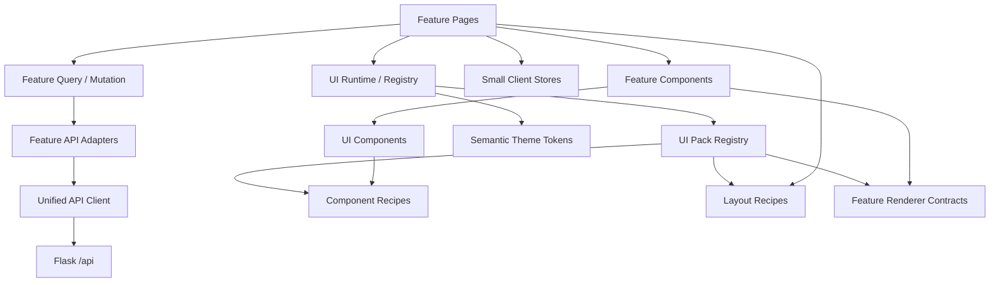

# 02｜目标前端架构

## 1. 技术栈

### 1.1 固定依赖

| 类别 | 选择 | 用途 |
|---|---|---|
| 框架 | Vue 3 | 组件与响应式 |
| 语言 | TypeScript strict | 编译期契约 |
| 构建 | Vite | 开发、构建、代码分割 |
| 路由 | Vue Router | 页面边界、URL 状态、权限守卫 |
| 服务端状态 | TanStack Vue Query | 缓存、轮询、失效、并发和请求取消 |
| 客户端状态 | Pinia | Session 摘要、布局和本地偏好 |
| UI 基座 | Naive UI | 表格、树、表单、弹窗等成熟控件 |
| 表单 | VeeValidate | 表单状态和字段错误 |
| Schema | Zod | 表单与关键 API 边界运行时校验 |
| 图标 | Lucide Vue Next + 现有 Provider 图标 | 通用图标和品牌图标 |
| 日期 | date-fns | 日期格式和区间计算 |
| 单测 | Vitest | 工具、Store、Composable、适配器 |
| 组件测试 | Vue Testing Library | 用户行为级组件验证 |
| API Mock | MSW | 组件与 Feature 集成测试 |
| E2E | Playwright | 管理端和访客端核心流程 |
| 可访问性 | axe-core/Playwright | 自动化基础检查 |

Node 使用当前稳定 LTS，提交 `package-lock.json`，生产和 CI 一律使用 `npm ci`。不得混用 npm、pnpm 和 yarn。

### 1.2 不引入的内容

- Nuxt；
- React；
- 第二套 UI 组件库；
- Axios 与多套请求封装并存；
- GraphQL；
- 微前端；
- 低代码表单生成器；
- 全局 Event Bus；
- 把全部状态放入 Pinia；
- 直接把旧脚本包进 Vue 生命周期继续运行。

## 2. 目标目录

```text
frontend/
  package.json
  package-lock.json
  vite.config.ts
  tsconfig.json
  tsconfig.app.json
  eslint.config.js
  index.html
  public/
    icons/                         # 迁移后的品牌/Provider 静态图标
  src/
    main.ts
    App.vue
    app/
      create-app.ts
      router/
        index.ts
        routes.ts
        guards.ts
      layout/
        AdminLayout.vue
        PublicLayout.vue
        AppSidebar.vue
        AppTopbar.vue
      providers/
        query-client.ts
        naive-theme.ts
      error/
        AppErrorBoundary.vue
        RouteErrorPage.vue
    api/
      client.ts
      api-error.ts
      auth.ts
      response.ts
      generated/
        schema.d.ts
    components/
      ui/
      business/
    composables/
      use-async-action.ts
      use-confirm.ts
      use-disclosure.ts
      use-document-title.ts
      use-polling-policy.ts
    features/
      auth/
      dashboard/
      requests/
      jobs/
      storage/
      organizer/
      rclone/
      media/
      updates/
      trending/
      notifications/
      settings/
      profile/
      public-search/
      public-submit/
      public-trending/
      request-status/
    stores/
      session-store.ts
      preference-store.ts
      layout-store.ts
    ui/
      contracts/
      runtime/
      themes/
      recipes/
      layouts/
      renderers/
      packs/
    styles/
      reset.css
      semantic.css
      typography.css
      utilities.css
      motion.css
    types/
      common.ts
      pagination.ts
      status.ts
    dev/
      ComponentGalleryPage.vue
  tests/
    fixtures/
    msw/
    helpers/
  e2e/
```

## 3. Feature 标准结构

每个业务 Feature 使用统一形态：

```text
features/storage/
  api/
    storage-api.ts
    storage-contracts.ts
    storage-adapters.ts
    query-keys.ts
  components/
    ProviderAccountCard.vue
    ProviderAuthDialog.vue
    NativeFolderTree.vue
    OpenListConnectionCard.vue
    StorageLocationEditor.vue
    StoragePreflightDialog.vue
  composables/
    use-provider-auth.ts
    use-folder-tree.ts
    use-storage-editor.ts
  pages/
    StorageWorkspacePage.vue
  schemas/
    account-schema.ts
    location-schema.ts
  types/
    storage.ts
  index.ts
```

规则：

- Feature 对外只通过 `index.ts` 暴露页面、路由或少量公共类型；
- Feature 内部组件不得被其他 Feature 通过深层路径导入；
- 真正跨 Feature 复用的组件移动到 `components/business/`；
- 只在某个 Feature 使用的控件，即使看起来通用，也先留在 Feature 内；
- API 原始响应类型和页面 ViewModel 分离；
- 页面组件不直接拼 endpoint，不直接读 CSRF，不直接解析后端错误。

## 4. 依赖方向



禁止反向依赖：

- `components/ui` 不得导入 Feature；
- `api/client.ts` 不得导入页面、Store 或业务类型；
- Store 不得直接调用具体 Feature API；
- 一个 Feature 不得读写另一个 Feature 的内部 Store；
- Router 只导入 Feature 暴露的 Route Component，不导入 Feature 内部实现。

## 5. 路由设计

### 5.1 管理端

目标路由：

```text
/admin/login
/admin/overview
/admin/requests
/admin/requests/:requestId
/admin/jobs
/admin/jobs/:jobId
/admin/storage
/admin/organizer
/admin/organizer/tasks/:taskId
/admin/rclone
/admin/media
/admin/updates
/admin/updates/:subscriptionId
/admin/trending
/admin/notifications
/admin/settings
/admin/profile
```

兼容规则：

- `/admin` 重定向 `/admin/overview`；
- 旧 `/admin/requests`、`/admin/jobs` 保持可访问；
- 详情页面使用真实 URL，不再依赖一个全局 Drawer 承载全部详情；
- 移动端可以将详情表现为全屏 Drawer，但 URL 必须仍可刷新和分享；
- 所有页面组件使用动态 import，实现路由级代码分割。

### 5.2 访客端

目标路由：

```text
/
/submit
/submit/search
/submit/link
/submit/trending
/submit/query
/request/:token
```

兼容规则：

- `/` 仍跳转 `/submit/search`；
- `/submit` 重定向 `/submit/search`；
- 兼容旧 Hash：`/submit#search`、`#link`、`#trending`、`#query`，首次加载后替换为新 URL；
- 请求编号查询结果可以跳转 `/request/:token`；
- 分类、搜索源、分页等可分享状态写入 Query String；
- Provider 文件选择等敏感/大状态不写入 URL。

## 6. 状态所有权

### 6.1 TanStack Query 管理

- Dashboard 数据；
- Requests、Jobs、Organizer、rclone、Updates、Trending 列表和详情；
- Provider、OpenList、Storage Setup 配置；
- 公共配置、搜索结果、资源详情和文件树节点；
- 通知投递；
- 健康状态；
- 所有来自后端且可重新获取的数据。

### 6.2 Pinia 管理

只允许以下状态：

- 当前管理员登录摘要；
- CSRF Token 的内存副本；
- Sidebar 折叠状态；
- Theme、UI Pack 和密度偏好；
- 用户选择的默认分页大小；
- 非敏感的最近提交编号索引。

Pinia 中不得存储：

- Jobs 列表；
- Provider Accounts；
- Storage Setup 完整响应；
- Organizer 任务；
- 搜索结果；
- API 加载状态；
- 可以由 Query Cache 管理的数据。

### 6.3 组件本地状态

- 表单未保存值；
- Dialog 是否打开；
- 目录树展开节点；
- 当前选中行；
- 临时文件选择；
- Hover、Focus、局部 Loading；
- 未提交的资源选集。

### 6.4 Router 管理

- 当前页面；
- Tab；
- 页码和每页数量；
- 筛选状态；
- 排序字段；
- 日志日期范围；
- 搜索关键词（不包含密码和分享访问载荷）。

## 7. API Client 架构

页面只能通过如下链路访问接口：

```text
Page/Composable
  -> featureApi.listJobs()
  -> apiClient.request()
  -> fetch()
```

统一 Client 必须处理：

- `credentials: "same-origin"`；
- JSON 与 FormData；
- `X-CSRF-Token`；
- `AbortSignal`；
- 204 空响应；
- JSON 解析失败；
- 后端 `code`/`error_code` 差异；
- `trace_id`；
- `field_errors`；
- 401 Session 失效；
- 429 `retry_after`；
- 5xx 通用错误；
- 请求超时由上层决定，不在 Client 中偷偷无限重试。

参考接口：

```ts
export interface ApiRequestOptions<TBody = unknown> {
  method?: 'GET' | 'POST' | 'PUT' | 'PATCH' | 'DELETE'
  body?: TBody
  signal?: AbortSignal
  csrf?: boolean
  headers?: HeadersInit
}

export interface ApiErrorShape {
  status: number
  code: string
  message: string
  traceId?: string
  retryable?: boolean
  retryAfter?: number
  fieldErrors?: Record<string, string>
  details?: unknown
}
```

不得在页面中写：

```ts
fetch('/api/admin/...')
```

不得在组件中自行判断：

```ts
payload.code || payload.error_code || payload.message
```

这些兼容逻辑必须集中在 API Client 或 Feature Adapter。

## 8. Query 规则

### 8.1 Query Key

```ts
export const jobKeys = {
  all: ['jobs'] as const,
  lists: () => [...jobKeys.all, 'list'] as const,
  list: (filters: JobFilters) => [...jobKeys.lists(), filters] as const,
  details: () => [...jobKeys.all, 'detail'] as const,
  detail: (id: number) => [...jobKeys.details(), id] as const,
}
```

所有 Feature 必须提供集中 Query Key Factory，禁止在页面中随意写字符串数组。

### 8.2 Mutation

- 写操作默认不自动重试；
- 成功后只失效相关 Query；
- 乐观更新仅用于可安全回滚的简单 UI，不用于任务创建、Provider 登录、预检、重试或取消；
- Mutation 按钮必须防重复提交；
- 失败时展示后端业务消息和 Trace ID；
- 需要二次确认的危险操作统一使用 `useConfirm()`。

### 8.3 轮询

- 轮询函数根据数据状态动态返回间隔；
- 终态返回 `false`；
- 页面失焦时一般暂停，关键认证流程可降低频率继续；
- 同一个 Query 不允许额外创建手工 `setInterval`；
- Provider Auth Session、运行中的 Job、Organizer 和 rclone 使用各自明确策略；
- 轮询失败使用有上限退避，不得无限快速请求。

## 9. TypeScript 与运行时类型

### 9.1 编译设置

必须开启：

```json
{
  "strict": true,
  "noUncheckedIndexedAccess": true,
  "exactOptionalPropertyTypes": true,
  "noImplicitOverride": true,
  "useUnknownInCatchVariables": true
}
```

### 9.2 类型层次

每个 Feature 至少区分：

1. `Api*`：后端原始响应；
2. `Domain/ViewModel`：组件使用的稳定模型；
3. `FormValues`：编辑表单；
4. `Payload`：写接口请求；
5. `Schema`：Zod 运行时校验。

示例：

```ts
interface ApiProviderAccount { /* 后端字段 */ }
interface ProviderAccountView { /* 页面稳定字段 */ }
interface ProviderAccountFormValues { /* 表单字段 */ }
interface CreateProviderAccountPayload { /* 提交字段 */ }
```

不要让页面直接依赖后端所有可选字段，也不要为省事把接口响应声明成 `Record<string, any>`。

### 9.3 `any` 规则

- 业务代码禁止 `any`；
- 第三方库边界确实无法描述时可以在单一 Adapter 文件使用，并写明原因；
- 对未知后端错误使用 `unknown`；
- OpenAPI 生成的弱类型不能绕过 Feature Adapter。

## 10. 表单架构

复杂表单使用：

```text
Zod Schema
  -> VeeValidate Form
  -> UI Field Wrapper
  -> Feature Payload Adapter
  -> Mutation
```

规则：

- 后端 `field_errors` 映射到字段；
- 页面离开前对脏表单提醒；
- Secret 输入不回显真实值，只显示 configured 状态；
- Provider 动态字段由 Manifest 驱动时，只驱动字段定义，不生成任意业务流程；
- 不建设通用 JSON Schema 表单引擎；
- 创建和编辑复用字段组件，但允许不同提交逻辑；
- 保存按钮只在表单有效且已变更时启用。

## 11. 错误边界

错误分四层：

1. **字段错误**：表单字段下方；
2. **局部错误**：卡片/树节点/列表区域；
3. **页面错误**：Route 页面错误态，可重试；
4. **应用错误**：无法启动、Chunk 加载失败、全局 Session 失效。

不允许所有错误都只显示 Toast。Toast 适合操作反馈；持久错误必须在对应区域可见。

## 12. 前端安全规则

- 不在 LocalStorage 存储密码、Cookie、Token、Provider 凭证、分享密码或完整访问载荷；
- CSRF Token 只保存在内存 Store，可通过 Session 接口重新获取；
- 最近提交仅保存公开 Request Token 和标题摘要；
- 默认使用 Vue 文本插值，禁止未经清洗使用 `v-html`；
- 外部链接使用 `rel="noopener noreferrer"`；
- 上传文件前限制类型和大小，并仍以后端校验为准；
- 错误日志不得输出请求 Body 中的 Secret 字段；
- Query Devtools 只在开发环境加载；
- 生产 Source Map 是否发布由部署策略决定，不得公开包含 Secret 的构建变量。

## 13. 代码大小与复杂度建议

这些是重构警戒线，不是机械拆分指标：

- Page 建议不超过 400 行；
- 普通组件建议不超过 250 行；
- Composable 建议不超过 200 行；
- API Adapter 建议不超过 300 行；
- 单个函数建议不超过 60 行；
- 单文件出现三个以上独立业务状态机时必须拆分；
- Props 超过 12 个通常意味着职责需要调整；
- 一个组件同时管理列表、编辑、认证和预检时必须拆分。

禁止通过把逻辑移动到无语义的 `utils.ts` 来满足行数要求。

## 14. 开发环境路由与代理

Vite 开发服务器代理：

```ts
server: {
  proxy: {
    '/api': 'http://127.0.0.1:5251',
    '/health': 'http://127.0.0.1:5251',
    '/readyz': 'http://127.0.0.1:5251',
    '/static/uploads': 'http://127.0.0.1:5251',
  },
}
```

开发环境仍使用真实 Flask Session。浏览器从 Vite 地址访问时必须验证 Cookie/代理行为；不允许为了开发方便关闭 CSRF 或在后端增加宽泛 CORS。

## 15. 架构验收

创建任何 Feature 后，必须能回答：

- 它的页面入口在哪里？
- 它的 API 只集中在哪个目录？
- 后端响应如何转换成 ViewModel？
- 哪些状态属于 Query、Pinia、Router 和组件本地？
- 哪些组件是真正公共组件？
- 当前定制应落在 Theme Token、Component Recipe、Layout Recipe 还是 Feature Renderer？
- Feature 是否错误读取了具体 Theme/UI Pack ID？
- 错误显示在哪一层？
- 如何测试无数据、错误、权限失效和移动端？
- 删除该 Feature 时需要改动哪些公开入口？

如果答案仍然是“去 `App.vue`、全局 Store 和公共 utils 里找”，说明新架构正在重复旧问题。
