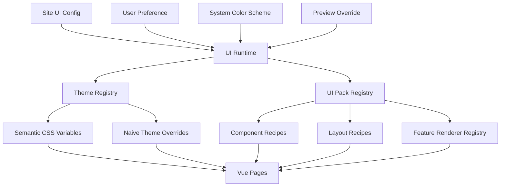

# 11｜多主题引擎、组件皮肤与 UI Pack 定制规范

> 文档状态：定稿，作为主题切换、组件定制和后续换肤扩展的架构真源  
> 适用范围：管理端、访客端、基础组件、业务组件、页面骨架和品牌资源  
> 核心目标：前端不绑定某一种颜色、品牌风格或组件外形，后期可以在不重写业务代码的情况下替换主题、组件皮肤和页面呈现  
> 关联文档：`03-design-system-and-components.md`、`10-custom-ui-visual-spec.md`

## 1. 为什么需要独立的 UI 定制架构

“支持主题切换”不能只理解为增加亮色和暗色两个 CSS 文件。

本项目后期的定制范围包括：

- 颜色模式；
- 品牌色和状态色；
- 字体、字号和字重；
- 圆角、边框、阴影和透明度；
- 页面密度；
- Button、Input、Select、Card、Dialog、Table 等基础组件外形；
- Sidebar、Topbar、Page Header 等应用壳组件；
- Provider Account Card、Job Timeline、Resource Card 等业务组件；
- 管理端和访客端不同的页面布局；
- Logo、站点名称、图标和背景资源；
- 后续新增的完整 UI Pack。

如果只把颜色抽成变量，后期更换组件形态仍然需要修改所有页面；如果允许页面随意覆盖 CSS，又会重新变成难以维护的全局样式堆。

因此必须把 UI 定制能力设计成有边界的四层体系：

```text
Theme Tokens
  -> Component Recipes
  -> Layout Recipes
  -> Feature Renderers / UI Pack
```

## 2. 已锁定的架构决策

1. 不锁定“深海蓝”“极光蓝”或任何单一品牌方向。
2. 必须同时具备亮色、暗色、跟随系统和高对比参考主题。
3. 管理端和访客端可以选择不同主题与不同 UI Pack。
4. 基础组件保持稳定 Props、Events、Slots 和可访问性合同，外形由 Component Recipe 决定。
5. 复杂业务组件可以通过 Feature Renderer Registry 替换呈现，但不能改变业务语义和 API 契约。
6. Theme 负责视觉值，UI Pack 负责组件和布局呈现，两者不能混为一个巨大配置对象。
7. 用户运行时切换 Theme 不应重新加载页面，也不能丢失表单和 Query 状态。
8. 高级 UI Pack 以受版本控制的前端代码形式交付；运行时不执行用户上传的 JavaScript 或 Vue 代码。
9. 第一版不开放任意 CSS 注入。自定义主题通过经过 Schema 校验的 Token JSON 完成。
10. Naive UI 仍然只负责底层交互和可访问性，Theme Overrides 必须由当前 Theme 和 Component Recipe 动态生成。
11. 主题、组件皮肤和页面布局都必须进入 Component Gallery 与视觉回归。
12. 业务 Feature 不得读取具体主题 ID 并编写特殊业务分支。

## 3. 概念与职责边界

### 3.1 Theme

Theme 是一组可运行时切换的语义视觉值，负责：

- Color Scheme；
- 背景与表面；
- 文本和边框；
- Primary、Success、Warning、Danger、Info；
- 字体族与排版比例；
- 基础间距比例；
- 圆角比例；
- 阴影与模糊强度；
- 动效时长；
- Focus Ring；
- 图表序列色。

Theme 不负责：

- Sidebar 在左侧还是顶部；
- Provider Card 内部如何排版；
- Job Timeline 使用横向轨道还是垂直轨道；
- Button 是否具有业务确认逻辑；
- 页面数据和接口请求。

### 3.2 Component Recipe

Component Recipe 是稳定组件合同下的一套外形规则，负责：

- Button 是实体、描边还是柔和表面；
- Input 的边框、填充和 Focus 表现；
- Card 的边界、分隔和层级；
- Table 的密度、表头和 Hover；
- Dialog 的 Header、Footer 和尺寸策略；
- StatusBadge 的结构和状态标记方式；
- Navigation Item 的选中标识；
- Loading、Empty、Error 的视觉构成。

Component Recipe 不允许修改：

- Props 含义；
- Events；
- 表单值和校验；
- Focus Trap；
- 键盘行为；
- 请求、Mutation 和权限逻辑。

### 3.3 Layout Recipe

Layout Recipe 负责页面骨架，例如：

- `sidebar`：固定左侧导航；
- `compact-sidebar`：窄 Sidebar；
- `top-navigation`：顶部一级导航；
- `public-centered`：访客端居中内容；
- `public-content-first`：访客端内容优先布局；
- `split-workspace`：列表 + 检查器；
- `single-column`：单列设置或详情。

Layout Recipe 只能在预定义槽位中组合页面结构，不能改变路由、权限和 Feature 数据流。

### 3.4 Feature Renderer

Feature Renderer 用于复杂业务展示，例如：

- `ProviderAccountCardRenderer`；
- `StorageStepRailRenderer`；
- `JobStageTrackRenderer`；
- `JobEventTimelineRenderer`；
- `OrganizerMappingRenderer`；
- `LogViewerRenderer`；
- `ResourceCardRenderer`；
- `ResourceFileTreeRenderer`；
- `RequestStatusTrackRenderer`。

这些 Renderer 可以被 UI Pack 替换，但必须实现同一 TypeScript Contract 和 Contract Test。

### 3.5 UI Pack

UI Pack 是可选择的一组：

```text
默认 Theme 建议
+ Component Recipes
+ Layout Recipes
+ Feature Renderers
+ 图标与品牌资源策略
```

UI Pack 可以改变整套界面的外形，但不能复制或重写业务 Feature。

## 4. 总体架构



解析优先级：

```text
当前预览覆盖
  > 当前用户偏好
  > 端类型配置（admin/public）
  > 站点默认配置
  > system preference
  > 内置 fallback
```

## 5. 主题数据合同

### 5.1 `ThemeDefinition`

```ts
export type ThemeColorScheme = 'light' | 'dark'

export interface ThemeDefinition {
  id: string
  label: string
  version: number
  colorScheme: ThemeColorScheme
  description?: string
  builtIn: boolean
  tokens: ThemeTokenSet
  naive?: NaiveThemeTokenPatch
  charts?: ChartTokenSet
  metadata?: {
    author?: string
    homepage?: string
    license?: string
  }
}
```

规则：

- `id` 使用小写 ASCII、数字和连字符；
- Theme ID 是稳定持久化值，不使用中文 Label；
- `version` 用于 Theme JSON 迁移；
- `colorScheme` 决定浏览器 `color-scheme`、系统控件和 Meta；
- `builtIn=false` 的主题必须通过 Schema 校验；
- Theme 不得包含任意 CSS 字符串或 JavaScript。

### 5.2 `ThemeTokenSet`

```ts
export interface ThemeTokenSet {
  color: ThemeColorTokens
  typography: ThemeTypographyTokens
  space: ThemeSpacingTokens
  radius: ThemeRadiusTokens
  border: ThemeBorderTokens
  shadow: ThemeShadowTokens
  motion: ThemeMotionTokens
  focus: ThemeFocusTokens
}
```

### 5.3 颜色语义 Token

```ts
export interface ThemeColorTokens {
  canvas: string
  shell: string
  navigation: string
  workspace: string

  surface1: string
  surface2: string
  surface3: string
  surfaceRaised: string
  surfaceInteractive: string
  surfaceSelected: string
  overlay: string

  textPrimary: string
  textSecondary: string
  textMuted: string
  textDisabled: string
  textOnPrimary: string

  borderDefault: string
  borderStrong: string
  divider: string
  inputBorder: string

  primary: string
  primaryHover: string
  primaryActive: string
  primarySoft: string

  success: string
  successSoft: string
  successText: string
  warning: string
  warningSoft: string
  warningText: string
  danger: string
  dangerSoft: string
  dangerText: string
  info: string
  infoSoft: string
  infoText: string
}
```

页面和组件只允许使用语义 Token，不允许直接引用 `blue500`、`gray900` 等某套 Palette 名称。

### 5.4 CSS Variable 输出

Theme Runtime 将合同输出为稳定变量：

```css
:root {
  --ui-color-canvas: ...;
  --ui-color-shell: ...;
  --ui-color-navigation: ...;
  --ui-color-workspace: ...;
  --ui-color-surface-1: ...;
  --ui-color-surface-2: ...;
  --ui-color-text-primary: ...;
  --ui-color-text-secondary: ...;
  --ui-color-border-default: ...;
  --ui-color-primary: ...;
  --ui-color-success: ...;
  --ui-color-warning: ...;
  --ui-color-danger: ...;
}
```

禁止：

- 在组件中使用 Theme ID 判断颜色；
- 在 Feature CSS 中定义新的品牌色；
- 依赖某个主题一定是暗色；
- 使用固定白色作为主按钮文字而不经过 `textOnPrimary`；
- 通过 `filter: invert()` 粗暴适配亮暗主题。

## 6. 内置参考主题

内置主题只是系统能力验证和安全 fallback，不代表最终品牌方向。

第一阶段至少提供：

| Theme ID | 作用 |
|---|---|
| `system` | 跟随操作系统，在 Light/Dark 参考主题间切换 |
| `default-light` | 中性亮色参考主题 |
| `default-dark` | 中性暗色参考主题 |
| `high-contrast-light` | 高对比亮色可访问性主题 |
| `high-contrast-dark` | 高对比暗色可访问性主题 |

可选演示主题可以存在，但不得写入业务逻辑或成为页面布局前提。

## 7. Component Recipe 合同

### 7.1 总体结构

```ts
export interface ComponentRecipeSet {
  button: ButtonRecipe
  input: InputRecipe
  select: SelectRecipe
  checkbox: CheckboxRecipe
  switch: SwitchRecipe
  card: CardRecipe
  table: TableRecipe
  dialog: DialogRecipe
  drawer: DrawerRecipe
  menu: MenuRecipe
  tabs: TabsRecipe
  badge: BadgeRecipe
  toast: ToastRecipe
  pageState: PageStateRecipe
  tree: TreeRecipe
  logViewer: LogViewerRecipe
}
```

Recipe 的值最终输出为 Component Token，而不是让页面拼接 Class 字符串。

### 7.2 Component Token 命名

```css
--ui-button-height-sm
--ui-button-height-md
--ui-button-radius
--ui-button-primary-bg
--ui-button-primary-text
--ui-button-secondary-bg
--ui-input-height
--ui-input-radius
--ui-input-bg
--ui-card-radius
--ui-card-border
--ui-card-shadow
--ui-table-row-height
--ui-table-header-bg
--ui-dialog-radius
--ui-dialog-shadow
--ui-nav-item-radius
--ui-nav-active-indicator-width
```

Component Token 可以引用 Theme Token：

```css
--ui-button-primary-bg: var(--ui-color-primary);
--ui-input-bg: var(--ui-color-surface-1);
--ui-card-border: var(--ui-color-border-default);
```

### 7.3 基础组件定制边界

#### `AppButton`

允许定制：

- 高度；
- 水平 Padding；
- 圆角；
- 边框；
- 填充；
- 阴影；
- 图标位置；
- Primary/Secondary/Ghost/Danger 的视觉层级。

禁止定制：

- Loading 时允许重复提交；
- 删除 `aria-label` 要求；
- 改变 Danger 的业务语义；
- 将 Disabled 伪装成可点击；
- 隐藏键盘 Focus。

#### `AppInput` / `AppSelect`

允许定制：

- Filled/Outlined/Underlined Recipe；
- 高度、圆角和前后缀区域；
- Focus、Error 和 Configured 状态外形；
- Dropdown 表面与选中标记。

禁止定制：

- 移除 Label；
- 只用 Placeholder 代替字段名称；
- 错误仅通过颜色表达；
- 改变值类型和表单绑定。

#### `AppCard`

允许定制：

- Bordered/Flat/Raised/Soft Recipe；
- 圆角；
- 分隔；
- Header 和 Footer 表面；
- Interactive Hover。

禁止定制：

- 让 Card 承担业务请求；
- 在所有区域强制套 Card；
- 通过 Recipe 创建卡片套卡片的默认布局。

#### `AppDataTable`

允许定制：

- Comfortable/Compact Density；
- 表头、分隔和 Hover；
- 选中指示；
- 操作列和移动卡片 Renderer。

禁止定制：

- 改变服务端分页语义；
- 隐藏不可用操作的原因；
- 破坏键盘与屏幕阅读器表格语义。

#### `AppDialog` / `AppDrawer`

允许定制：

- Header/Body/Footer 构成；
- 宽度档位；
- 圆角、边界和 Overlay；
- 手机全屏或 Bottom Sheet Recipe。

禁止定制：

- 移除 Focus Trap；
- 关闭 ESC 后不提供替代关闭路径；
- 关闭后不恢复焦点；
- 将路由详情永久塞进无法刷新恢复的 Modal。

### 7.4 Component Recipe 选择

UI Pack 可以声明：

```ts
export interface ComponentRecipeSelection {
  button: 'solid' | 'soft' | 'minimal'
  input: 'outlined' | 'filled' | 'underlined'
  card: 'bordered' | 'flat' | 'raised'
  table: 'comfortable' | 'compact'
  navigation: 'indicator' | 'filled' | 'minimal'
  dialog: 'centered' | 'sheet'
}
```

这些值是 Registry Key，不是页面中的字符串分支。

## 8. 可替换组件 Renderer

### 8.1 为什么需要 Renderer Registry

只靠 CSS 无法完成以下定制：

- Job Stage 从横向改为垂直；
- Resource Card 从横向列表改为海报优先；
- Provider Account 从对象卡改为紧凑列表；
- Public Search 从 Hero 布局改为内容优先布局；
- Organizer 在特定 UI Pack 中使用逐项审核工作台。

因此复杂组件使用 Renderer Registry。

### 8.2 Registry 合同

```ts
export interface UiRendererRegistry {
  ProviderAccountCard: Component<ProviderAccountCardContract>
  StorageStepRail: Component<StorageStepRailContract>
  JobStageTrack: Component<JobStageTrackContract>
  JobEventTimeline: Component<JobEventTimelineContract>
  OrganizerMappingWorkspace: Component<OrganizerMappingContract>
  ResourceCard: Component<ResourceCardContract>
  ResourceFileTree: Component<ResourceFileTreeContract>
  RequestStatusTrack: Component<RequestStatusTrackContract>
}
```

页面通过 `useUiRenderer('JobStageTrack')` 获取实现，不直接 import 某个 Pack 的 Vue 文件。

### 8.3 Contract 必须包含

- Typed Props；
- Typed Emits；
- Slot 说明；
- Loading/Empty/Error/Disabled；
- 键盘行为；
- ARIA 语义；
- 移动端要求；
- 性能上限；
- Contract Test Fixture。

### 8.4 Renderer 不得改变的内容

- API 请求；
- Query Key；
- Mutation；
- Provider 业务判断；
- Job 状态机；
- 权限；
- CSRF；
- Secret 处理；
- Router 路径。

Renderer 只接收已经适配好的 View Model 和事件回调。

## 9. Layout Recipe

### 9.1 管理端 Shell 合同

```ts
export interface AdminShellSlots {
  brand: Slot
  primaryNavigation: Slot
  secondaryNavigation?: Slot
  globalStatus?: Slot
  userMenu: Slot
  pageHeader: Slot
  content: Slot
}
```

内置 Layout Recipe：

- `sidebar-standard`；
- `sidebar-compact`；
- `top-navigation`；
- `hybrid-navigation`。

每个 Recipe 都必须支持：

- Router 当前态；
- 移动 Drawer；
- 键盘导航；
- 未读数量；
- 用户菜单；
- Public 入口；
- 320px。

### 9.2 访客端 Shell 合同

内置 Layout Recipe：

- `public-centered`；
- `public-content-first`；
- `public-minimal`。

访客端 UI Pack 可以与管理端完全不同，但必须共享安全配置、状态语义和资源合同。

### 9.3 工作区布局

可复用布局：

- `single-column`；
- `master-detail`；
- `split-inspector`；
- `step-workspace`；
- `table-detail`；
- `content-sidebar`。

Feature 选择布局的原因来自任务结构，而不是 Theme ID。

## 10. `UiPackDefinition`

```ts
export interface UiPackDefinition {
  id: string
  label: string
  version: number
  description?: string
  supportedAppAreas: Array<'admin' | 'public'>
  defaultThemeId: string
  supportedThemeIds?: string[]
  recipes: ComponentRecipeSelection
  layouts: {
    adminShell?: AdminShellRecipeId
    publicShell?: PublicShellRecipeId
    storage?: WorkspaceRecipeId
    organizer?: WorkspaceRecipeId
    settings?: WorkspaceRecipeId
  }
  renderers: Partial<UiRendererRegistry>
  assets?: UiPackAssets
}
```

规则：

- `id` 和 `version` 稳定；
- UI Pack 不包含 API Client 或 Store；
- UI Pack 不直接注册 Router；
- UI Pack 不修改后端数据；
- UI Pack 可以依赖 `@/ui/contracts`，不能依赖 Feature 内部私有文件；
- UI Pack 必须通过所有 Contract Test。

## 11. 推荐目录

```text
frontend/src/ui/
  contracts/
    theme.ts
    component-recipes.ts
    layout-recipes.ts
    renderer-registry.ts
    ui-pack.ts

  runtime/
    theme-registry.ts
    ui-pack-registry.ts
    resolve-ui-config.ts
    apply-theme.ts
    apply-color-scheme.ts
    bootstrap-theme.ts
    ui-runtime-provider.vue

  themes/
    default-light.ts
    default-dark.ts
    high-contrast-light.ts
    high-contrast-dark.ts

  recipes/
    buttons/
    inputs/
    cards/
    tables/
    navigation/
    overlays/

  layouts/
    admin-shell/
    public-shell/
    workspaces/

  renderers/
    default/

  packs/
    standard/
      index.ts
      component-recipes.ts
      layouts.ts
      renderers.ts

  gallery/
    ThemeGalleryPage.vue
    ComponentRecipeGalleryPage.vue
    UiPackPreviewPage.vue
```

Feature 目录只引用合同和 Runtime：

```text
features/jobs/
  pages/JobDetailPage.vue
  view-models/job-detail.ts
```

`JobDetailPage` 不得 import `packs/standard/JobStageTrack.vue`。

## 12. 主题应用与首屏 Bootstrap

### 12.1 防止主题闪烁

在 Vue Mount 前执行极小的 Bootstrap：

```ts
const preference = readSafeUiPreference()
const resolved = resolveInitialTheme(preference, matchMedia)

document.documentElement.dataset.themeId = resolved.themeId
document.documentElement.dataset.colorScheme = resolved.colorScheme
document.documentElement.dataset.uiPack = resolved.uiPackId
document.documentElement.dataset.density = resolved.density
document.documentElement.style.colorScheme = resolved.colorScheme
```

Bootstrap 只能读取安全的本地偏好，不请求 API，不解析完整 Theme JSON。

Vue 初始化后再加载站点配置并无闪烁地校正。

### 12.2 切换流程

```text
用户选择 Theme/UI Pack
  -> 校验 Registry 与兼容性
  -> 设置 Preview State
  -> 更新 CSS Variables
  -> 更新 Naive Theme Overrides
  -> 更新 document color-scheme
  -> 触发图表重绘
  -> 保持 Router/Query/Form 状态
  -> 用户确认后持久化
```

切换不得：

- Reload 页面；
- 清理 Query Cache；
- 重置表单；
- 关闭当前 Drawer/Dialog；
- 改变业务数据；
- 中断运行中的 Mutation。

## 13. 配置模型

### 13.1 用户偏好

```ts
export interface UiPreference {
  themeId: string | 'system'
  uiPackId: string
  density: 'comfortable' | 'compact'
  fontScale: 'sm' | 'md' | 'lg'
  reducedTransparency: boolean
  reducedMotion: boolean | 'system'
}
```

用户偏好适用于管理端个人体验，可以先存 `localStorage`，后期再同步到 Profile。

### 13.2 站点 UI 配置

```ts
export interface SiteUiConfig {
  version: number
  admin: {
    defaultThemeId: string
    defaultUiPackId: string
    allowUserOverride: boolean
  }
  public: {
    themeId: string
    uiPackId: string
  }
  brand: {
    siteName: string
    logoUrl?: string
    faviconUrl?: string
    compactLogoUrl?: string
  }
  customTheme?: CustomThemeDefinition
}
```

管理端和访客端必须独立配置，不能假设二者使用同一主题。

### 13.3 配置优先级

管理端：

```text
Preview
  > User Preference（站点允许时）
  > Site Admin Default
  > system/default
```

访客端：

```text
Preview（管理员预览）
  > Site Public Config
  > default
```

默认不允许访客端自行把站点品牌主题永久改掉；如产品后期需要，可新增本地 Color Scheme 偏好。

## 14. 后端边界

后端不需要理解 CSS 或组件实现，只存储经过校验的配置。

建议接口：

```text
GET  /api/admin/ui/config
PUT  /api/admin/ui/config
POST /api/admin/ui/theme/validate
POST /api/admin/ui/theme/preview
GET  /api/public/ui-config
```

也可以复用现有 Settings 存储，但必须提供独立 Schema 和权限边界。

后端负责：

- 配置版本；
- Theme Token JSON Schema 校验；
- Theme/UI Pack ID 白名单；
- Logo 与资源 URL 校验；
- 审计修改；
- 回滚上一版配置；
- Public 安全字段投影。

后端不负责：

- 生成 CSS；
- 加载 Vue 组件；
- 决定 Component Recipe；
- 接受任意 HTML/JS/CSS。

## 15. 主题与 UI 定制设置页

### 15.1 页面结构

```text
外观设置
  ├─ 管理端外观
  │    Theme / UI Pack / Density / Font Scale
  ├─ 访客端外观
  │    Theme / UI Pack / Brand Preview
  ├─ 品牌资源
  │    Site Name / Logo / Compact Logo / Favicon
  ├─ 自定义主题
  │    Semantic Tokens / Component Recipes
  └─ 导入、导出与版本
```

### 15.2 实时预览

预览区至少支持：

- Button、Input、Select；
- Card、Table；
- Dialog、Toast；
- Sidebar、Topbar；
- Provider Account Card；
- Job Stage Track；
- Resource Card；
- Loading、Empty、Error；
- Desktop/Mobile 宽度切换；
- Light/Dark 对比检查。

预览不得直接影响正式站点配置，必须点击“发布外观”才持久化。

### 15.3 自定义主题编辑器

第一版允许编辑：

- Primary；
- Canvas、Shell、Surface；
- Text、Border；
- Success/Warning/Danger/Info；
- 字体族白名单；
- Font Scale；
- Radius Scale；
- Shadow Level；
- Density；
- Transparency Level；
- Component Recipe 选择。

第一版不允许：

- 任意 CSS；
- 任意 JS；
- HTML 模板；
- 远程字体 CSS；
- 外链 SVG Script；
- 修改业务组件 Props；
- 删除可访问性状态。

### 15.4 导入与导出

导出格式：

```json
{
  "schemaVersion": 1,
  "kind": "fnos-ui-theme",
  "theme": {},
  "recipeSelection": {},
  "brand": {}
}
```

导入流程：

```text
选择 JSON
  -> 本地解析
  -> Schema 校验
  -> 安全字段过滤
  -> 对比当前配置
  -> 预览
  -> 管理员确认
  -> 保存新版本
```

## 16. Naive UI 集成

### 16.1 动态 Theme Overrides

禁止维护单一固定 `naive-overrides.ts`。

应使用：

```ts
export function createNaiveThemeOverrides(
  theme: ThemeDefinition,
  recipes: ComponentRecipeSet,
): GlobalThemeOverrides {
  return {
    common: mapCommonTokens(theme, recipes),
    Button: mapButtonTokens(theme, recipes.button),
    Input: mapInputTokens(theme, recipes.input),
    Select: mapSelectTokens(theme, recipes.select),
    DataTable: mapTableTokens(theme, recipes.table),
    Dialog: mapDialogTokens(theme, recipes.dialog),
  }
}
```

### 16.2 切换要求

- `NConfigProvider` 响应 Theme Runtime；
- Overlay、Popover、Dropdown 使用当前主题；
- Teleport 到 Body 的内容仍能读取 CSS Variable；
- Theme 切换时已打开 Dialog 不闪烁或丢失焦点；
- DatePicker、Select Menu、Tooltip 同步更新；
- Naive Dark Theme 只作为底层参考，不直接成为品牌主题。

## 17. CSS 层与作用域

建议使用 CSS Cascade Layers：

```css
@layer reset, theme, recipes, components, layouts, features, utilities;
```

职责：

| Layer | 内容 |
|---|---|
| `reset` | 最小 Reset |
| `theme` | 当前 Theme Semantic Variables |
| `recipes` | Component Tokens |
| `components` | 基础组件结构 |
| `layouts` | App Shell 和 Workspace |
| `features` | Feature 特定结构 |
| `utilities` | 少量稳定工具 |

规则：

- UI Pack 不使用高权重全局 Selector 覆盖一切；
- 禁止 `!important` 作为主题切换策略；
- Theme 变量在 `:root` 或应用根输出；
- 管理端/访客端并存预览时允许在独立根节点作用域输出；
- Feature CSS 不覆盖 Theme Registry；
- Component Renderer 使用 CSS Module 或稳定 BEM Namespace。

## 18. 品牌资源

支持：

- 主 Logo；
- Compact Logo；
- Favicon；
- 登录页插图；
- Public Header Logo；
- Provider 品牌图标。

规则：

- Logo 容器尺寸由 Layout Recipe 决定；
- Logo 资源不应决定 Header 高度；
- 图片加载失败有文字或默认图标 fallback；
- SVG 必须经过安全处理；
- 不允许上传带脚本 SVG；
- Light/Dark 可分别配置 Logo；
- 图片 URL 不包含认证 Token；
- Public Config 只返回安全资源 URL。

## 19. 安全与维护边界

### 19.1 禁止任意运行时代码

不允许用户通过主题设置上传：

- JavaScript；
- Vue SFC；
- HTML；
- 任意 CSS；
- 浏览器扩展代码；
- 外部 Script URL。

### 19.2 高级 UI Pack 的交付方式

完整组件或布局定制通过代码仓库交付：

```text
新增 UI Pack 源码
  -> Contract Test
  -> Component Gallery
  -> Visual Regression
  -> Build
  -> 发布新前端版本
  -> 后台选择并启用
```

这样既支持深度定制，又不会把生产站点变成任意代码执行平台。

### 19.3 版本兼容

Theme 和 UI Pack 都有版本：

- Theme JSON：Schema Migration；
- UI Pack：与 UI Contract Version 对齐；
- 不兼容 Pack 在 Registry 中标记不可用；
- 发布前自动检查缺失 Renderer；
- 配置回滚到旧 Pack 时不需要数据库业务回滚。

## 20. 可访问性要求

每个 Theme/UI Pack 必须保证：

- 正文、辅助文本和控件满足对比度；
- Focus Ring 清晰；
- Success/Warning/Danger 不只依赖颜色；
- High Contrast Theme 可用；
- 200% 缩放可用；
- Reduced Motion 生效；
- Reduced Transparency 生效；
- Component Renderer 保留 ARIA；
- Color Scheme 正确传递给系统控件；
- Logo 和装饰资源具有正确替代文本策略。

如果 Theme 配置导致关键对比度不足，校验必须阻止发布，而不是只显示警告。

## 21. 性能要求

- Theme 切换不重新创建整个 Vue App；
- Theme CSS Variable 更新在一帧内完成；
- UI Pack 切换可使用懒加载，但显示明确 Loading；
- 内置 Theme 不拆成大量网络请求；
- Public 首屏只加载当前 Public UI Pack；
- 不因预览所有主题而同时挂载所有页面；
- 图表只在颜色 Token 改变后按需重绘；
- 大表格不因 Theme 切换重建数据模型；
- Bootstrap 体积保持最小，不引入 Vue Runtime。

## 22. 测试策略

### 22.1 单元测试

- Theme Schema；
- Token 完整性；
- Theme Resolve 优先级；
- System Theme 切换；
- UI Pack 兼容性；
- Component Recipe Resolve；
- Config Migration；
- Import/Export；
- Public 安全投影。

### 22.2 Contract Test

每个可替换 Renderer 运行同一测试套件：

- Props；
- Emits；
- Loading/Empty/Error；
- 键盘；
- ARIA；
- 移动端；
- 极端长文案；
- 未知 Provider/Status；
- Reduced Motion。

### 22.3 组件视觉回归

至少覆盖：

```text
default-light + standard-pack
default-dark + standard-pack
high-contrast-light + standard-pack
high-contrast-dark + standard-pack
每个新增 UI Pack + 它声明的主 Theme
```

Button、Input、Select、Card、Table、Dialog、Navigation、PageState、Provider Card、Job Timeline 和 Resource Card 必须进入矩阵。

### 22.4 页面视觉回归

核心页面不对所有 Theme × UI Pack 做笛卡尔积，避免测试爆炸。

规则：

- Reference Theme Light/Dark 覆盖全部核心页面；
- 每个自定义 UI Pack 覆盖其主要 Theme 和核心页面；
- 高对比主题覆盖关键路径；
- 管理端与访客端分别验证；
- 390px 和 320px 必测。

### 22.5 E2E

- 切换 Theme 不丢表单；
- 切换 Theme 不清 Query；
- 刷新恢复用户偏好；
- Site Public Theme 生效；
- 管理员预览不影响正式访客端；
- 发布后 Public Config 更新；
- 回滚恢复上一版本；
- 无效 Theme JSON 被拒绝；
- 未安装 UI Pack 自动 fallback。

## 23. 迁移顺序

### 阶段 A：建立合同

1. 创建 Theme/UI Pack TypeScript Contract；
2. 将固定颜色改为 Semantic Token；
3. 建立 Reference Light/Dark Theme；
4. 建立 Theme Registry；
5. 动态生成 Naive Theme Overrides。

### 阶段 B：组件 Recipe

1. Button/Input/Select；
2. Card/Table；
3. Dialog/Drawer/Toast；
4. Navigation/PageState；
5. Component Gallery。

### 阶段 C：Layout Recipe

1. Admin Shell；
2. Public Shell；
3. Split Workspace；
4. Settings Layout；
5. Responsive Contract。

### 阶段 D：Feature Renderer

1. Provider Account Card；
2. Job Stage/Timeline；
3. Resource Card/File Tree；
4. Organizer Workspace；
5. Request Status Track。

### 阶段 E：配置中心

1. Theme Switcher；
2. UI Pack Switcher；
3. Preview；
4. Site Config；
5. Import/Export；
6. Version/Rollback。

## 24. AI 开发规则

AI 新增或修改组件时必须回答：

1. 这是业务行为、组件结构、Component Recipe 还是 Theme Token？
2. 是否误用了固定颜色？
3. 是否在 Feature 中判断 Theme ID？
4. 是否需要稳定 Renderer Contract？
5. 是否支持 Light/Dark/High Contrast？
6. 是否支持 Comfortable/Compact？
7. 是否在 320px 可用？
8. 是否保留键盘和 ARIA？
9. 是否进入 Component Gallery？
10. 是否需要更新 UI Contract Version？

AI 不得：

- 为某个主题复制一份完整页面；
- 创建 `JobDetailDark.vue` 和 `JobDetailLight.vue`；
- 在业务代码中写 `if (themeId === ...)`；
- 用全局 CSS 覆盖修补 UI Pack；
- 让 Theme JSON包含任意 CSS；
- 让 Component Recipe 修改业务逻辑；
- 未做 Contract Test 就替换 Renderer；
- 只验证默认暗色主题；
- 把“后期定制”理解为未来重写全部组件。

## 25. 完成定义

多主题与 UI 定制架构只有同时满足以下条件才算完成：

1. 内置 Light/Dark/System/High Contrast Theme 可切换；
2. Theme 切换无页面 Reload；
3. 当前表单、筛选、Drawer 和 Query 状态不丢失；
4. 管理端与访客端可分别配置；
5. Naive Overlay 与项目组件同步换肤；
6. 基础组件使用 Component Token；
7. 至少两种 Component Recipe 组合可运行；
8. Admin/Public Layout Recipe 可替换；
9. 复杂业务组件具备 Renderer Contract；
10. 自定义 Theme JSON 可校验、预览、导入和导出；
11. 不执行任意 CSS/JS/HTML；
12. Component Gallery 可切换 Theme/UI Pack/Density；
13. Light/Dark/High Contrast 视觉回归通过；
14. 390px/320px 通过；
15. axe 无严重问题；
16. Theme/UI Pack 版本可回滚；
17. 新增 UI Pack 不需要复制业务 Feature；
18. 所有中文文案使用 UTF-8 无 BOM 常量。

达到以上标准后，后期无论调整颜色、组件外形、导航布局，还是新增完整 UI Pack，都能在稳定合同内完成，而不是再次推倒前端。
